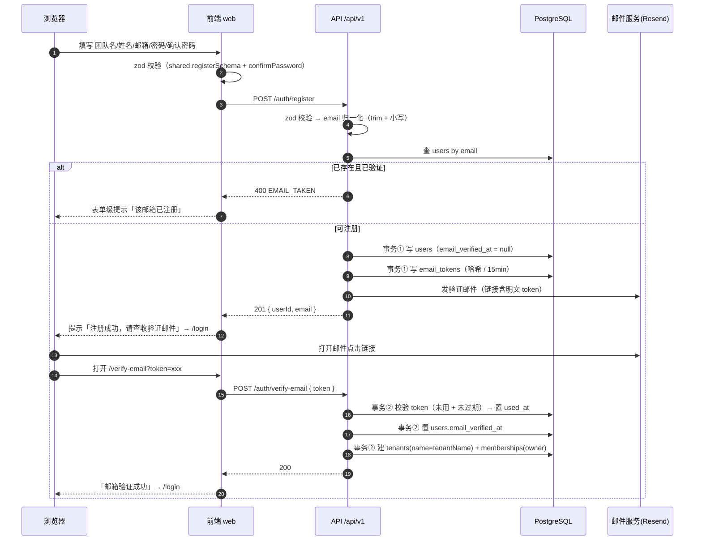
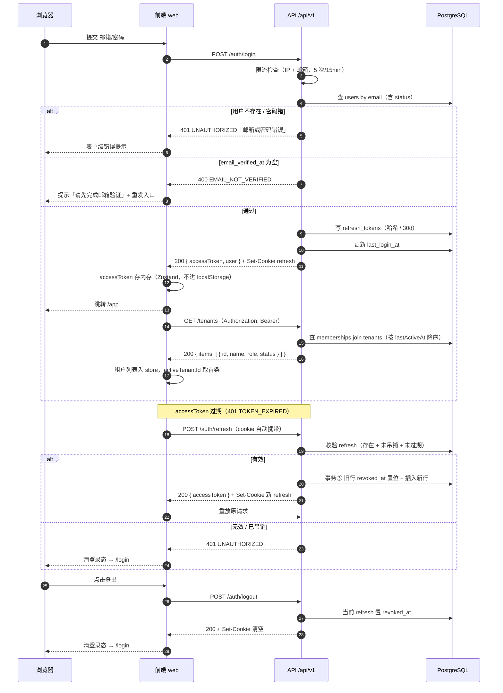
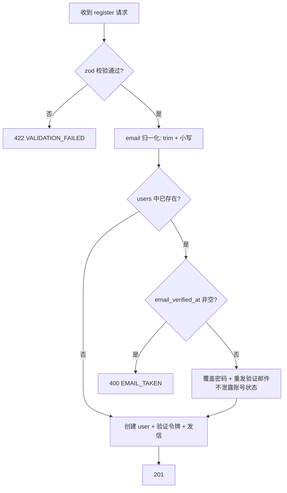

# 01 注册与登录

> 版本 v1.0 ｜ 更新 2026-11-03 ｜ 状态：已确认
> 确认：李顺 · 2026-11-03 ｜ 变更：租户信息改为独立接口 `GET /tenants`，登录与 `/auth/me` 均不返回租户信息
> 关联：《需求文档》§4 核心能力 / §6 安全基线、《技术方案设计》§5.3 认证设计 / §5.4 多租户隔离、《数据库设计与数据字典》§3.1、`知识点/M2-01-认证链路JWT双令牌`
>
> **一页速览**
> 接口：`POST /auth/register` · `POST /auth/verify-email` · `POST /auth/login` · `POST /auth/refresh` · `POST /auth/logout` · `GET /auth/me` · `GET /tenants`
> 前端落点：`pages/Register`、`pages/Login`、`pages/VerifyEmail`、`shared/api/{client,auth}.ts`、`store/tenant.ts`、`app/guards/RequireAuth.tsx`
> 后端落点：`src/modules/auth/{auth.module,auth.controller,auth.service,token.service,mail.service}.ts`、`src/modules/tenants/{tenants.module,tenants.controller,tenants.service}.ts`、`src/common/guards/jwt-auth.guard.ts`、`src/setup-app.ts`
> 关键异常：`EMAIL_TAKEN` / `EMAIL_NOT_VERIFIED` / `TOKEN_INVALID` / `RATE_LIMITED` / `UNAUTHORIZED`

---

## 1. 需求

### 1.1 用户故事

| 编号 | 角色 | 诉求 | 目的 |
|------|------|------|------|
| US-01 | 新用户 | 用团队名 + 姓名 + 邮箱 + 密码注册 | 开通属于自己团队的租户，成为 owner |
| US-02 | 注册用户 | 点击邮件里的验证链接完成激活 | 账号可用，能登录 |
| US-03 | 已激活用户 | 用邮箱 + 密码登录 | 进入控制台 |
| US-04 | 已登录用户 | access token 过期时自动续期 | 操作不被打断 |
| US-05 | 已登录用户 | 主动登出 | 在公共设备上终止会话 |

### 1.2 验收标准

每条都能直接翻译成一条测试用例，测试用例不得超出此表范围。

| 编号 | 标准 |
|------|------|
| AC-01 | 注册成功返回 `201`，`data` 含 `userId`、`email`；**不下发任何令牌**（未验证不可登录） |
| AC-02 | 邮箱已存在且 `email_verified_at` 非空 → `400 EMAIL_TAKEN` |
| AC-03 | 请求体不符合 `registerSchema` → `422 VALIDATION_FAILED`，`details` 含字段级错误 |
| AC-04 | `users.password_hash` 为 bcrypt（cost=12）产物，长度 60；库中无明文密码 |
| AC-05 | 注册后 `email_tokens` 新增一条：`type=verify_email`、`expires_at` = 创建时间 + 15min、`token_hash` 为 64 位 hex；明文令牌只出现在邮件链接里 |
| AC-06 | 验证成功返回 `200`，且**同一事务内**完成四件事：`email_tokens.used_at` 置位、`users.email_verified_at` 置位、`tenants` 新增 1 条（`name` = tenantName）、`memberships` 新增 1 条（`role=owner`、`status=active`） |
| AC-07 | 同一 token 二次验证 → `400 TOKEN_INVALID`（`used_at` 已非空） |
| AC-08 | token 过期 → `400 TOKEN_INVALID` |
| AC-09 | 未验证邮箱登录 → `400 EMAIL_NOT_VERIFIED`，不下发任何令牌，`users.last_login_at` 不变 |
| AC-10 | 密码错误或邮箱不存在 → 一律 `401 UNAUTHORIZED`，`message` 统一为「邮箱或密码错误」，不暴露账号是否存在 |
| AC-11 | 登录成功返回 `200`，`data` 为 `{ accessToken, user }`（**不含租户信息**）；`accessToken` 有效期 15min；响应 `Set-Cookie` 下发 refresh（`HttpOnly`、`SameSite=Strict`、`Path=/api/v1/auth`、30 天），且 `refresh_tokens` 落一条；`users.last_login_at` 更新 |
| AC-12 | refresh 成功返回 `200` 与新 accessToken；旧 refresh 行 `revoked_at` 置位；用旧 refresh 再请求 → `401 UNAUTHORIZED` |
| AC-13 | 登出返回 `200`，refresh 行 `revoked_at` 置位并清空 cookie；此后用该 refresh 刷新 → `401 UNAUTHORIZED` |
| AC-14 | 同一 IP 或同一邮箱 15 分钟内登录失败 5 次 → 第 6 次返回 `429 RATE_LIMITED` |
| AC-15 | 所有响应符合统一体：成功 `{success:true,data,message,timestamp}`，失败 `{success:false,error:{code,message,details}}` |
| AC-16 | `GET /tenants` 返回当前用户所属租户列表，按 `lastActiveAt` 降序（空值排最后），每项含 `id`、`name`、`role`、`status`、`lastActiveAt`；未登录 → `401 UNAUTHORIZED` |

### 1.3 范围外

- 找回密码 / 重置密码 → `02-找回密码`
- 邀请注册（受邀加入已有租户）→ `05-成员与邀请`
- 第三方 OAuth 登录（v2）
- 图形验证码 / 短信验证码
- 多设备会话列表与"踢下线"界面
- 租户创建与切换 UI（本期只做 `GET /tenants` 列表接口，切换与创建入口在 `04-租户创建与切换`）

---

## 2. 交互逻辑

### 2.1 注册 → 邮箱验证



### 2.2 登录 → 刷新 → 登出



### 2.3 注册路径判定



### 2.4 异常分支表

| # | 触发条件 | HTTP | 错误码 | 前端表现 |
|---|---------|------|--------|---------|
| 1 | 字段缺失 / 格式错 / 密码强度不足 | 422 | `VALIDATION_FAILED` | 字段下方红字，取 `details` 定位字段 |
| 2 | 邮箱已注册且已验证 | 400 | `EMAIL_TAKEN` | 邮箱字段下方提示，引导去登录 |
| 3 | 验证 token 不存在 | 400 | `TOKEN_INVALID` | 整页错误态：链接无效，提供「重新发送」 |
| 4 | 验证 token 已使用 | 400 | `TOKEN_INVALID` | 提示「链接已使用」，引导去登录 |
| 5 | 验证 token 已过期 | 400 | `TOKEN_INVALID` | 提示「链接已过期」，提供「重新发送」 |
| 6 | 登录时邮箱未验证 | 400 | `EMAIL_NOT_VERIFIED` | 表单级提示 + 重发验证邮件按钮 |
| 7 | 邮箱不存在 / 密码错 | 401 | `UNAUTHORIZED` | 统一文案「邮箱或密码错误」，不区分 |
| 8 | 登录失败超限 | 429 | `RATE_LIMITED` | 提示「尝试过于频繁，请 15 分钟后再试」 |
| 9 | access 过期 | 401 | `TOKEN_EXPIRED` | 静默走 refresh，用户无感 |
| 10 | refresh 失效 | 401 | `UNAUTHORIZED` | 清登录态 → `/login`，toast「登录已过期」 |
| 11 | 访问需登录接口但无 access | 401 | `UNAUTHORIZED` | 同 10 |

> 注意：现有 `http-exception.filter.ts` 里 `409 → SUBSCRIPTION_STATE_INVALID` 的兜底映射不适用于认证族。**所有认证异常必须显式抛出 `{ code, message }`**，否则前端拿到错误的业务码。

---

## 3. 前端改动

### 3.1 现状（已完成部分）

| 文件 | 现状 |
|------|------|
| `pages/Register/index.tsx` | 表单已实现（RHF + zodResolver + antd Controller），校验走 `registerFormSchema`；**提交不发请求**，仅 `message.success` 后跳 `/login` |
| `pages/Register/schema.ts` | `registerSchema.extend({ confirmPassword }).refine(...)`，二次确认属前端关注点，不进共享契约 |
| `pages/Login/index.tsx` | 表单已实现，校验复用 `loginSchema`；**提交不发请求**，写 `localStorage.token = mock-token-*` 后跳 `/app` |
| `app/guards/RequireAuth.tsx` | 仅判断 `localStorage.token` 是否存在；`TOKEN_KEY = 'token'` |
| `shared/api/client.ts` | axios 实例 + 401 拦截已就位，但响应契约与后端不一致（见 3.3） |
| `app/router.tsx` | 已有 `/login`、`/register`、`/app`；缺 `/verify-email` |

### 3.2 待改动

| # | 文件 | 改动 |
|---|------|------|
| F-01 | `shared/api/client.ts` | ① `ApiResponse` 改为后端真实结构 `{success,data,message,timestamp}`；② `toApiError` 从 `data.error.code` 取码（当前读的是 `data.code`，永远取不到）；③ 加 `withCredentials: true`；④ 401 处理改为「先尝试 refresh 一次，失败才清登录态」，并加并发去重（多个请求同时 401 只发一次 refresh） |
| F-02 | `shared/api/auth.ts`（新增） | 6 个接口的请求函数 + 出参类型，统一从此处调用，页面不直接写 URL |
| F-03 | `app/auth/token.ts`（新增） | accessToken 的读写封装，替换散落的 `localStorage.getItem(TOKEN_KEY)`；token 只存内存，刷新页面靠 refresh cookie 静默续期 |
| F-04 | `pages/Login/index.tsx` | `onSubmit` 改调 `login()`；成功后写入 accessToken（**不含租户信息**）、跳 `/app`；按 `EMAIL_NOT_VERIFIED` / `RATE_LIMITED` / `UNAUTHORIZED` 分支提示 |
| F-05 | `pages/Register/index.tsx` | `onSubmit` 剔除 `confirmPassword` 后调 `register()`；成功跳 `/login`；按 `EMAIL_TAKEN` 做字段级提示 |
| F-06 | `pages/VerifyEmail/index.tsx`（新增） | 读 `?token=`，进页自动提交；三态：验证中 / 成功（3s 后跳登录）/ 失败（按异常表 #3~#5 显示原因） |
| F-07 | `app/router.tsx` | 注册 `/verify-email` 路由（公共路由，不需登录） |
| F-08 | `constants/errorCode.ts`（新增） | 错误码 → 用户文案映射表，未知码回落「操作失败，请稍后重试」 |
| F-09 | `app/guards/RequireAuth.tsx` | 改为读 `auth/token.ts`；保持"无 token 跳登录"，不做接口探测（首屏不发额外请求） |
| F-10 | `store/tenant.ts`（新增）+ `app/AuthLayout.tsx` | 进 `/app` 后调 `GET /tenants`，结果写 Zustand（`tenants`、`activeTenantId` = 首条）；后续请求带 `X-Tenant-Id`（守卫落地见 `04-租户创建与切换`） |

### 3.3 错误码 → 文案映射

| 错误码 | 文案 | 展示位置 |
|--------|------|---------|
| `VALIDATION_FAILED` | 按 `details` 字段级展示 | 字段下方 |
| `EMAIL_TAKEN` | 该邮箱已注册，请直接登录 | 邮箱字段下方 |
| `EMAIL_NOT_VERIFIED` | 邮箱尚未验证，请查收验证邮件 | 表单级 Alert |
| `TOKEN_INVALID` | 链接无效或已过期，请重新获取 | 页面错误态 |
| `UNAUTHORIZED` | 邮箱或密码错误 | 表单级 Alert |
| `RATE_LIMITED` | 尝试过于频繁，请 15 分钟后再试 | 表单级 Alert |
| `INTERNAL_ERROR` | 服务异常，请稍后重试 | 表单级 Alert |

---

## 4. 后端接口

### 4.1 接口清单

统一前缀 `/api/v1`。除 `GET /auth/me` 外全部 `@Public()`。

| # | 方法 | 路径 | 鉴权 | 入参 | 出参 `data` | 成功 | 失败 |
|---|------|------|------|------|------------|------|------|
| 1 | POST | `/auth/register` | 公开 | `registerSchema` | `{ userId, email }` | 201 | 422 / 400 `EMAIL_TAKEN` / 500 |
| 2 | POST | `/auth/verify-email` | 公开 | `{ token }` | `{ verified: true, tenantId }` | 200 | 400 `TOKEN_INVALID` |
| 3 | POST | `/auth/login` | 公开 | `loginSchema` | `{ accessToken, user }` | 200 | 422 / 400 `EMAIL_NOT_VERIFIED` / 401 / 429 |
| 4 | POST | `/auth/refresh` | 公开（读 cookie） | 无 body | `{ accessToken }` | 200 | 401 `UNAUTHORIZED` |
| 5 | POST | `/auth/logout` | 公开（读 cookie） | 无 body | `{ ok: true }` | 200 | — |
| 6 | GET | `/auth/me` | 需 access | 无 | `{ user }` | 200 | 401 |
| 7 | GET | `/tenants` | 需 access | 无 | `{ items: [{ id, name, role, status, lastActiveAt }] }` | 200 | 401 |

出参类型与 zod schema 全部放 `packages/shared`（如 `loginResultSchema`、`authUserSchema`），前端 `z.infer` 复用，不在两端各写一份。

### 4.2 数据模型

**不新增表、不新增迁移**（`20261103022859_auth_tokens` 已建好 `email_tokens` / `refresh_tokens`）。

| 表 | 用途 | 关键约束 |
|----|------|---------|
| `users` | 认证主体，全局表 | `email` UNIQUE（并发注册的最终兜底：捕获 P2002 转 `EMAIL_TAKEN`） |
| `tenants` | 注册时创建，1 个 | `owner_id` FK → users |
| `memberships` | `(tenant_id, user_id)` 唯一，注册建 owner 行；`GET /tenants` 按 `user_id` 反查 | `role=owner`、`status=active` |
| `email_tokens` | 验证令牌，只存 SHA-256 hex | `used_at` 非空即已消费；`expires_at` +15min |
| `refresh_tokens` | 会话，可吊销 | `token_hash` UNIQUE；轮转=旧行 `revoked_at` 置位 + 插新行 |

`users.nickname` 取注册时的 `name`（max 20 ≤ 字段 50，无需截断）；`tenants.name` 取 `tenantName`（max 50 ≤ 100）。

### 4.3 关键约束

**事务边界**
- 注册：`users` + `email_tokens` 同一事务（`prisma.$transaction`）。邮件在事务**提交后**发，发送失败不回滚账号（用户可重发）。
- 验证：`email_tokens.used_at` + `users.email_verified_at` + `tenants` + `memberships` 四写必须同一事务（AC-06）。漏事务会造成"邮箱已验证但没租户"的僵尸账号。
- 刷新：旧行吊销 + 新行插入同一事务。

**并发与幂等**
- 注册并发：靠 `users.email` 唯一索引兜底，捕获 Prisma `P2002` → `EMAIL_TAKEN`。
- 验证并发：`updateMany({ where: { id, used_at: null } })` 判断影响行数，为 0 即已被消费，避免双请求都通过。
- 刷新并发：同上模式，`updateMany({ where: { id, revoked_at: null } })`。

**安全**
- bcrypt cost = 12（`bcrypt.hash(password, 12)`）。
- 令牌只存哈希：`sha256(token)` → 64 位 hex；明文只出现在邮件链接与响应 cookie 中。
- 登录不做用户枚举：账号不存在与密码错误返回完全一致的响应与耗时（不存在时也跑一次假比对）。
- cookie：`HttpOnly` + `SameSite=Strict` + `Path=/api/v1/auth` + `Max-Age=30d`；`Secure` 仅生产开启（**本地 http 下开 Secure 会导致 refresh cookie 永不发送**）。
- 邮件里的验证链接指向前端：`${APP_WEB_URL}/verify-email?token=xxx`，不是 API 地址。

**令牌载荷与租户上下文**
access token payload 只含 `{ sub, type: 'access' }`，**不含 tenantId** —— 一个用户可属多租户，把租户写进令牌会导致切租户必须换令牌。租户上下文改为请求级传递：前端带 `X-Tenant-Id` 头，守卫校验该用户在此租户的 membership 存在且 `status=active`（落地见《技术方案设计》§5.4 与 `04-租户创建与切换`）。因此登录响应、`/auth/me` 都不返回租户信息，租户列表走 `GET /tenants`。

**限流**
`@nestjs/throttler` 对 `/auth/login` 按 IP + 邮箱双维度，5 次 / 15 分钟；超限抛 `RATE_LIMITED`。

**审计**
登录成功/失败写 `audit_logs`（`action=user.login`，成功 `result=success`，失败 `result=failed`，无租户上下文时 `tenant_id` 为 NULL）。`AuditService` 属 M2 后续任务，本期只留调用点，不实现落库。

**配置新增**（`env.schema.ts`，缺键启动即失败）
`MAIL_API_KEY`（已在 `.env`，schema 里缺）、`APP_WEB_URL`、`MAIL_FROM`；`JWT_ACCESS_TTL` / `JWT_REFRESH_TTL` 建议改为数字（秒/天），避免 jsonwebtoken 的 `StringValue` 类型不兼容。

**邮件发送**
`MailService` 走 Resend。域名未验证时只能发到账号本人邮箱 —— 收到 `Resend` 403/422 时应记录日志并返回可读错误（`INTERNAL_ERROR` 而非 500 裸抛）。开发期用 `MAIL_DEV_MODE=true`：不实际发信，把验证链接打到服务端日志，并在 `NODE_ENV !== 'production'` 时回显到响应 `details.verifyUrl`，本地才能走通「注册 → 点链接」。

---

## 5. 测试

### 5.1 单测（Vitest，`src/modules/auth/*.spec.ts`）

| 目标 | 用例 |
|------|------|
| `AuthService.register` | 正常创建；邮箱已存在抛 `EMAIL_TAKEN`；P2002 转 `EMAIL_TAKEN`；密码哈希 cost=12 |
| `AuthService.verifyEmail` | 正常四写；token 不存在/已用/过期分别抛 `TOKEN_INVALID`；并发第二次失败 |
| `AuthService.login` | 正常签发；未验证抛 `EMAIL_NOT_VERIFIED`；密码错与用户不存在返回同一异常 |
| `AuthService.refresh` | 正常轮转；旧 token 再用失败；过期失败 |
| `AuthService.logout` | 吊销当前行；重复登出不报错（幂等） |
| `TokenService` | access 签发/校验；过期识别；refresh 哈希稳定 |
| `TenantsService.listByUser` | 只返回 `status=active` 的 membership；按 `lastActiveAt` 降序、空值排后；不返回已软删租户（`deleted_at` 非空） |
| `MailService` | 链接拼接正确（`APP_WEB_URL`）；发送失败不打挂注册事务 |

### 5.2 e2e 用例矩阵（Supertest，`test/auth.e2e-spec.ts`）

> **测试库**：e2e 连独立库（`DATABASE_URL_TEST`，本地 Docker Postgres 或 Neon 独立 database），先 `prisma migrate deploy` 建表；不得写开发库。每个用例前清空 `users` / `tenants` / `memberships` / `email_tokens` / `refresh_tokens`。

| # | 场景 | 期望 |
|---|------|------|
| E-01 | 正常注册 | 201，`data.userId` 为 cuid，DB `users` 1 条、`email_tokens` 1 条 |
| E-02 | 重复注册（已验证） | 400 `EMAIL_TAKEN` |
| E-03 | 弱密码（纯数字） | 422 `VALIDATION_FAILED`，`details` 指向 `password` |
| E-04 | 邮箱格式非法 | 422 `VALIDATION_FAILED` |
| E-05 | 验证有效 token | 200；`users.email_verified_at` 非空；`tenants` 1 条；`memberships` 1 条 `role=owner` |
| E-06 | 重复验证同一 token | 400 `TOKEN_INVALID` |
| E-07 | 验证过期 token（构造 `expires_at` 过去） | 400 `TOKEN_INVALID` |
| E-08 | 未验证登录 | 400 `EMAIL_NOT_VERIFIED`，响应无 `accessToken` |
| E-09 | 密码错误 | 401 `UNAUTHORIZED`，message 与"用户不存在"完全一致 |
| E-10 | 用户不存在 | 401 `UNAUTHORIZED` |
| E-11 | 正常登录 | 200；有 `accessToken`；`Set-Cookie` 含 `HttpOnly`；`refresh_tokens` 1 条 |
| E-12 | 带 access 访问 `/auth/me` | 200，`data.user.email` 正确，响应**不含**租户字段 |
| E-13 | 不带 access 访问 `/auth/me` | 401 `UNAUTHORIZED` |
| E-14 | 篡改 access 签名 | 401 `TOKEN_EXPIRED` |
| E-15 | 正常刷新 | 200 新 access；旧 refresh 行 `revoked_at` 非空 |
| E-16 | 旧 refresh 重放 | 401 `UNAUTHORIZED` |
| E-17 | 登出后刷新 | 401 `UNAUTHORIZED` |
| E-18 | 登录失败 6 次 | 第 6 次 429 `RATE_LIMITED` |
| E-19 | 带 access 访问 `/tenants` | 200，1 条，`role=owner`，`name` 等于注册时的 tenantName |
| E-20 | 不带 access 访问 `/tenants` | 401 `UNAUTHORIZED` |

> 限流用例（E-18）会污染同 IP 的其他用例：需在测试环境把阈值调到可控值（如 3），或把该用例放最后并独立 `describe` 块。

### 5.3 手工验证清单

```bash
BASE=http://localhost:3000/api/v1

# 1 注册
curl -s -X POST $BASE/auth/register -H 'Content-Type: application/json' \
  -d '{"tenantName":"测试团队","name":"李顺","email":"me@example.com","password":"Passw0rd"}' | jq

# 2 从服务端日志或邮件取 token，再验证
curl -s -X POST $BASE/auth/verify-email -H 'Content-Type: application/json' \
  -d '{"token":"<token>"}' | jq

# 3 登录（-c 存 cookie，-b 带上）
curl -s -c /tmp/ck.txt -X POST $BASE/auth/login -H 'Content-Type: application/json' \
  -d '{"email":"me@example.com","password":"Passw0rd"}' | jq

# 4 带 access 取当前用户
curl -s $BASE/auth/me -H "Authorization: Bearer <accessToken>" | jq

# 5 刷新 / 6 登出
curl -s -b /tmp/ck.txt -c /tmp/ck.txt -X POST $BASE/auth/refresh | jq
curl -s -b /tmp/ck.txt -X POST $BASE/auth/logout | jq
```

前端手工验证：注册 → 查收邮件（或看日志链接）→ 点链接 → 登录 → 刷新页面仍在登录态 → 等 access 过期（或手改 15m 为 30s）→ 操作接口不报错 → 登出后访问 `/app` 被踢回 `/login`。
