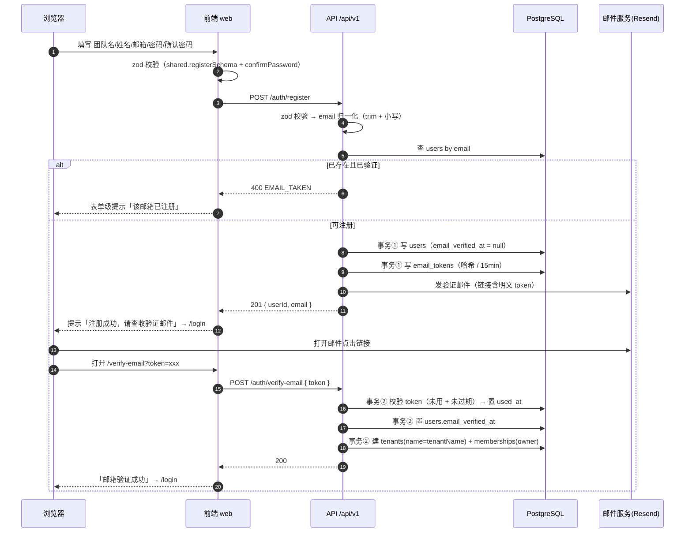
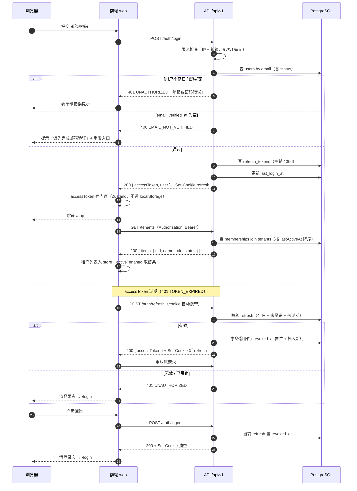
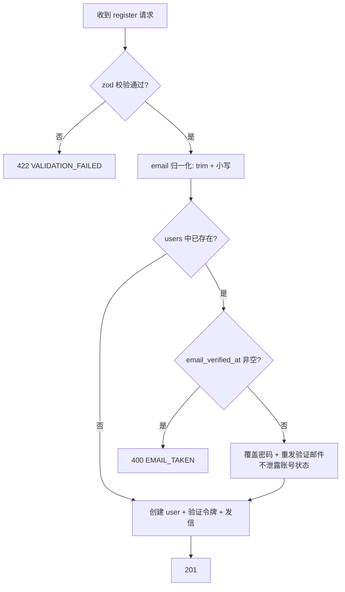
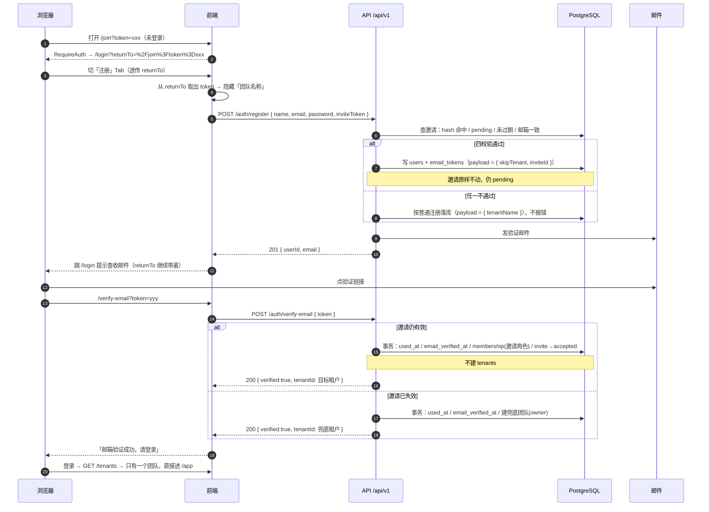

# 01 注册与登录

> 版本 v1.3 ｜ 更新 2026-11-11 ｜ 状态：已确认（v1.3 待实现）
> 确认：李顺 · 2026-11-11 ｜ 变更：v1.3 新增「受邀注册」——被邀请人从邀请链接进注册时**不再建默认团队**，邮箱验证时自动加入被邀请的团队（§2.5）；`registerSchema` 增可选 `inviteToken`、`tenantName` 改为条件必填，`email_tokens.payload` 增 `skipTenant` / `inviteId` 两个键。v1.2 明确「记住我」的收尾方式——`loginSchema.rememberMe` 字段保留，但服务端固定 30 天、暂不读取，前端不渲染控件（见 D-02）；v1.1 明确前端会话的落地方式——access 仅存内存、删除「记住我」界面、启动时 bootstrap 恢复会话、多租户走独立选择页；修订 §3.1/§3.2 并新增 §3.4 约束（v1.0：租户信息改为独立接口 `GET /tenants`，登录与 `/auth/me` 均不返回租户信息）
> 关联：《需求文档》§4 核心能力 / §6 安全基线、《技术方案设计》§5.3 认证设计 / §5.4 多租户隔离、《数据库设计与数据字典》§3.1、`知识点/M2-01-认证链路JWT双令牌`
>
> **一页速览**
> 接口：`POST /auth/register`（含可选 `inviteToken`） · `POST /auth/verify-email` · `POST /auth/login` · `POST /auth/refresh` · `POST /auth/logout` · `GET /auth/me` · `GET /tenants`
> 前端落点：`pages/_public/{login,register,verify-email}`、`components/auth/AuthShell.tsx`、`shared/api/{client,auth}.ts`、`stores/tenant.ts`、`app/guards/RequireAuth.tsx`
> 后端落点：`src/modules/auth/{auth.module,auth.controller,auth.service,token.service}.ts`、`src/common/mail/`、`src/modules/tenants/{tenants.module,tenants.controller,tenants.service}.ts`、`src/common/guards/jwt-auth.guard.ts`、`src/setup-app.ts`
> 关键异常：`EMAIL_TAKEN` / `EMAIL_NOT_VERIFIED` / `TOKEN_INVALID` / `RATE_LIMITED` / `UNAUTHORIZED`

---

## 1. 需求

### 1.1 用户故事

| 编号 | 角色 | 诉求 | 目的 |
|------|------|------|------|
| US-01 | 新用户 | 用团队名 + 姓名 + 邮箱 + 密码注册 | 开通属于自己团队的租户，成为 owner |
| US-02 | 注册用户 | 点击邮件里的验证链接完成激活 | 账号可用，能登录 |
| US-03 | 已激活用户 | 用邮箱 + 密码登录 | 进入控制台 |
| US-04 | 已登录用户 | access token 过期时自动续期 | 操作不被打断 |
| US-05 | 已登录用户 | 主动登出 | 在公共设备上终止会话 |
| US-06 | 被邀请的新用户 | 打开邀请链接后注册，验证邮箱即进入对方团队 | 不用先"自立门户"再切过去 |

### 1.2 验收标准

每条都能直接翻译成一条测试用例，测试用例不得超出此表范围。

| 编号 | 标准 |
|------|------|
| AC-01 | 注册成功返回 `201`，`data` 含 `userId`、`email`；**不下发任何令牌**（未验证不可登录） |
| AC-02 | 邮箱已存在且 `email_verified_at` 非空 → `400 EMAIL_TAKEN` |
| AC-03 | 请求体不符合 `registerSchema` → `422 VALIDATION_FAILED`，`details` 含字段级错误 |
| AC-04 | `users.password_hash` 为 bcrypt（cost=12）产物，长度 60；库中无明文密码 |
| AC-05 | 注册后 `email_tokens` 新增一条：`type=verify_email`、`expires_at` = 创建时间 + 15min、`token_hash` 为 64 位 hex；明文令牌只出现在邮件链接里 |
| AC-06 | 验证成功返回 `200`，且**同一事务内**完成四件事：`email_tokens.used_at` 置位、`users.email_verified_at` 置位、`tenants` 新增 1 条（`name` = tenantName）、`memberships` 新增 1 条（`role=owner`、`status=active`） |
| AC-07 | 同一 token 二次验证 → `400 TOKEN_INVALID`（`used_at` 已非空） |
| AC-08 | token 过期 → `400 TOKEN_INVALID` |
| AC-09 | 未验证邮箱登录 → `400 EMAIL_NOT_VERIFIED`，不下发任何令牌，`users.last_login_at` 不变 |
| AC-10 | 密码错误或邮箱不存在 → 一律 `401 UNAUTHORIZED`，`message` 统一为「邮箱或密码错误」，不暴露账号是否存在 |
| AC-11 | 登录成功返回 `200`，`data` 为 `{ accessToken, user }`（**不含租户信息**）；`accessToken` 有效期 15min；响应 `Set-Cookie` 下发 refresh（`HttpOnly`、`SameSite=Strict`、`Path=/api/v1/auth`、30 天），且 `refresh_tokens` 落一条；`users.last_login_at` 更新 |
| AC-12 | refresh 成功返回 `200` 与新 accessToken；旧 refresh 行 `revoked_at` 置位；用旧 refresh 再请求 → `401 UNAUTHORIZED` |
| AC-13 | 登出返回 `200`，refresh 行 `revoked_at` 置位并清空 cookie；此后用该 refresh 刷新 → `401 UNAUTHORIZED` |
| AC-14 | 同一 IP 或同一邮箱 15 分钟内登录失败 5 次 → 第 6 次返回 `429 RATE_LIMITED` |
| AC-15 | 所有响应符合统一体：成功 `{success:true,data,message,timestamp}`，失败 `{success:false,error:{code,message,details}}` |
| AC-16 | `GET /tenants` 返回当前用户所属租户列表，按 `lastActiveAt` 降序（空值排最后），每项含 `id`、`name`、`role`、`status`、`lastActiveAt`；未登录 → `401 UNAUTHORIZED` |
| AC-17 | 登录成功后按 F5 刷新，仍停留在 `/app`，全程不出现登录页（`booting` 期间渲染 Spin） |
| AC-18 | access 过期后继续操作：自动 refresh 并重放原请求，页面不跳登录；3 个请求并发 401 时只发出 1 次 `POST /auth/refresh` |
| AC-19 | 多租户账号无有效选择时被 `replace` 到 `/select-tenant`；单租户账号自动选中并进 `/app`；刷新后沿用上次选择，不重复弹选择 |
| AC-20 | 切换租户后，新的列表请求带新 `X-Tenant-Id`，且不显示上一租户缓存数据（切换时已 `queryClient.clear()`） |
| AC-21 | 业务请求同时带 `Authorization` 与 `X-Tenant-Id`；`/auth/*`、`/tenants` 不要求 `X-Tenant-Id`（未注入也能通） |
| AC-22 | 登录页无「记住我」勾选框；未登录访问 `/app` 重定向 `/login`，且 `booting` 期间不跳转 |
| AC-23 | `registerSchema.tenantName` 为**条件必填**：无 `inviteToken` 时不传 → `422 VALIDATION_FAILED`；带合法的 `inviteToken` 时不传 → 通过 |
| AC-24 | `POST /auth/register` 带 `inviteToken` 且通过四校验（`sha256` 命中、`status=pending`、未过期、`invite.email` 与归一化后的注册邮箱一致）→ `201`，`email_tokens.payload = { skipTenant: true, inviteId }`；**注册阶段不消费邀请**，`invites.status` 仍为 `pending` |
| AC-25 | `inviteToken` 任一校验不通过（不存在 / 已撤销 / 已过期 / 邮箱不匹配）→ **不报错**，按普通注册落库（payload 只含 `tenantName`），响应仍是 `201` |
| AC-26 | `POST /auth/verify-email` 时 payload 含 `inviteId` 且邀请仍有效 → 同一事务内完成 `email_tokens.used_at`、`users.email_verified_at`、`memberships`（`role` 取邀请里的角色、`invited_by` 取邀请人）、`invites.status=accepted`+`accepted_at`+`accepted_by`；**不建 `tenants`**，响应 `tenantId` 为该邀请所属租户 |
| AC-27 | 验证时邀请已失效（撤销 / 过期 / 邮箱已变更）→ 不建 `memberships`，改为建兜底租户（`name` = `{nickname} 的团队`、`role=owner`），响应 `tenantId` 为该租户；账号不留在"零团队"状态 |
| AC-28 | `AuthShell` 的 Tab 跳转透传 `location.search`，注册成功跳 `/login` 时同样带上 `returnTo`；其校验口径与登录页一致（`startsWith('/')` 且不以 `//` 开头），防开放重定向。**验证邮件的链接不携带 `returnTo`**——受邀注册在验证事务里已经入团，不需要再回到 `/join` |
| AC-29 | 注册页识别受邀场景（`returnTo` 中含 `/join?token=`）时：隐藏「团队名称」字段、顶部提示「你正在通过邀请加入团队」、提交时把该 token 作为 `inviteToken`；其余字段与校验同普通注册 |
| AC-30 | 受邀注册并验证后 `GET /tenants` 只返回被邀请的那个团队（角色为邀请时选定），**不出现自建的默认团队**（邀请在注册到验证之间失效的例外见 AC-27）；未验证前登录仍被 `EMAIL_NOT_VERIFIED` 拦下 |

### 1.3 范围外

- 找回密码 / 重置密码 → `02-找回密码`
- 邀请的创建 / 撤销 / 重发，以及**已注册用户**的接受动作 → `05-成员与邀请`（被邀请人**尚未注册**的那一段在本文 §2.5）
- 第三方 OAuth 登录（v2）
- 图形验证码 / 短信验证码
- 多设备会话列表与"踢下线"界面
- 租户创建与切换 UI（本期只做 `GET /tenants` 列表接口，切换与创建入口在 `04-租户创建与切换`）

---

## 2. 交互逻辑

### 2.1 注册 → 邮箱验证



> 这是**未被邀请**的注册路径。受邀注册（从邀请链接进入）只差一步：验证时把「建自己的团队」换成「加入别人的团队」，见 §2.5。

### 2.2 登录 → 刷新 → 登出



### 2.3 注册路径判定



### 2.4 异常分支表

| # | 触发条件 | HTTP | 错误码 | 前端表现 |
|---|---------|------|--------|---------|
| 1 | 字段缺失 / 格式错 / 密码强度不足 | 422 | `VALIDATION_FAILED` | 字段下方红字，取 `details` 定位字段 |
| 2 | 邮箱已注册且已验证 | 400 | `EMAIL_TAKEN` | 邮箱字段下方提示，引导去登录 |
| 3 | 验证 token 不存在 | 400 | `TOKEN_INVALID` | 整页错误态：链接无效，提供「重新发送」 |
| 4 | 验证 token 已使用 | 400 | `TOKEN_INVALID` | 提示「链接已使用」，引导去登录 |
| 5 | 验证 token 已过期 | 400 | `TOKEN_INVALID` | 提示「链接已过期」，提供「重新发送」 |
| 6 | 登录时邮箱未验证 | 400 | `EMAIL_NOT_VERIFIED` | 表单级提示 + 重发验证邮件按钮 |
| 7 | 邮箱不存在 / 密码错 | 401 | `UNAUTHORIZED` | 统一文案「邮箱或密码错误」，不区分 |
| 8 | 登录失败超限 | 429 | `RATE_LIMITED` | 提示「尝试过于频繁，请 15 分钟后再试」 |
| 9 | access 过期 | 401 | `TOKEN_EXPIRED` | 静默走 refresh，用户无感 |
| 10 | refresh 失效 | 401 | `UNAUTHORIZED` | 清登录态 → `/login`，toast「登录已过期」 |
| 11 | 访问需登录接口但无 access | 401 | `UNAUTHORIZED` | 同 10 |
| 12 | 注册时 `inviteToken` 无效（不存在 / 已撤销 / 已过期 / 邮箱不符） | 201 | —（**不报错**） | 用户无感知；验证后拿到的是兜底团队，符合 AC-25 |
| 13 | 验证时 payload 里的邀请已失效 | 200 | — | 同上，建兜底团队，见 AC-27 |

> 注意：现有 `http-exception.filter.ts` 里 `409 → SUBSCRIPTION_STATE_INVALID` 的兜底映射不适用于认证族。**所有认证异常必须显式抛出 `{ code, message }`**，否则前端拿到错误的业务码。

### 2.5 受邀注册（不建默认团队）

05 落地后邀请是「链接 + 邮箱」的形式，而被邀请人很可能还没有账号——此时唯一入口就是注册页。按 §2.1 走会先给他建一个自己的团队，再让他手动接受邀请，最后手里两个团队、其中一个是空的。本节把这段并成一条路。



五个决策，都有明确的排除项：

| 决策 | 取值 | 理由 |
|---|---|---|
| 带什么进来 | `inviteToken`，**不是** `tenantId` / `tenantName` | 注册接口无登录态，前端传的 `tenantId` 一律不可信——传别人的 id 就是「注册即入团」，绕过邀请的全部校验。`tenantName` 是展示信息，用它当「建不建团队」的开关则属于用缺省值承载语义，任何漏传的调用方都会静默得到零团队账号。只有 token 服务端验得了：hash 命中 + `pending` + 未过期 + 邮箱一致 |
| 注册阶段消费邀请？ | **不消费** | 注册时邮箱未验证，而 `users.email` 的唯一键已经占住。邀请链接被转发到群里是常态，谁先拿到谁就能用该邮箱注册；若此时就消费，攻击者占住邮箱、邀请变 `accepted`，他自己永远验证不了邮箱也登录不了，管理员却在成员列表看到「已接受」，真正的受邀人反倒被挡在 410 外面 |
| 验证阶段消费邀请？ | **消费** | 点开邮件里的验证链接 = 证明持有该邮箱，此时身份与被邀请邮箱一致；「接受」的意图在注册提交 token 时已表达。合进同一事务，用户才能真的只点一次链接 |
| 邀请已失效 | 建兜底团队（`{nickname} 的团队`） | 零团队账号登录后无处可去；有个团队至少能进工作台，名字在租户设置里能改（M3）。另一个选择是让用户落到 `/select-tenant` 空态自己建，但「明明点了邀请链接却什么都没有」更难解释 |
| 校验失败 | **静默降级，不报错** | 注册不该因为邀请过期而失败——用户没做错任何事，报错只会把他卡在注册页。按普通注册继续，唯一差别是团队名走兜底 |

**与 05 的边界**：`05-成员与邀请` 的「已注册用户点链接 → `/join` → 点加入」完全不受影响；本节只覆盖「还没有账号」的那一半。两条路终点一致——`invites.status=accepted` 加一条 `status=active` 的 membership，区别只在于谁触发（用户点按钮 vs 验证事务）。

**注册页拿不到团队名**：`GET /invites/:token` 需要登录（05 AC-06 明确不做匿名预览），所以注册页只能说「你正在通过邀请加入团队」，具体是哪个团队等登录后在顶栏和头像下拉里看。要显示名字就得开匿名预览接口，等于给「这个链接是否有效」提供一个探测口，收益不值得。

---

## 3. 前端改动

### 3.1 现状（已完成部分）

> 落点已随约定式路由迁移：`pages/Register/index.tsx` → `pages/_public/register/page.tsx`，登录与验证邮箱同理。下表是 v1.1 时点的状态，保留作历史对照，**不是当前文件路径**。

| 文件 | 现状 |
|------|------|
| `pages/Register/index.tsx` | 表单已实现（RHF + zodResolver + antd Controller），校验走 `registerFormSchema`；**提交不发请求**，仅 `message.success` 后跳 `/login` |
| `pages/Register/schema.ts` | `registerSchema.extend({ confirmPassword }).refine(...)`，二次确认属前端关注点，不进共享契约 |
| `pages/Login/index.tsx` | 表单已实现，校验复用 `loginSchema`；**提交不发请求**，写 `localStorage.token = mock-token-*` 后跳 `/app` |
| `app/guards/RequireAuth.tsx` | 仅判断 `localStorage.token` 是否存在；`TOKEN_KEY = 'token'` |
| `utils/token.ts` | 读写 `localStorage` / `sessionStorage`，由「记住我」勾选决定落点；接真实后端后这套存储作废（会话由 httpOnly cookie 维持，见 §3.4） |
| `shared/api/client.ts` | axios 实例 + 401 拦截已就位，但响应契约与后端不一致（见 3.3） |
| `app/router.tsx` | 已有 `/login`、`/register`、`/app`；缺 `/verify-email` |

### 3.2 待改动

| # | 文件 | 改动 |
|---|------|------|
| F-01 | `shared/api/client.ts` | ① `ApiResponse` 改为后端真实结构 `{success,data,message,timestamp}`；② `toApiError` 从 `data.error.code` 取码（当前读的是 `data.code`，永远取不到）；③ 加 `withCredentials: true`；④ 401 处理改为「先尝试 refresh 一次，失败才清登录态」，并加并发去重（多个请求同时 401 只发一次 refresh） |
| F-02 | `shared/api/auth.ts`（新增） | 6 个接口的请求函数 + 出参类型，统一从此处调用，页面不直接写 URL |
| F-03 | `stores/auth.ts`（新增，Zustand） | 会话状态唯一来源：`accessToken`（**只存内存，不落 storage**）、`user`、`status: 'booting' \| 'authenticated' \| 'anonymous'`。`status` 用来区分「启动恢复中」与「确实未登录」，否则刷新页面会闪跳登录页。`utils/token.ts` 的 storage 逻辑随之下线 |
| F-04 | `pages/Login/index.tsx` | `onSubmit` 改调 `login()`；成功后写入 accessToken（**不含租户信息**）、跳 `/app`；按 `EMAIL_NOT_VERIFIED` / `RATE_LIMITED` / `UNAUTHORIZED` 分支提示 |
| F-05 | `pages/Register/index.tsx` | `onSubmit` 剔除 `confirmPassword` 后调 `register()`；成功跳 `/login`；按 `EMAIL_TAKEN` 做字段级提示 |
| F-06 | `pages/VerifyEmail/index.tsx`（新增） | 读 `?token=`，进页自动提交；三态：验证中 / 成功（提示「租户已创建」，按钮手动去登录，**不自动跳**）/ 失败（`TOKEN_INVALID` 统一文案）。失败页按钮落回**注册页**：后端没有「重发验证邮件」接口，重新提交注册才会覆盖密码并重发（v1.3 起成功态文案由 F-16 取代） |
| F-07 | `app/router.tsx` | 注册 `/verify-email`、`/select-tenant` 路由（公共路由，不需登录） |
| F-08 | `constants/errorCode.ts`（新增） | 错误码 → 用户文案映射表，未知码回落「操作失败，请稍后重试」 |
| F-09 | `app/guards/RequireAuth.tsx` | 改为读 `stores/auth` 的 `status`：`booting` 渲染全屏 Spin 且不跳转、`anonymous` 跳登录、`authenticated` 放行。守卫本身不发请求——恢复动作在 F-11 做一次 |
| F-10 | `stores/tenant.ts` + `pages/SelectTenant/index.tsx`（均新增） | 登录/恢复成功后拉 `GET /tenants` 分流：空列表 → 引导页；1 条 → 自动选中进 `/app`；多条 → 无有效 `currentTenantId` 时 `replace` 到 `/select-tenant`。`currentTenantId` 持久化到 localStorage，刷新不重选 |
| F-11 | `app/bootstrap.tsx`（新增） | 启动先 `POST /auth/refresh` 拿 accessToken，再 `GET /auth/me` 补 user；失败则清状态置 `anonymous`。期间 `status='booting'`。这是「刷新页面不掉线」的唯一入口 |
| F-12 | `shared/api/client.ts` | 请求拦截器在 `Authorization` 之后注入 `X-Tenant-Id`（从 `stores/tenant` 读，保证与内存一致）；`/auth/*` 与 `/tenants` 是 `@SkipTenant`，不必注入 |
| F-13 | `components/auth/AuthShell.tsx` | Tab 跳转改为 `navigate({ pathname: tab.path, search: location.search })`。当前是无参 `navigate(tab.path)`，登录页带来的 `returnTo` 在点「注册」时被整段丢掉（AC-28） |
| F-14 | `pages/_public/register/page.tsx` | 从 `returnTo` 解析 `/join?token=`：命中则隐藏「团队名称」、顶部提示「你正在通过邀请加入团队」、提交时把 token 作为 `inviteToken`（AC-29）；注册成功跳 `/login` 时把 `returnTo` 一并带上 |
| F-15 | `pages/_public/register/schema.ts` | `registerFormSchema` 继承 shared 的条件必填：带 `inviteToken` 时跳过 `tenantName` 校验，否则沿用 2–50 |
| F-16 | `pages/_public/verify-email/page.tsx` | 成功态文案去掉「租户已创建」（受邀注册不建租户），统一为「邮箱验证成功，请登录」。**不处理 `returnTo`**，验证链接不带它 |

### 3.3 错误码 → 文案映射

| 错误码 | 文案 | 展示位置 |
|--------|------|---------|
| `VALIDATION_FAILED` | 按 `details` 字段级展示 | 字段下方 |
| `EMAIL_TAKEN` | 该邮箱已注册，请直接登录 | 邮箱字段下方 |
| `EMAIL_NOT_VERIFIED` | 邮箱尚未验证，请查收验证邮件 | 表单级 Alert |
| `TOKEN_INVALID` | 链接无效或已过期，请重新获取 | 页面错误态 |
| `UNAUTHORIZED` | 邮箱或密码错误 | 表单级 Alert |
| `RATE_LIMITED` | 尝试过于频繁，请 15 分钟后再试 | 表单级 Alert |
| `INTERNAL_ERROR` | 服务异常，请稍后重试 | 表单级 Alert |

### 3.4 前端会话约束

这几条不是实现细节，写错会产出很难定位的 bug，评审时逐条对：

| 约束 | 原因与做法 |
|---|---|
| access 令牌不进 storage | 会话真正由 httpOnly refresh cookie 维持（30 天），access 只是 15 分钟的调用凭证。落 localStorage 的收益仅是「刷新省一次 refresh」，代价是 XSS 可直接读取。`withCredentials: true` 让 cookie 自动携带 |
| 「记住我」界面删除 | 后端 `REFRESH_TTL_DAYS` 固定 30 天，cookie 的 `maxAge` 由服务端写死，前端无参数可影响。保留勾选框等于 UI 撒谎（勾不勾都是 30 天）。改为静态文案「登录后 30 天内免登录」。**契约里的 `rememberMe?: boolean` 保留、前端调用时显式传 `true`**（见 D-02），只是服务端暂不读取 |
| refresh 必须单飞 | 轮转式 refresh 下，三个请求同时 401 若各发一次 refresh，后两次会拿着已吊销的 token 失败，并把第一次换到的新 token 一并吊销。用一个模块级 `Promise` 加锁，`finally` 里必须清空 |
| 401 只重试一次 | 请求上打 `_retry` 标记，并排除 `/auth/login`、`/auth/refresh`、`/auth/logout`，否则登录失败会触发 refresh → refresh 失败 → 再触发，死循环 |
| 启动恢复不放在守卫里 | `RequireAuth` 只读 `status`，不发请求；恢复集中在 `bootstrap`。否则每次路由切换都会打一次 refresh |
| `booting` 不能当未登录 | 恢复期间跳登录页会造成「刷新必被踢出」的观感。此状态渲染 Spin，不做重定向 |
| 切租户清 React Query 缓存 | 否则上一租户的列表数据会直接显示在新租户下，属于跨租户串数据。切换时 `queryClient.clear()` |
| 多标签不同步（已知限制） | A 标签登出后，B 标签内存中的 access 仍有效，最长 15 分钟后失效。本期接受；需要时用 `BroadcastChannel` 广播登出事件 |

---

## 4. 后端接口

### 4.1 接口清单

统一前缀 `/api/v1`。除 `GET /auth/me` 外全部 `@Public()`。

> **守卫**：整个 `AuthController` 在**类级**标了 `@SkipTenant()`。`@Public()` 只跳 JwtAuthGuard，
> TenantGuard 仍会要求 `X-Tenant-Id`；认证接口发生在选定租户之前，不可能带这个头。
> 漏标的后果是整条认证链路 403 `TENANT_MISMATCH`（见 §6 D-01）。

| # | 方法 | 路径 | 鉴权 | 入参 | 出参 `data` | 成功 | 失败 |
|---|------|------|------|------|------------|------|------|
| 1 | POST | `/auth/register` | 公开 | `registerSchema` | `{ userId, email }` | 201 | 422 / 400 `EMAIL_TAKEN` / 500 |
| 2 | POST | `/auth/verify-email` | 公开 | `{ token }` | `{ verified: true, tenantId }` | 200 | 400 `TOKEN_INVALID` |
| 3 | POST | `/auth/login` | 公开 | `loginSchema`（含可选 `rememberMe`，**服务端暂不读取**） | `{ accessToken, user }` | 200 | 422 / 400 `EMAIL_NOT_VERIFIED` / 401 / 429 |
| 4 | POST | `/auth/refresh` | 公开（读 cookie） | 无 body | `{ accessToken }` | 200 | 401 `UNAUTHORIZED` |
| 5 | POST | `/auth/logout` | 公开（读 cookie） | 无 body | `{ ok: true }` | 200 | — |
| 6 | GET | `/auth/me` | 需 access | 无 | `{ user }` | 200 | 401 |
| 7 | GET | `/tenants` | 需 access | 无 | `{ items: [{ id, name, role, status, lastActiveAt }] }` | 200 | 401 |

出参类型与 zod schema 全部放 `packages/shared`（如 `loginResultSchema`、`authUserSchema`），前端 `z.infer` 复用，不在两端各写一份。

> **v1.3（受邀注册）**：`/auth/register` 的入参多一个可选 `inviteToken`（明文邀请令牌，只走 body 不进 URL）；`/auth/verify-email` 的出参形状不变，但 `tenantId` 在受邀场景下指的是**被邀请的那个团队**，不是新建的团队（§2.5）。

### 4.2 数据模型

**不新增表、不新增迁移**（`20261103022859_auth_tokens` 已建好 `email_tokens` / `refresh_tokens`）。

| 表 | 用途 | 关键约束 |
|----|------|---------|
| `users` | 认证主体，全局表 | `email` UNIQUE（并发注册的最终兜底：捕获 P2002 转 `EMAIL_TAKEN`） |
| `tenants` | 注册时创建，1 个 | `owner_id` FK → users |
| `memberships` | `(tenant_id, user_id)` 唯一，注册建 owner 行；`GET /tenants` 按 `user_id` 反查 | `role=owner`、`status=active` |
| `email_tokens` | 验证令牌，只存 SHA-256 hex。`payload` 两种形态：普通注册 `{ tenantName }`、受邀注册 `{ skipTenant: true, inviteId }` | `used_at` 非空即已消费；`expires_at` +15min |
| `refresh_tokens` | 会话，可吊销 | `token_hash` UNIQUE；轮转=旧行 `revoked_at` 置位 + 插新行 |

`users.nickname` 取注册时的 `name`（max 20 ≤ 字段 50，无需截断）；`tenants.name` 取 `tenantName`（max 50 ≤ 100）。

### 4.3 关键约束

**事务边界**
- 注册：`users` + `email_tokens` 同一事务（`prisma.$transaction`）。邮件在事务**提交后**发，发送失败不回滚账号（用户可重发）。
- 验证：`email_tokens.used_at` + `users.email_verified_at` + `tenants` + `memberships` 四写必须同一事务（AC-06）。漏事务会造成"邮箱已验证但没租户"的僵尸账号。
- 刷新：旧行吊销 + 新行插入同一事务。

**并发与幂等**
- 注册并发：靠 `users.email` 唯一索引兜底，捕获 Prisma `P2002` → `EMAIL_TAKEN`。
- 验证并发：`updateMany({ where: { id, used_at: null } })` 判断影响行数，为 0 即已被消费，避免双请求都通过。
- 刷新并发：同上模式，`updateMany({ where: { id, revoked_at: null } })`。

**受邀注册（v1.3）**

- **注册阶段只校验、不消费**。四个条件全中才把 `{ skipTenant: true, inviteId }` 写进 `email_tokens.payload`：`sha256(token)` 命中 `invites.token_hash`、`status='pending'`、`expires_at > now()`、`invite.email` 与归一化后的注册邮箱相同。任一不中 → 按普通注册写 `{ tenantName }`，**不抛异常**（用户没做错事，不该卡在注册页）。
- **验证阶段才消费**。payload 带 `inviteId` 时**必须重新查一遍邀请**，不能信 15 分钟前注册时的结论——期间邀请可能被撤销，也可能被重发轮换过。仍有效则 `memberships` + `invites` 与 `email_tokens.used_at`、`users.email_verified_at` 同事务；失效则建兜底租户（AC-27）。
- **不信前端传的 `tenantId`**。注册接口是 `@Public`，任何租户 id 不加校验就写进 membership 都是越权入口（能直接注册进别人的团队）。邀请的租户只能由 `inviteId` 反查。
- **重发不影响这条路**：05 的重发是 `update` 同一行、只轮换 `token_hash`，`id` 不变，所以注册时记下的 `inviteId` 仍然有效。若邀请被「撤销 + 重新邀请」，撤销走的是 `revoked` 状态、新邀请另起一行，旧 `inviteId` 自然判失效 → 兜底团队。
- **与 `acceptInvite` 的字段必须一致**：`role` 取邀请里的角色、`invitedBy` 取 `invite.invitedBy`、`status='active'`。两处各写一份是有意的（`acceptInvite` 要处理「已 active 幂等返回」「disabled 拒绝」等分支，`verifyEmail` 这条路上账号刚建、不可能已有 membership），但字段口径不能漂。

**安全**
- bcrypt cost = 12（`bcrypt.hash(password, 12)`）。
- 令牌只存哈希：`sha256(token)` → 64 位 hex；明文只出现在邮件链接与响应 cookie 中。
- 登录不做用户枚举：账号不存在与密码错误返回完全一致的响应与耗时（不存在时也跑一次假比对）。
- cookie：`HttpOnly` + `SameSite=Strict` + `Path=/api/v1/auth` + `Max-Age=30d`；`Secure` 仅生产开启（**本地 http 下开 Secure 会导致 refresh cookie 永不发送**）。
- 邮件里的验证链接指向前端：`${APP_WEB_URL}/verify-email?token=xxx`，不是 API 地址。

**令牌载荷与租户上下文**
access token payload 只含 `{ sub, type: 'access' }`，**不含 tenantId** —— 一个用户可属多租户，把租户写进令牌会导致切租户必须换令牌。租户上下文改为请求级传递：前端带 `X-Tenant-Id` 头，守卫校验该用户在此租户的 membership 存在且 `status=active`（落地见《技术方案设计》§5.4 与 `04-租户创建与切换`）。因此登录响应、`/auth/me` 都不返回租户信息，租户列表走 `GET /tenants`。

**限流**
`@nestjs/throttler` 对 `/auth/login` 按 IP + 邮箱双维度，5 次 / 15 分钟；超限抛 `RATE_LIMITED`。

**审计**
登录成功写一条 `audit_logs`（`action='auth.login'`、`tenant_id=null`、`detail` 只有 `method`/`path`，无 `durationMs`）；**失败登录不写**——`actor_user_id` 是 NOT NULL，且失败登录可被刷量。由 `AuthService.login` 直接调 `audit.record`（`@Public` 接口执行时 `req.user` 还不存在，拦截器拿不到 actor），落地见 `05-成员与邀请` AC-15。

**配置新增**（`env.schema.ts`，缺键启动即失败）
`MAIL_API_KEY`（已在 `.env`，schema 里缺）、`APP_WEB_URL`、`MAIL_FROM`；`JWT_ACCESS_TTL` / `JWT_REFRESH_TTL` 建议改为数字（秒/天），避免 jsonwebtoken 的 `StringValue` 类型不兼容。

**邮件发送**
`MailService` 走 Resend。域名未验证时只能发到账号本人邮箱 —— 收到 `Resend` 403/422 时应记录日志并返回可读错误（`INTERNAL_ERROR` 而非 500 裸抛）。开发期用 `MAIL_DEV_MODE=true`：不实际发信，把验证链接打到服务端日志，并在 `NODE_ENV !== 'production'` 时回显到响应 `details.verifyUrl`，本地才能走通「注册 → 点链接」。

---

## 5. 测试

### 5.1 单测（Vitest，`src/modules/auth/*.spec.ts`）

| 目标 | 用例 |
|------|------|
| `AuthService.register` | 正常创建；邮箱已存在抛 `EMAIL_TAKEN`；P2002 转 `EMAIL_TAKEN`；密码哈希 cost=12；**带合法 `inviteToken` 时 payload 写 `{ skipTenant, inviteId }` 且不动 `invites` 行**；token 不存在 / 已撤销 / 已过期 / 与注册邮箱不符 → 回落普通注册且**不抛错** |
| `AuthService.verifyEmail` | 正常四写；token 不存在/已用/过期分别抛 `TOKEN_INVALID`；并发第二次失败；**payload 带 `inviteId` 且邀请有效 → 不调 `tenant.create`、`membership` 取邀请角色、`invites.status=accepted`**；**邀请已失效 → 建兜底租户** |
| `AuthService.login` | 正常签发；未验证抛 `EMAIL_NOT_VERIFIED`；密码错与用户不存在返回同一异常 |
| `AuthService.refresh` | 正常轮转；旧 token 再用失败；过期失败 |
| `AuthService.logout` | 吊销当前行；重复登出不报错（幂等） |
| `TokenService` | access 签发/校验；过期识别；refresh 哈希稳定 |
| `TenantsService.listByUser` | 只返回 `status=active` 的 membership；按 `lastActiveAt` 降序、空值排后；不返回已软删租户（`deleted_at` 非空） |
| `MailService` | 链接拼接正确（`APP_WEB_URL`）；发送失败不打挂注册事务 |

### 5.2 e2e 用例矩阵（Supertest，`test/auth.e2e-spec.ts`）

> **测试库**：e2e 连独立库（`DATABASE_URL_TEST`，本地 Docker Postgres 或 Neon 独立 database），先 `prisma migrate deploy` 建表；不得写开发库。每个用例前清空 `users` / `tenants` / `memberships` / `email_tokens` / `refresh_tokens`。

| # | 场景 | 期望 |
|---|------|------|
| E-01 | 正常注册 | 201，`data.userId` 为 cuid，DB `users` 1 条、`email_tokens` 1 条 |
| E-02 | 重复注册（已验证） | 400 `EMAIL_TAKEN` |
| E-03 | 弱密码（纯数字） | 422 `VALIDATION_FAILED`，`details` 指向 `password` |
| E-04 | 邮箱格式非法 | 422 `VALIDATION_FAILED` |
| E-05 | 验证有效 token | 200；`users.email_verified_at` 非空；`tenants` 1 条；`memberships` 1 条 `role=owner` |
| E-06 | 重复验证同一 token | 400 `TOKEN_INVALID` |
| E-07 | 验证过期 token（构造 `expires_at` 过去） | 400 `TOKEN_INVALID` |
| E-08 | 未验证登录 | 400 `EMAIL_NOT_VERIFIED`，响应无 `accessToken` |
| E-09 | 密码错误 | 401 `UNAUTHORIZED`，message 与"用户不存在"完全一致 |
| E-10 | 用户不存在 | 401 `UNAUTHORIZED` |
| E-11 | 正常登录 | 200；有 `accessToken`；`Set-Cookie` 含 `HttpOnly`；`refresh_tokens` 1 条 |
| E-12 | 带 access 访问 `/auth/me` | 200，`data.user.email` 正确，响应**不含**租户字段 |
| E-13 | 不带 access 访问 `/auth/me` | 401 `UNAUTHORIZED` |
| E-14 | 篡改 access 签名 | 401 `TOKEN_EXPIRED` |
| E-15 | 正常刷新 | 200 新 access；旧 refresh 行 `revoked_at` 非空 |
| E-16 | 旧 refresh 重放 | 401 `UNAUTHORIZED` |
| E-17 | 登出后刷新 | 401 `UNAUTHORIZED` |
| E-18 | 登录失败 6 次 | 第 6 次 429 `RATE_LIMITED` |
| E-19 | 带 access 访问 `/tenants` | 200，1 条，`role=owner`，`name` 等于注册时的 tenantName |
| E-20 | 不带 access 访问 `/tenants` | 401 `UNAUTHORIZED` |
| E-21 | 带有效 `inviteToken` 注册 | 201；`email_tokens.payload` 含 `skipTenant` / `inviteId`；`invites` 仍 `pending`、`accepted_at` 为空（注册阶段不消费） |
| E-22 | 接着 E-21 验证邮箱 | 200；`tenants` **不新增**；`memberships` 1 条且 `role` 与邀请一致、`invited_by` = 邀请人；`invites.status=accepted` |
| E-23 | 带已撤销 / 已过期的 `inviteToken` 注册 | 201 且 payload 无 `skipTenant`；验证后 `tenants` 新增 1 条（兜底名 `{nickname} 的团队`） |
| E-24 | 邀请发给 `a@x.com`，用 `b@x.com` 注册并带该 token | 201 且按普通注册处理（邮箱不一致，邀请不生效） |

> 限流用例（E-18）会污染同 IP 的其他用例：需在测试环境把阈值调到可控值（如 3），或把该用例放最后并独立 `describe` 块。

### 5.3 手工验证清单

```bash
BASE=http://localhost:3000/api/v1

# 1 注册
curl -s -X POST $BASE/auth/register -H 'Content-Type: application/json' \
  -d '{"tenantName":"测试团队","name":"李顺","email":"me@example.com","password":"Passw0rd"}' | jq

# 2 从服务端日志或邮件取 token，再验证
curl -s -X POST $BASE/auth/verify-email -H 'Content-Type: application/json' \
  -d '{"token":"<token>"}' | jq

# 3 登录（-c 存 cookie，-b 带上）
curl -s -c /tmp/ck.txt -X POST $BASE/auth/login -H 'Content-Type: application/json' \
  -d '{"email":"me@example.com","password":"Passw0rd"}' | jq

# 4 带 access 取当前用户
curl -s $BASE/auth/me -H "Authorization: Bearer <accessToken>" | jq

# 5 刷新 / 6 登出
curl -s -b /tmp/ck.txt -c /tmp/ck.txt -X POST $BASE/auth/refresh | jq
curl -s -b /tmp/ck.txt -X POST $BASE/auth/logout | jq

# 7 受邀注册：先按 05 造一条邀请（需 access + X-Tenant-Id），从 joinUrl 末尾取 token
curl -s -X POST $BASE/invites -H "Authorization: Bearer <accessToken>" -H "X-Tenant-Id: <tenantId>" \
  -H 'Content-Type: application/json' -d '{"email":"new@example.com","role":"member"}' | jq -r '.data.joinUrl'

# 8 不传 tenantName，只带 inviteToken
curl -s -X POST $BASE/auth/register -H 'Content-Type: application/json' \
  -d '{"name":"新同事","email":"new@example.com","password":"Passw0rd","inviteToken":"<token>"}' | jq

# 9 按 #2 的方式验证新账号的令牌，登录拿 newAccessToken，再查团队：应当只有被邀请的那一个
curl -s $BASE/tenants -H "Authorization: Bearer <newAccessToken>" | jq '.data.items | length'
```

前端手工验证：注册 → 查收邮件（或看日志链接）→ 点链接 → 登录 → 刷新页面仍在登录态 → 等 access 过期（或手改 15m 为 30s）→ 操作接口不报错 → 登出后访问 `/app` 被踢回 `/login`。

受邀场景：隐身窗口打开 `joinUrl` → 被拦到登录页 → 点「注册」，团队名字段应消失、顶部出现受邀提示 → 提交 → 收信验证 → 登录 → 头像下拉里只有对方团队，切过去能在成员列表看到自己。

### 5.4 前端单测（Vitest）

| 用例 | 断言 |
|------|------|
| 错误归一 | 有 `error` 体时取 `data.error.code`；无 `error` 体回落 `httpStatus`；网络错误 `httpStatus=0` |
| refresh 单飞 | 3 次并发调用只产生 1 次请求，三者拿到同一个新 token |
| 401 重试 | 首次 401 → refresh → 重放成功；重放再 401 时不再重试，直接抛错 |
| `RequireAuth` | `booting` 不跳转；`anonymous` 跳 `/login`；`authenticated` 渲染 children |
| 租户分流 | 0 条 → 引导态；1 条 → 自动写入 `currentTenantId`；多条且无有效选择 → 跳 `/select-tenant` |
| 注册页受邀识别 | `returnTo` 含 `/join?token=xxx` 时隐藏团队名输入、提示受邀、提交体带 `inviteToken`；不含时团队名仍必填（前后端同一条条件必填规则） |
| `AuthShell` Tab 透传 | 从 `/login?returnTo=%2Fjoin%3Ftoken%3Dx` 点「注册」，导航目标仍带 `returnTo`；`returnTo=//evil.com` 被丢弃 |

---

## 6. 偏差与落地记录

> 2026-11-06 补齐登录 / 注册 / 找回 / 重置全链路后回填。上一版状态标「v1.1 已实现」，
> 实际只完成了登录与登录态恢复，注册仍是「只弹提示不发请求」。

| # | 位置 | 设计 | 实际 | 原因 |
|---|------|------|------|------|
| D-01 | §4.1 鉴权列 | 只写 `@Public()` | 控制器**类级**加 `@SkipTenant()` | `@Public` 只跳 JwtAuthGuard；03 引入 TenantGuard 后 `/auth/*` 全量 403 `TENANT_MISMATCH`，登录、注册、找回密码同时不可用，而 service 层单测全绿——只有手工冒烟才暴露。回归用例：`apps/api/src/modules/auth/auth.controller.spec.ts` |
| D-02 | 登录入参 | 无「记住我」 | `loginSchema.rememberMe?: boolean`，服务端固定 30 天、**暂不读取**；前端调用时显式传 `true` | 设计稿 S1 有该复选框，先保留契约字段与调用位，将来做「不记住 → 会话 cookie」时只改服务端一行（`setRefreshCookie(res, token, body.rememberMe !== false)`），不必改 shared 与调用方。本期无论传 `true`、`false` 还是不传，`Set-Cookie` 都带 `Max-Age=2592000`；前端因此**不渲染**勾选框、只显示静态文案，但提交时会显式传 `rememberMe: true` —— 把「默认持久」写进调用方而不是依赖后端默认值，避免出现「勾了没用」的控件。access token 仍只存内存 |
| D-03 | F-06 失效页 | 「重发验证邮件」按钮 | 改为「返回注册」 | 后端没有 resend 接口；重新提交注册会覆盖密码并重发验证信（§2.3），不需要新接口 |
| D-04 | F-08 | 新增 `constants/errorCode.ts` | 未建，错误文案就地写在各页面 | 当前只有 4 个错误码需翻译，抽表反而多一层跳转；错误码超过 8 个再收敛到映射表 |
| D-05 | §2.4 第 6 行 | `EMAIL_NOT_VERIFIED` → 「表单级提示 + 重发按钮」 | 仅 toast「邮箱尚未验证，请查收验证邮件」 | 同 D-03，无重发接口；给出可执行下一步（去收信）比给一个假按钮好 |
| D-06 | 启动时恢复登录态 | 应用根部包裹 `AppBootstrap`，挂载即 `refreshAccessToken()` | 改由 `app/session.ts#ensureSession()` 按需触发，仅 `RequireAuth` 调用 | refresh cookie 是 httpOnly 的，前端读不到，公开页（`/login` 等）那一次 refresh 必然 401：首屏要多等一个 RTT 才渲染表单、控制台常驻红字、服务端白挨一次无效请求。**代价**：已登录用户直接在地址栏打开 `/login` 不会自动跳 `/app`（进 `/app` 才会恢复）——比起每张公开页都先吃一个 401，这个取舍更划算。实测见 §6.3 |
| D-07 | 05 §2.1 主流程 | 邀请 → 注册 → 登录 → `/join` → 点「加入」，四步 | 受邀注册合并成「注册 → 验证即入团」两步，`/join` 只服务已注册用户 | 未注册的人点完验证邮件还得再回来点一次邀请链接，中间没有任何提示说「还差一步」；而验证邮箱本身就证明了邮箱所有权且与被邀请邮箱一致，「接受」的意图在注册提交 token 时已表达。安全边界不放宽——注册阶段仍然不消费邀请（§4.3） |

### 6.1 落地清单

| 文件 | 改动 |
|------|------|
| `pages/Register/index.tsx` | `onSubmit` 调 `authApi.register`；显式组装请求体剔除 `confirmPassword`；`EMAIL_TAKEN` → 邮箱字段级错误；`VALIDATION_FAILED` → 按 `details.path` 回填字段；`RATE_LIMITED` → toast；成功后带 `state.registeredEmail` 跳 `/login` |
| `pages/Register/constants.ts` | 补三条设计稿字段说明（团队名 / 邮箱 / 密码）与失败兜底文案 |
| `pages/Login/index.tsx` | 「记住我」复选框进契约；从注册页跳来时顶部 `Alert` 说明验证邮件已发送 + 预填邮箱；勾选后 localStorage 只记邮箱 |
| `pages/Login/constants.ts`（新增） | `REMEMBERED_EMAIL_KEY` 与提示文案 |
| `shared/contracts/auth.ts` | `loginSchema.rememberMe`（可选，默认行为不变） |
| `auth.controller.ts` | 类级 `@SkipTenant()`；`setRefreshCookie(res, token, persistent)` |
| `app/session.ts`（新增） | `ensureSession()`：模块级 Promise 去重 + 已有结论短路；失败静默回落 `anonymous` |
| `app/guards/RequireAuth.tsx` | `booting` 时渲染全屏 Spin 并触发 `ensureSession()`，不再直接 `Navigate`（否则刷新 `/app` 会闪一下登录页） |
| `app/bootstrap.tsx`（删除） | 原全局阻塞式恢复，已由上面两处取代 |

### 6.2 端到端验证（2026-11-06，独立实例 `:3001` + `MAIL_DEV_MODE=true`）

从服务端日志取邮件里的明文令牌，按真实顺序打一遍：

| # | 请求 | 期望 | 实测 |
|---|------|------|------|
| 1 | `POST /auth/register` | 201 `{ userId, email }` | 201 ✓ |
| 2 | `POST /auth/verify-email` | 200 `{ verified: true, tenantId }` | 200 ✓（同时建 tenant + owner membership） |
| 3 | `POST /auth/login`（`rememberMe: true`） | 200 + `Set-Cookie` 带 `Max-Age=2592000` | ✓ |
| 4 | `POST /auth/login`（`rememberMe: false`） | 同上——本期服务端忽略该字段，`Max-Age` 仍在 | ✓ |
| 5 | `GET /auth/me`、`GET /tenants` | 200；租户名 = 注册填的团队名，`role=owner` | ✓ |
| 6 | `POST /auth/forgot-password` | 200 `{ ok: true }`（邮箱存在与否同响应） | ✓ |
| 7 | `POST /auth/reset-password` | 200 `{ ok: true }` | ✓ |
| 8 | 旧密码登录 / 新密码登录 | 401 / 200 | ✓ |
| 9 | 重置前的 refresh cookie 再刷新 | 401（全部 refresh 已吊销） | ✓ |
| 10 | 同一重置令牌再用一次 | 400 `TOKEN_INVALID` | ✓ |

> 注意：`MAIL_DEV_MODE` 下令牌只打在服务端日志（`MailService` 的 `warn`），响应体里**不**回显。
> 想复现这条链路，起实例时把 stdout 重定向到文件，再从日志里 grep `token=`。

### 6.3 启动请求实测（2026-11-06，headless Chrome + netlog）

用 `--log-net-log` 抓真实网络事件，按 `source.id` 去重（netlog 里同一请求会拆成 request / socket / connect 多个 source，直接 grep 会重复计数）：

| 打开路径 | 登录态 | 后端请求 |
|----------|--------|----------|
| `/login` | 未登录（无 cookie） | **0 个** |
| `/app` | 未登录（无 cookie） | 1 次 `POST /auth/refresh` → 401 → 回落 `anonymous` → 跳 `/login` |
| `/app` | 已登录 | 1 次 `POST /auth/refresh` → 200 → `GET /auth/me` → 渲染工作台 |

修复前后对比：`/login` 从「1 次必然 401 的 refresh + 全屏 Spin 等一个 RTT」变成「零请求、直接出表单」。

回归用例：`apps/web/src/app/session.test.ts`（已有结论不请求 / 并发只探一次 / 失败静默回落）。

### 6.4 v1.3 落地清单（待实现）

| 文件 | 改动 |
|------|------|
| `packages/shared/src/contracts/auth.ts` | `registerSchema` 增 `inviteToken?: string`；`tenantName` 改条件必填（`superRefine`：无 `inviteToken` 时必填 2–50，有则可省）。`RegisterInput` 的 `tenantName` 随之变可选，调用方都要按可选处理。**注意前端的 `registerFormSchema = registerSchema.extend({ confirmPassword })`**：zod 4 的 `.refine` 不改类型，但 extend 之后要确认两条 check 都在（团队名条件必填 + 两次密码一致）；若 extend 不接受带 check 的 object，退路是 shared 拆成 `registerBaseSchema`（纯 `z.object`）+ `registerSchema`（base + refine）两个导出，前端 extend 前者 |
| `apps/api/src/modules/auth/auth.service.ts` | `register`：四校验 → payload 写 `{ skipTenant, inviteId }`，失败静默回落 `{ tenantName }`。`verifyEmail`：payload 带 `inviteId` 时**重查邀请**再决定「加入」还是「建兜底团队」；`readTenantName` 改为解析整个 payload 对象 |
| `apps/api/src/modules/auth/auth.controller.ts` | 无结构改动（`@Body({ schema })` 自动带上新字段） |
| `apps/web/src/components/auth/AuthShell.tsx` | Tab 跳转带 `location.search`（F-13） |
| `apps/web/src/pages/_public/register/page.tsx` | 从 `returnTo` 取 `/join?token=`，隐藏团队名 + 顶部提示 + 提交带 `inviteToken`（F-14） |
| `apps/web/src/pages/_public/register/schema.ts` | 继承条件必填，带 token 时跳过团队名校验（F-15） |
| `apps/web/src/pages/_public/verify-email/page.tsx` | 成功态去掉「租户已创建」，统一「邮箱验证成功，请登录」（F-16） |
| `_docs/功能技术方案/05-成员与邀请.md` | ✅ 已随本次更新：§1.3 范围界定、§2.1 图后注、§3.2 的 `/join` 行、§5.3 手工清单第 2–3 步、AC-06 补「注册页也拿不到团队名」 |

> 前置依赖：05 的 `invites` 表与 `acceptInvite` 已落地（`20261111011742_member_invites`）。本节只改认证侧，不动 `members` 模块。
