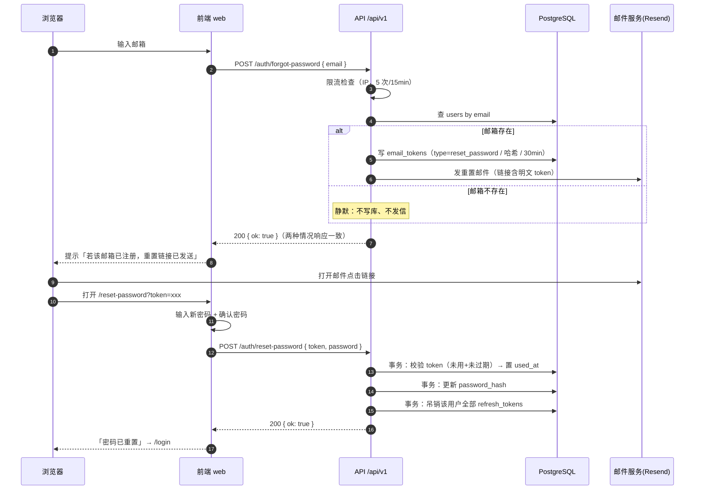
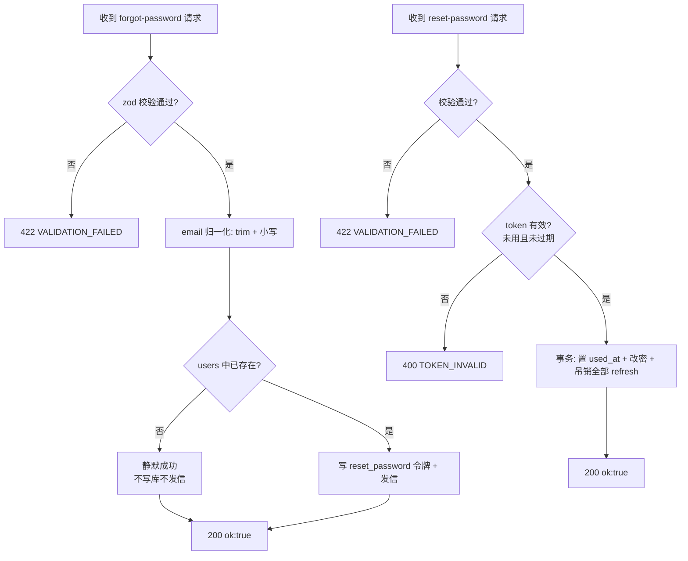

# 02 找回密码

> 版本 v1.2 ｜ 更新 2026-11-06 ｜ 状态：已实现
> 确认：李顺 · 2026-11-05 ｜ 变更：v1.1 补 F-07——重置成功后必须清本地会话（后端已吊销全部 refresh，前端残留 access 会造成「密码改了但页面还是登录态」）；v1.2 前端两页落地到设计稿 R7–R10，补 §6 实际与方案的偏差
> 关联：《需求文档》§4 核心能力 / §6 安全基线、《技术方案设计》§5.3 认证设计、`知识点/M2-01-认证链路JWT双令牌`、`01-注册与登录`
>
> **一页速览**
> 接口：`POST /auth/forgot-password` · `POST /auth/reset-password`
> 前端落点：`pages/ForgotPassword`、`pages/ResetPassword`、`shared/api/auth.ts`
> 后端落点：`src/modules/auth/{auth.controller,auth.service,token.service,mail.service}.ts`（复用 email_tokens，type 扩 `reset_password`）
> 关键异常：`TOKEN_INVALID` / `VALIDATION_FAILED` / `RATE_LIMITED`

---

## 1. 需求

### 1.1 用户故事

| 编号 | 角色 | 诉求 | 目的 |
|------|------|------|------|
| US-01 | 已注册用户 | 忘记密码时，用邮箱申请重置链接 | 不联系管理员也能自助找回账号 |
| US-02 | 已注册用户 | 点重置链接并设置新密码 | 恢复登录能力 |
| US-03 | 已注册用户 | 重置成功后，其它设备上的登录态失效 | 防止账号被他人继续占用 |

### 1.2 验收标准

每条都能直接翻译成一条测试用例，测试用例不得超出此表范围。

| 编号 | 标准 |
|------|------|
| AC-01 | `forgot-password` 对任意邮箱（存在或不存在）都返回 `200`，`data` 固定为 `{ ok: true }`，响应体与耗时一致，不泄露账号是否存在 |
| AC-02 | 邮箱存在且已注册时，`email_tokens` 新增一条 `type=reset_password`、`expires_at` = 创建时间 + 30min、`token_hash` 为 64 位 hex；明文令牌只出现在邮件链接里 |
| AC-03 | 邮箱不存在时，不写 `email_tokens`、不发邮件，但仍返回 `200 { ok: true }` |
| AC-04 | `reset-password` 成功返回 `200 { ok: true }`，且**同一事务内**完成：`users.password_hash` 更新（bcrypt cost=12）、该 token `used_at` 置位、该用户**全部** `refresh_tokens.revoked_at` 置位 |
| AC-05 | token 不存在 / 已使用 / 已过期 → 一律 `400 TOKEN_INVALID` |
| AC-06 | 新密码不符合 `resetPasswordSchema` → `422 VALIDATION_FAILED`，`details` 含字段级错误 |
| AC-07 | 重置后旧密码登录失败、新密码登录成功 |
| AC-08 | 重置后该用户所有旧 refresh token 刷新 → `401 UNAUTHORIZED`（他端下线） |
| AC-09 | 同一 token 二次重置 → `400 TOKEN_INVALID` |
| AC-10 | 所有响应符合统一体（同 01 AC-15） |
| AC-11 | `forgot-password` 同一 IP 15 分钟内超过 5 次 → `429 RATE_LIMITED` |

### 1.3 范围外

- 短信 / 图形验证码找回（v2）
- 通过安全问题找回
- 改密后发送「密码已重置」通知邮件（本期只重置，不额外通知）
- 重置历史审计（`audit_logs` 落库属 M2 任务，本期只留调用点）

---

## 2. 交互逻辑

### 2.1 申请重置 → 设置新密码



### 2.2 重置路径判定



### 2.3 异常分支表

| # | 触发条件 | HTTP | 错误码 | 前端表现 |
|---|---------|------|--------|---------|
| 1 | 字段缺失 / 邮箱格式错 / 密码强度不足 | 422 | `VALIDATION_FAILED` | 字段下方红字，取 `details` 定位 |
| 2 | token 不存在 / 已用 / 已过期 | 400 | `TOKEN_INVALID` | 页面错误态：链接无效，提供「重新发送」 |
| 3 | 申请重置过于频繁 | 429 | `RATE_LIMITED` | 提示「尝试过于频繁，请 15 分钟后再试」 |

> 与 01 一致：认证族异常必须显式抛 `{ code, message }`，不能依赖 filter 的 `409 → SUBSCRIPTION_STATE_INVALID` 兜底。

---

## 3. 前端改动

### 3.1 待改动

| # | 文件 | 改动 |
|---|------|------|
| F-01 | `pages/ForgotPassword/index.tsx`（新增） | 邮箱表单（复用 `email` 校验）；提交调 `forgotPassword()`；无论结果都提示「若该邮箱已注册，重置链接已发送」 |
| F-02 | `pages/ResetPassword/index.tsx`（新增） | 读 `?token=`；新密码 + 确认密码（复用 `resetPasswordSchema` + confirmPassword refine）；提交调 `resetPassword()`；成功跳 `/login`，失败按异常表展示 |
| F-03 | `shared/api/auth.ts` | 新增 `forgotPassword` / `resetPassword` 两个请求函数 + 出参类型 |
| F-04 | `pages/Login/index.tsx` | 「忘记密码?」链接从占位提示改为跳转 `/forgot-password` |
| F-05 | `app/router.tsx` | 注册 `/forgot-password`、`/reset-password`（公共路由） |
| F-06 | `constants/errorCode.ts` | 补 `TOKEN_INVALID` / `RATE_LIMITED` 相关文案（若 01 已覆盖则复用） |
| F-07 | `pages/ResetPassword/index.tsx` | 重置成功后**清本地会话再跳登录**：后端已在事务内吊销该用户全部 refresh，但浏览器内存里可能仍有旧 access，不清会出现「密码改了、页面还是登录态」的错觉。顺序为 `resetPassword()` → `useAuthStore.getState().clear()` → `queryClient.clear()` → 跳 `/login` |

### 3.2 错误码 → 文案映射

| 错误码 | 文案 | 展示位置 |
|--------|------|---------|
| `VALIDATION_FAILED` | 按 `details` 字段级展示 | 字段下方 |
| `TOKEN_INVALID` | 链接无效或已过期，请重新获取 | 页面错误态 |
| `RATE_LIMITED` | 尝试过于频繁，请 15 分钟后再试 | 表单级 Alert |

---

## 4. 后端接口

### 4.1 接口清单

统一前缀 `/api/v1`，两个接口均 `@Public()`。

| # | 方法 | 路径 | 鉴权 | 入参 | 出参 `data` | 成功 | 失败 |
|---|------|------|------|------|------------|------|------|
| 1 | POST | `/auth/forgot-password` | 公开 | `{ email }` | `{ ok: true }` | 200 | 422 / 429 |
| 2 | POST | `/auth/reset-password` | 公开 | `{ token, password }` | `{ ok: true }` | 200 | 422 / 400 `TOKEN_INVALID` |

出参类型与 zod schema 放 `packages/shared`（新增 `forgotPasswordSchema`、`resetPasswordSchema`、`resetPasswordResultSchema`），前端 `z.infer` 复用。

### 4.2 数据模型

**不新增表、不新增迁移**——`email_tokens` 的 `EmailTokenType` 枚举已含 `reset_password`（`20261103022859_auth_tokens` 已建）。

| 表 | 用途 | 关键约束 |
|----|------|---------|
| `email_tokens` | 复用：`type` 新增 `reset_password` 使用场景 | `used_at` 非空即已消费；`expires_at` +30min |
| `users` | 更新 `password_hash` | bcrypt cost=12 |
| `refresh_tokens` | 重置后批量吊销 | `revoked_at` 置位（改密吊销全部） |

### 4.3 关键约束

**事务边界**
- `reset-password`：token `used_at` 置位 + `users.password_hash` 更新 + 该用户全部 `refresh_tokens.revoked_at` 置位，三者同一事务（AC-04）。漏事务会造成"密码已改但旧会话仍在"或"token 已消费但密码没改"。

**并发与幂等**
- token 消费：`updateMany({ where: { id, used_at: null } })` 判断影响行数，为 0 即已被消费（与 01 验证同模式），防重放。
- `forgot-password` 可重复申请：每次申请生成**新** token 并插入，不覆盖旧 token；旧 token 在成功重置后被 `used_at` 标记，天然失效。

**安全**
- 防枚举：邮箱不存在与存在时响应体、状态码、耗时完全一致（不存在时不发信、不写库，但响应仍为 `200 { ok:true }`）。
- 令牌只存哈希：`sha256(token)` → 64 位 hex；明文只出现在邮件链接。
- 重置链接指向前端：`${APP_WEB_URL}/reset-password?token=xxx`。
- bcrypt cost = 12。
- 改密吊销全部 refresh：防止攻击者利用已泄露的 refresh token 在改密后继续访问（对应 `RefreshToken.revokedAt` 注释「改密吊销全部」）。

**限流**
`@nestjs/throttler` 对 `/auth/forgot-password` 按 IP，5 次 / 15 分钟；超限抛 `RATE_LIMITED`。`/auth/reset-password` 依赖 token 本身的一次性，不再额外限流。

**邮件发送**
复用 `MailService`，新增 `sendResetPasswordEmail(to, token)` 方法，逻辑与 `sendVerifyEmail` 同构：`MAIL_DEV_MODE=true` 时不发信、链接打日志。

---

## 5. 测试

### 5.1 单测（Vitest，`src/modules/auth/*.spec.ts`）

| 目标 | 用例 |
|------|------|
| `AuthService.forgotPassword` | 邮箱存在写 token + 发信；邮箱不存在不写不发但返回 `{ok:true}`；token 类型为 `reset_password`、TTL 30min |
| `AuthService.resetPassword` | 正常改密 + 置 used_at + 吊销全部 refresh；token 不存在/已用/过期分别抛 `TOKEN_INVALID`；并发第二次失败 |
| `MailService.sendResetPasswordEmail` | 链接拼接正确（`APP_WEB_URL/reset-password`） |

### 5.2 e2e 用例矩阵（Supertest，`test/auth.e2e-spec.ts` 追加）

> 测试库约束同 01 §5.2（`DATABASE_URL_TEST` 独立库，用例前清空相关表）。

| # | 场景 | 期望 |
|---|------|------|
| E-21 | 已注册邮箱申请重置 | 200 `{ok:true}`；`email_tokens` 1 条 `type=reset_password` |
| E-22 | 未注册邮箱申请重置 | 200 `{ok:true}`；`email_tokens` 0 条；响应体与 E-21 一致 |
| E-23 | 用有效 token 重置 | 200；`password_hash` 变化；该 token `used_at` 非空；该用户全部 `refresh_tokens.revoked_at` 非空 |
| E-24 | 旧密码登录 | 401 `UNAUTHORIZED` |
| E-25 | 新密码登录 | 200 |
| E-26 | 重复重置同一 token | 400 `TOKEN_INVALID` |
| E-27 | 重置过期 token | 400 `TOKEN_INVALID` |
| E-28 | 弱密码重置 | 422 `VALIDATION_FAILED` |
| E-29 | 重置后旧 refresh 刷新 | 401 `UNAUTHORIZED` |
| E-30 | 申请重置超限 | 429 `RATE_LIMITED` |

### 5.3 手工验证清单

```bash
BASE=http://localhost:3000/api/v1

# 1 申请重置（邮箱存在或不存在都返回 200 ok:true）
curl -s -X POST $BASE/auth/forgot-password -H 'Content-Type: application/json' \
  -d '{"email":"me@example.com"}' | jq

# 2 从服务端日志取 token，重置
curl -s -X POST $BASE/auth/reset-password -H 'Content-Type: application/json' \
  -d '{"token":"<token>","password":"NewPassw0rd"}' | jq

# 3 旧密码登录应 401，新密码应 200
curl -s -X POST $BASE/auth/login -H 'Content-Type: application/json' \
  -d '{"email":"me@example.com","password":"Passw0rd"}' | jq
curl -s -X POST $BASE/auth/login -H 'Content-Type: application/json' \
  -d '{"email":"me@example.com","password":"NewPassw0rd"}' | jq
```

前端手工验证：登录页点「忘记密码」→ 输邮箱 → 提示已发送 → 查邮件/日志 → 点链接 → 设新密码 → 旧密码登录失败、新密码成功 → 其它设备会话失效。

---

## 6. 实际与方案的偏差

> 2026-11-06 前端落地为设计稿 R7–R10 四屏后回写。接口契约与后端行为未偏离，偏差集中在「交互形态」与「文案可否落地」。

| # | 方案原文 | 实际实现 | 原因 |
|---|---------|---------|------|
| D-01 | F-01：提交后 `message` 提示「若该邮箱已注册，重置链接已发送」 | 提交成功后切到独立屏 R8「邮件已发送」，含邮箱回显、60s 重发冷却、返回登录 | 设计稿 R8 就是独立屏；toast 承载不了「没收到怎么办」这类后续指引 |
| D-02 | F-02：成功跳 `/login` | 成功时先 `useAuthStore.clear()` + `useTenantStore.clear()` + `queryClient.clear()`，再跳 `/login` 并给成功提示 | F-07 的落地形式；顺带清掉租户缓存，避免换号后残留上一个账号的团队 |
| D-03 | F-06：在 `constants/errorCode.ts` 补 `TOKEN_INVALID` / `RATE_LIMITED` 文案 | 未建该文件，两处文案就近放在页面 `constants.ts` 与 `message.error` 里 | §24 约定页面私有文案放 `pages/<Name>/constants.ts`；这两个码只在本流程出现，集中映射表反而多一层 |
| D-04 | R9 副标题「为 lishun@example.com 设置新密码」 | 改成「请为你的账号设置新密码」 | `?token=` 只带令牌，库里只存 `sha256(token)`，反查不出邮箱；要显示邮箱得新增预检接口，本期不改后端 |
| D-05 | 共用 S1 的 `AuthShell`（带登录/注册 Tab） | 新增 `components/auth/AuthCard` 承载无 Tab 的单事卡，`AuthShell` 改为内部复用它 | R7–R12 六屏都没有 Tab；不抽壳会出现 6 份 360 卡片的复制粘贴 |

前端单测：`pages/{ForgotPassword,ResetPassword,VerifyEmail}/index.test.tsx` 共 6 条，覆盖两态渲染与「无 token 不发请求」。
