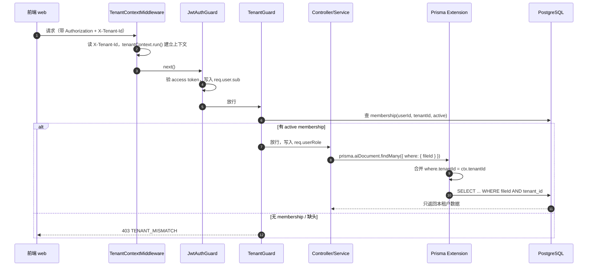
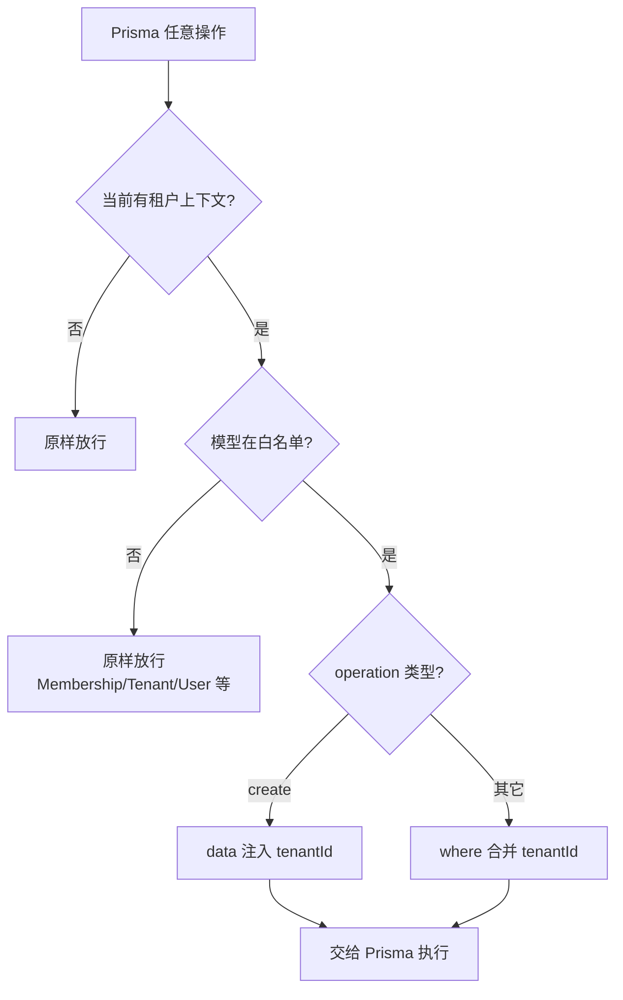

# 03 多租户行级隔离

> 版本 v1.1 ｜ 更新 2026-11-05 ｜ 状态：已实现
> 确认：李顺 · 2026-11-04
> 变更：v1.1（2026-11-05）修正后续功能编号引用（资源 CRUD 04→07、RBAC 06→06-RBAC与审计）；实际与方案的偏差见 `06-RBAC与审计` §6
> 关联：《需求文档》§6 多租户数据隔离设计、《技术方案设计》§5.4 多租户隔离、`知识点/M2-03-多租户行级隔离`、`知识点/M2-05-PrismaClient与依赖注入`、`01-注册与登录`
>
> **一页速览**
> 接口：本期**无新增对外接口**（机制层，业务接口留待 07-资源 CRUD）
> 前端落点：`shared/api` Axios 拦截器统一注入 `X-Tenant-Id` 头（本期后端先行，前端落点下一功能点落地）
> 后端落点：`src/prisma/tenant.extension.ts`、`src/common/middleware/tenant-context.middleware.ts`、`src/common/guards/tenant.guard.ts`、`src/prisma/{prisma.service,prisma.module}.ts`、`src/app.module.ts`
> 关键异常：`TENANT_MISMATCH`

---

## 1. 需求

### 1.1 用户故事

| 编号 | 角色 | 诉求 | 目的 |
|------|------|------|------|
| US-01 | 后端开发者 | 写租户内业务查询时，即便漏写 `tenantId` 过滤，数据也不会串到别的租户 | 消除「代码纪律失效即越权」这一行级隔离的固有风险 |
| US-02 | 后端开发者 | 在任意 Service 里拿到「当前请求属于哪个租户」的上下文，不必层层传参 | 请求级上下文贯穿异步调用链 |
| US-03 | 多租户用户 | 用 A 租户的登录态访问 B 租户的数据时被拒绝 | 租户间数据不可越权访问 |

### 1.2 验收标准

| 编号 | 标准 |
|------|------|
| AC-01 | 带 `X-Tenant-Id` 且用户在该租户有 `status=active` 的 membership 时，`TenantGuard` 放行，并把 `role` 写入 `req.userRole` |
| AC-02 | 缺少 `X-Tenant-Id` 头、或头为空字符串 → `403 TENANT_MISMATCH`，且不查库 |
| AC-03 | `X-Tenant-Id` 指定租户内无该用户 active membership → `403 TENANT_MISMATCH` |
| AC-04 | 白名单模型（`AiDocument`/`AiChunk`）的 `create` 自动注入 `data.tenantId`（业务代码不传、也不会传错） |
| AC-05 | 白名单模型的 `findMany`/`findFirst`/`update`/`delete` 等非 create 操作自动合并 `where.tenantId` |
| AC-06 | 非白名单模型（`Membership`/`Tenant`/`User` 等）与无租户上下文时，扩展**原样放行**、不注入任何过滤 |
| AC-07 | 租户上下文由 `TenantContextMiddleware` 从 `X-Tenant-Id` 头建立，经 `AsyncLocalStorage` 贯穿整条请求链 |
| AC-08 | 现有接口（`GET /tenants`、`/auth/*`）不受中间件与守卫影响，行为不变 |
| AC-09 | 全部现有单测仍通过；新增 `tenant.guard.spec.ts` 与 `tenant.extension.spec.ts` 通过 |

### 1.3 范围外

- **租户内的业务接口**（资源 CRUD、AI 文档等）：留待 07-资源 CRUD，本期只落地「隔离机制」，不造无业务意义的临时接口
- RBAC 按钮级权限（`RolesGuard`）：留待 06-RBAC与审计，本期 `TenantGuard` 只把 `role` 挂到请求上，不做角色拦截
- schema 物理隔离（每租户独立 schema，B 方案）：v1 不实施，仅保留迁移路径
- 前端 Axios 拦截器注入 `X-Tenant-Id`：与 04 资源 CRUD 的前端部分一并落地

---

## 2. 交互逻辑

### 2.1 请求链路的隔离机制



### 2.2 扩展拦截分支



### 2.3 异常分支表

| # | 触发条件 | HTTP | 错误码 | 前端表现 |
|---|---------|------|--------|---------|
| 1 | 缺少 `X-Tenant-Id` 头（或空串） | 403 | `TENANT_MISMATCH` | 提示缺少租户上下文，返回选租户页 |
| 2 | 该用户在此租户无 active membership | 403 | `TENANT_MISMATCH` | 提示无权访问该租户 |

> 本期没有受 `TenantGuard` 保护的真实路由，异常分支的端到端触发留待 07-资源 CRUD 验证；本期通过单测覆盖（§5.1）。

---

## 3. 前端改动

### 3.1 现状

- 前端 Axios 实例已配置 `withCredentials`（配合 refresh cookie），但**尚未注入 `X-Tenant-Id` 头**。
- 租户选择后的「当前租户」状态已存在（`GET /tenants` 返回列表），切换逻辑待 04 落地。

### 3.2 待改动（下一功能点落地）

| # | 文件 | 改动 |
|---|------|------|
| F-01 | `shared/api` 的 Axios 拦截器 | 从当前租户状态取 id，统一注入 `X-Tenant-Id` 请求头 |
| F-02 | 租户切换逻辑 | 切换租户时更新「当前租户」状态，后续请求自动携带新租户 id |

> 本期后端先行，前端这两处与 07-资源 CRUD 的前端部分一起实现，避免为纯后端机制先改前端。

---

## 4. 后端实现

### 4.1 实现清单

统一前缀 `/api/v1`，本期**无新增接口**。核心是四类组件的装配：

| # | 文件 | 动作 | 职责 |
|---|------|------|------|
| B-01 | `src/prisma/tenant.extension.ts` | 新增 | 定义 `tenantContext`（AsyncLocalStorage）+ `tenantScopedExtension()`（defineExtension） |
| B-02 | `src/prisma/prisma.service.ts` | 改造 | 挂扩展，导出 `extendedClient` 与 `ExtendedPrismaClient` 类型 |
| B-03 | `src/prisma/prisma.module.ts` | 改造 | 用 `PRISMA` token + `useValue` 提供扩展后的 client |
| B-04 | `src/common/middleware/tenant-context.middleware.ts` | 新增 | 读 `X-Tenant-Id`，`tenantContext.run()` 建立上下文 |
| B-05 | `src/common/guards/tenant.guard.ts` | 新增 | 校验 membership，通过后写 `req.userRole` |
| B-06 | `src/modules/tenants/tenants.service.ts` | 改造 | 注入从 `PrismaService` 换成 `@Inject(PRISMA)` |
| B-07 | `src/app.module.ts` | 改造 | 装配中间件 + 注册 TenantGuard（APP_GUARD） |
| B-08 | `src/common/types/authenticated-request.ts` | 改造 | 增加 `userRole?` 字段 |

### 4.2 数据模型变更

**不新增表、不新增迁移**。本期复用既有 `memberships` 表（`tenant_id` + `user_id` + `role` + `status`，含 `@@unique([tenantId, userId])`），作为租户隔离的判定依据。

白名单模型（当前 schema 里真实含 `tenant_id` 的业务模型）：

| 模型 | 表 | 说明 |
|------|----|------|
| `AiDocument` | `ai_documents` | AI 知识库文档，`tenant_id` 必备索引 |
| `AiChunk` | `ai_chunks` | AI 切片，`tenant_id` 冗余列 + 复合索引 |

**不进白名单**（关键约束，见 §4.3）：

| 模型 | 不隔离原因 |
|------|-----------|
| `Membership` | 「谁能进租户」的元数据；TenantGuard 在建立上下文前就要查它，隔离会自相矛盾 |
| `Tenant` | 租户主体，按 id 定位，非租户内业务数据 |
| `User` | 全局认证主体 |
| `EmailToken` / `RefreshToken` | 认证域，按 userId 定位 |

### 4.3 关键约束

**白名单的「先建表后补名单」纪律**
- `TENANT_SCOPED` 只列当前 schema 里真实存在的模型。文档《后端实施指南》§8.2 原样里的一长串（`Resource`/`File`/`Subscription`/`Invoice`…）都是后续里程碑才建的表，现在列进去会引用不存在的模型名、编译不过。
- 后续每建一张含 `tenant_id` 的表，**必须同步**把 model 名补进白名单，否则该表会漏隔离（这是本方案最危险的隐性坑）。

**Membership 不进白名单**
- `TenantGuard` 要查 membership 判断「用户是否属于该租户」，而守卫执行时租户上下文尚未建立（上下文正是靠这次查询才建立的）。若 Membership 也被强制合并 `tenantId`，守卫查询会被扩展「加持」一个来自空/上一个请求的 `tenantId`，导致误判。
- membership 是元数据，不是「租户内的业务数据」，语义上也不该被隔离。

**Prisma 扩展的类型接线（本功能点最易卡壳处）**
- `PrismaService extends PrismaClient` 得到的实例**不含** `$extends` 扩展能力；直接注入 `PrismaService` 用 `this.prisma.aiDocument.findMany()` 扩展不会生效。
- 正确接法：`prisma.service.ts` 里 `export const extendedClient = PrismaClient.$extends(tenantScopedExtension())`，`prisma.module.ts` 用 `PRISMA` token + `useValue: extendedClient` 提供；业务代码 `@Inject(PRISMA) private readonly prisma: ExtendedPrismaClient`。
- token 放 `prisma.module.ts`（`export const PRISMA = Symbol('PRISMA')`），类型放 `prisma.service.ts`（`export type ExtendedPrismaClient`），业务代码两处 import。

**守卫执行顺序**
- `APP_GUARD` 数组顺序即执行顺序：`ThrottlerGuard → JwtAuthGuard → TenantGuard`。JwtAuthGuard 必须先跑（先确定 `req.user.sub`），TenantGuard 才能用 `req.user.sub` 查 membership。顺序不可颠倒。

**业务纪律（沿用《技术方案设计》§5.4）**
- 任何 Controller/Service **永不从请求参数读 tenantId**，租户上下文只来自 `X-Tenant-Id` 头 + 扩展注入。
- `TenantContextMiddleware` 只建立上下文、不做权限校验（无头时也放行），拒绝交给 `TenantGuard`。

**隔离三道防线（缺一不可）**
1. `TenantGuard` 校验 membership（防越权进入）
2. Prisma Extension 自动合并 `tenantId`（防漏写过滤，代码纪律失效时的兜底）
3. 跨租户越权回归测试（防回归，随 07 资源 CRUD 补齐）

**安全**
- 越权（IDOR）是本方案要防的核心风险；本功能点落地后，应在《安全规范》§4 追加一条「03 多租户行级隔离」记录。

---

## 5. 测试

### 5.1 单测（Vitest）

| 目标 | 文件 | 用例 |
|------|------|------|
| `TenantGuard` | `src/common/guards/tenant.guard.spec.ts` | 缺头 403；空串 403 且不查库；无 active membership 403；有 membership 放行并写 `req.userRole`，且查询带 `status:'active'` |
| `tenantScopedExtension` | `src/prisma/tenant.extension.spec.ts` | 有上下文 + create + 白名单 → 注入 `data.tenantId`；有上下文 + findMany + 白名单 → 合并 `where.tenantId`；非白名单原样放行；无上下文原样放行 |

### 5.2 e2e 用例矩阵（跨租户越权，随 07 落地补齐）

> 本期无受 TenantGuard 保护的业务接口，跨租户越权的 e2e 用例留待 07-资源 CRUD 一并写（届时才有「租户内资源」可越权访问）。本期 e2e 仅回归现有接口不受影响（AC-08）。

| # | 场景 | 期望 | 状态 |
|---|------|------|------|
| E-31 | 带 access token 请求 `GET /tenants`（无 X-Tenant-Id） | 200，行为不变 | 本期验证 |
| E-32 | 带 access token 请求 `/auth/me`（无 X-Tenant-Id） | 200，行为不变 | 本期验证 |
| E-33 | 租户 B 的 token 访问租户 A 的资源 | 403 / 404 | 随 07 落地 |

### 5.3 手工验证清单

```bash
# 1 类型检查（脚本名是 typecheck，不是 type-check）
pnpm --filter @saas/api typecheck

# 2 单测（确认新增两个 spec 通过，现有 spec 不回归）
pnpm --filter @saas/api test

# 3 回归：现有接口不受中间件/守卫影响
#    - 登录后 GET /tenants 正常返回
#    - GET /auth/me 正常返回
```

> 本期手工验证的重点是「机制不破坏现状」（AC-08）；Guard 的端到端拦截效果待 04 资源 CRUD 时验证。
