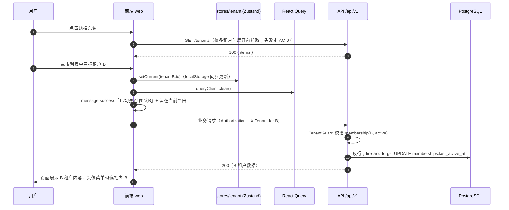
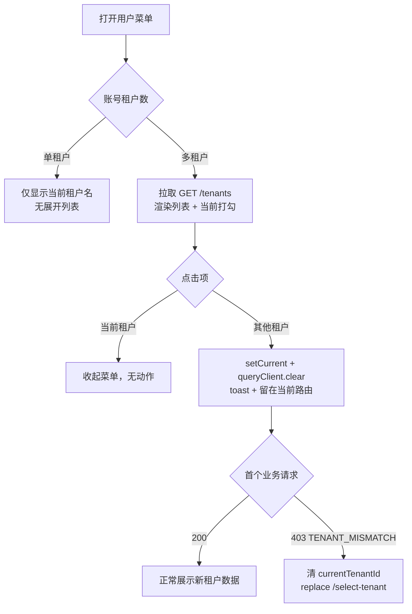

# 04 租户创建与切换

> 版本 v1.1 ｜ 更新 2026-11-10 ｜ 状态：已确认
> 确认：李顺 · 2026-11-06 ｜ 变更：v1.0 定稿——切换为**纯前端行为**（遵循 01 v1.1 请求级租户上下文），无新增接口；租户创建明确不做
> v1.1（2026-11-10）：**推翻「租户创建不做」**。被 owner/admin 移出后用户会落到 0 个团队，此时除退出登录外无路可走；新增 `POST /tenants`（创建者即 owner）与「被移出」的 403 兜底，`/select-tenant` 从「选择页」变为「落点/自救页」。加入团队（邀请码/邀请链接）仍不做，依赖 `05-成员与邀请`
> 关联：《需求文档》§5.1 用户中心（租户切换）、§6 多租户数据隔离；《01-注册与登录》§3.4/§4.3（X-Tenant-Id 机制、AC-19/20）、《03-多租户行级隔离》（TenantGuard）、`05-成员与邀请`（多租户的唯一来源）
>
> **一页速览**
> 接口：`GET /tenants`（已有）、**`POST /tenants`（v1.1 新增）**；切换本身不调任何接口
> 前端落点：`components/UserMenu`（头像下拉切换）、`pages/_guarded/select-tenant`（落点/自救页）、`shared/api/client.ts`（403 兜底）、`stores/tenant.ts`（`removedNotice`）
> 后端落点：`modules/tenants`（新增 create 事务）、`src/common/guards/tenant.guard.ts`（增量：放行后更新 `last_active_at`）
> 关键异常：`TENANT_MISMATCH`（复用 03）

---

## 1. 需求

### 1.1 用户故事

| 编号 | 角色 | 诉求 | 目的 |
|------|------|------|------|
| US-01 | 多租户用户 | 在顶栏头像下拉里直接切到另一个租户 | 不用进设置页，两步完成上下文切换 |
| US-02 | 多租户用户 | 在设置页看到当前租户并切换 | 低频场景有详情入口，与原型 S12 一致 |
| US-03 | 所有用户 | 头像菜单常驻显示当前所在租户 | 清楚知道"我现在在谁的租户里操作" |
| US-04 | 多租户用户 | 切换后列表/看板立即展示新租户数据 | 不残留上一租户内容（防串数据） |

### 1.2 验收标准

| 编号 | 标准 |
|------|------|
| AC-01 | 顶栏用户菜单常驻展示当前租户名；多租户账号可展开租户列表（来自 `GET /tenants`，按 `lastActiveAt` 降序），当前项带勾选标记 |
| AC-02 | 单租户账号菜单只显示当前租户名，不渲染可展开列表（列表仅一项时无切换意义） |
| AC-03 | 点击列表中其他租户：`stores/tenant.setCurrent(id)` → `queryClient.clear()` → 站内路由保持在当前页并重新拉取数据；**全程无 `/auth/*` 调用**（切换不产生/更换任何令牌） |
| AC-04 | 设置页「当前工作区」下拉与头像菜单同源（`stores/tenant`）：任一处切换，另一处即时同步；切出当前页前数据已清空重建（AC-03 同款） |
| AC-05 | 本地残留的 `currentTenantId` 指向已无 active membership 的租户（被移除/禁用后未重新登录）：首个业务请求返回 `403 TENANT_MISMATCH` → 前端清 `currentTenantId` 并 `replace` 到 `/select-tenant`（复用 01 AC-19 分流逻辑） |
| AC-06 | 切换成功后，后续业务请求的 `X-Tenant-Id` 为新租户 id；该租户的 `memberships.last_active_at` 被更新，`GET /tenants` 排序随之变化 |
| AC-07 | 切换时菜单租户列表刷新失败（网络/401）：菜单仍显示持久化的当前租户名（`stores/tenant` persist），列表置为加载失败态可重试，不阻断菜单其余项（个人中心/退出登录） |
| AC-08 | 头像菜单与 `/select-tenant` 数据同源且状态一致：在 `/select-tenant` 选择的租户，进 `/app` 后头像菜单勾选标记与之相符 |
| AC-09 | 用户被 owner/admin 移出当前团队后，首个业务请求返回 `403 TENANT_MISMATCH`：请求层清 `currentTenantId` 与**全部查询缓存**（含 `['tenants']`，否则落点层会用旧列表把他选回已失效团队、形成 403 循环），提示「你已不在该团队中」；还有别的团队则自动落到最近使用的那个并说明原因 |
| AC-10 | 失去全部团队后落到 `/select-tenant`：展示「还没有加入任何团队」并给**创建团队**表单，创建成功即成为 owner 并进入 `/app`；邀请加入按 §1.3 留待 05，页面上只给说明文案，不放假输入框 |

### 1.3 范围外

- **加入团队（邀请码 / 邀请链接）**：v1.1 起 `/select-tenant` 留了「邀请加入」的说明位，但后端尚无 `invites` 表与兑换接口，随 `05-成员与邀请` 一并落地。**当前只有「创建团队」这一条自救路径闭环**
- **租户创建配额**：明确不做。不设「单用户最多拥有 N 个团队」的限制（决策 2026-11-10），滥用风险留待后续按实际数据再评估
- **被移出租户后的数据清理**：服务端已有行级隔离兜底（03），前端只处理 `TENANT_MISMATCH` 的重定向（AC-05）
- **多标签页状态同步**：`BroadcastChannel` 广播仍是 01 §3.4 的已知限制，本期不做
- **待激活成员的展示**：`GET /tenants` 契约只返回 `active`（shared `roles.ts`），待激活账号无法登录、不产生切换场景，无需置灰态

---

## 2. 交互逻辑

### 2.1 切换主流程



### 2.2 分支流程



### 2.3 异常分支表

| # | 触发条件 | HTTP | 错误码 | 前端表现 |
|---|---------|------|--------|---------|
| 1 | 本地租户上下文指向无 active membership 的租户 | 403 | `TENANT_MISMATCH` | 清 `currentTenantId` → `/select-tenant`（复用 01 分流） |
| 2 | 菜单展开时 `GET /tenants` 失败 | 4xx/5xx | — | 列表区显示「加载失败，点击重试」，菜单其余项可用 |
| 3 | 切换后请求携带旧 `X-Tenant-Id`（并发竞态） | 403/200 | — | 拦截器每次请求实时读 store；`queryClient.clear()` 后无重放旧上下文的缓存请求，竞态窗口不存在 |

> 切换本身无后端写操作，因此无 4xx 业务错误码；本表只有"切换后世界的异常"。

---

## 3. 前端改动

### 3.1 现状

| 文件 | 现状 |
|------|------|
| `stores/tenant.ts` | 已有：`tenants` / `currentTenantId`（persist 至 `localStorage.saas.tenant`）、`setCurrent`、`clear`——本方案**零改动** |
| `shared/api/tenants.ts` | 已有：`listTenants()` 封装 `GET /tenants` |
| `pages/SelectTenant` | 已有：登录后多租户选择页（01 F-10），作为 AC-05 的回落目标 |
| 顶栏布局 | 目前只有面包屑 + 铃铛 + 静态头像（原型 `.hd` 结构），无下拉菜单 |
| `pages/Settings` 个人中心 | 「当前工作区」字段待接真实数据（原型 S12 占位） |
| Axios 拦截器注入 `X-Tenant-Id` | 03 §3.2 排期：随本功能点一并落地（切换后的请求才携带正确头，AC-06 依赖它） |

### 3.2 待改动

| # | 文件 | 改动 |
|---|------|------|
| F-01 | `shared/api/client.ts` 请求拦截器 | 注入 `X-Tenant-Id`（读 `stores/tenant.currentTenantId`）；`/auth/*`、`/tenants` 跳过注入（01 F-12 的既定设计，在此落地） |
| F-02 | `components/TenantSwitcher/`（新增） | 头像下拉菜单：当前租户名常驻；多租户展开列表（antd Dropdown，列表项显示租户名 + 角色 tag）；底部「个人中心」「退出登录」。单租户不渲染列表（AC-02） |
| F-03 | `components/TenantSwitcher/useSwitchTenant.ts`（新增） | 切换动作：`setCurrent` → `queryClient.clear()` → `message.success` → 留在当前路由。唯一写点，供菜单与设置页共用 |
| F-04 | `pages/Settings` 个人中心卡片 | 「当前工作区」改为 Select 下拉：选项来自 `stores/tenant.tenants`，选中即调 `useSwitchTenant`（AC-04） |
| F-05 | `stores/tenant.ts` 的消费方核对 | 确认 `clear()` 在登出/`/select-tenant` 回落（AC-05）两处被正确调用 |

### 3.3 错误码 → 文案映射

| 错误码 | 文案 | 展示位置 |
|--------|------|---------|
| `TENANT_MISMATCH` | 无权访问该租户，请重新选择工作区 | 全局 toast，随后跳 `/select-tenant` |
| 列表加载失败 | 租户列表加载失败，点击重试 | 菜单列表区 |

### 3.4 落地记录（2026-11-06）

方案确认当天先落地了「回落目标」这一块，F-02～F-04 仍未做：

| 项 | 状态 | 说明 |
|---|------|------|
| `pages/SelectTenant`（AC-05 回落目标） | 已实现 | 原先只有占位 `<div>`。设计稿 R1–R15 未覆盖这一屏，按认证卡片风格（`components/auth/AuthCard`，360 宽）自拟：团队名 + 角色标签、当前项勾选、空列表给空态、底部退出登录 |
| `app/useTenantRouting.ts` 挂载 | 已实现 | 挂在 `AuthLayout`，进 `/app` 时判定：0 个不动、1 个自动选定、多个且当前无效跳 `/select-tenant` |
| `shared/api/client.ts` 的 `X-Tenant-Id`（F-01） | 已实现 | `/auth/*`、`/tenants` 走白名单跳过注入 |
| `components/TenantSwitcher`（F-02/F-03）与设置页下拉（F-04） | 未做 | 顶栏下拉与设置页共用 `useSwitchTenant`，随本功能点补齐 |

两处与方案的差异：

- **切换后 `queryClient.clear()` 不在这里做**：`/select-tenant` 是"还没有进入工作台"的状态，页面本身没有业务查询缓存；清缓存留给 F-03 的 `useSwitchTenant`，两处职责不重叠。
- **`/select-tenant` 不套 `AuthLayout`**：它是进工作台的前置步骤，套上侧栏会出现"先进去再选"的视觉倒错，所以路由上只包 `RequireAuth`。

---

## 4. 后端接口

### 4.1 接口清单

**切换无接口**（01 §4.3 已定稿：令牌不含租户，上下文走请求头）；`GET /tenants` 复用（契约见 `packages/shared/src/contracts/tenant.ts`，列表只含 active membership + 未软删租户）。

v1.1 新增一个：

| 方法 | 路径 | 鉴权 | 说明 |
|---|---|---|---|
| POST | `/tenants` | 登录（`@SkipTenant`） | 创建团队，创建者即 owner。入参 `{ name }`（trim 后 2–30 字符，**不要求全局唯一**），返回与列表项同形状的 `TenantListItem`，201 |

服务端在**同一事务**内写 `tenants` + `memberships(role=owner, status=active)`：拆开写会留下「有团队、没有成员」的孤儿租户——它不出现在任何人的列表里，用户既看不到也删不掉。不标 `@Audit`：审计拦截器要求已有租户上下文，而这个接口本身就发生在上下文建立之前（增量留给审计模块）。不设配额（§1.3）。

### 4.2 数据模型变更

**不新增表、不新增字段、不新增迁移。** 复用 `memberships.last_active_at`（建表时已存在）。

### 4.3 关键约束

**`last_active_at` 的更新点（对 03 的增量补全，需在偏差中登记）**
- `TenantGuard` 校验通过、放行业务请求时，fire-and-forget `UPDATE memberships SET last_active_at = now() WHERE tenant_id AND user_id`。03 v1.1 落地的 TenantGuard 未包含此更新，导致 `GET /tenants` 排序字段恒为 null——本功能点顺带补全（AC-06）
- 更新失败只记 error 日志，不影响主请求（与 06 审计拦截器同款容错纪律）

**审计**
- 切换**不写** `audit_logs`：无后端写点，且"进入租户"本身不是敏感操作；切换后的每个业务操作由各自的 `@Audit` 记录（`tenantId` 即新租户），审计链路天然覆盖
- `AUDIT_ACTIONS` 词表不新增（无 `tenant.switch`）

**安全**
- 切换无权限问题：列表接口与守卫都以 active membership 为唯一准入依据，前端展示层无法放大权限
- 防串数据的核心仍是 01 §3.4 既有约束：`queryClient.clear()` 在 `setCurrent` 同一同步块内执行，两者顺序不可颠倒

---

## 5. 测试

### 5.1 单测（Vitest）

| 目标 | 用例 |
|------|------|
| `useSwitchTenant` | setCurrent 与 queryClient.clear 同步执行且顺序正确；切换后路由不变 |
| `TenantSwitcher` | 单租户不渲染列表；多租户渲染全部项且当前项有勾选标记；`GET /tenants` 失败显示重试态且菜单其余项可用 |
| `TenantGuard`（增量） | 放行后触发 `last_active_at` 更新；更新抛错不影响主请求响应 |
| 拦截器 | 业务请求注入当前 `currentTenantId`；`/auth/*` 与 `/tenants` 不注入 |
| AC-05 回落 | 收到 `TENANT_MISMATCH` 后 store 清空并跳转 `/select-tenant` |

### 5.2 e2e 用例矩阵

> 依赖 07-资源 CRUD 提供首个受 TenantGuard 保护的业务接口后端到端验证；本功能点落地时先验证 1-2 条（用 `/tenants` 与设置接口凑链路）。

| # | 场景 | 期望 |
|---|------|------|
| E-41 | 用户属租户 A（owner）+ 租户 B（member，邀请产生），切换 A→B | 切换无 `/auth/*` 调用；B 租户业务请求 200 |
| E-42 | 切换到 B 后查 `memberships` | B 行 `last_active_at` > A 行 |
| E-43 | 将用户从 B 移除（05 接口）后，前端残留 B 上下文发业务请求 | 403 `TENANT_MISMATCH` |
| E-44 | 单租户账号 `GET /tenants` | 1 条；前端菜单无列表展开 |

### 5.3 手工验证清单

```bash
# 前置：账号 A 属于两个租户（第二个通过 05 邀请流程产生）
pnpm --filter @saas/web dev
```

1. 登录 → 头像菜单显示当前租户名；展开列表勾选标记正确
2. 切换到另一租户 → toast 提示 → 当前页数据重建、无上一租户残留；DevTools Network 确认无 `/auth/*` 调用
3. `GET /tenants` 返回顺序随切换变化（最近使用在前）
4. 设置页「当前工作区」下拉切换 → 头像菜单勾选同步变化
5. （后置到 05/07 联调）被移出租户后残留上下文 → 业务请求 403 → 跳 `/select-tenant`
