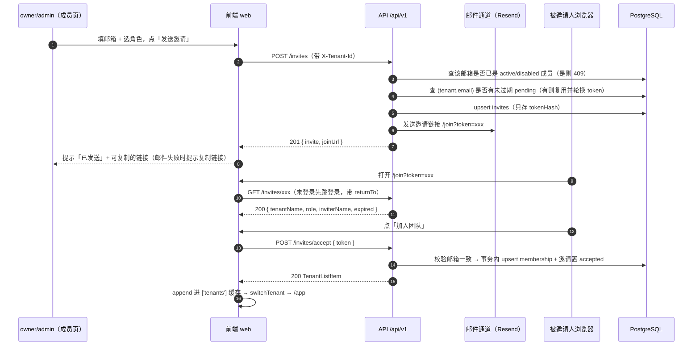
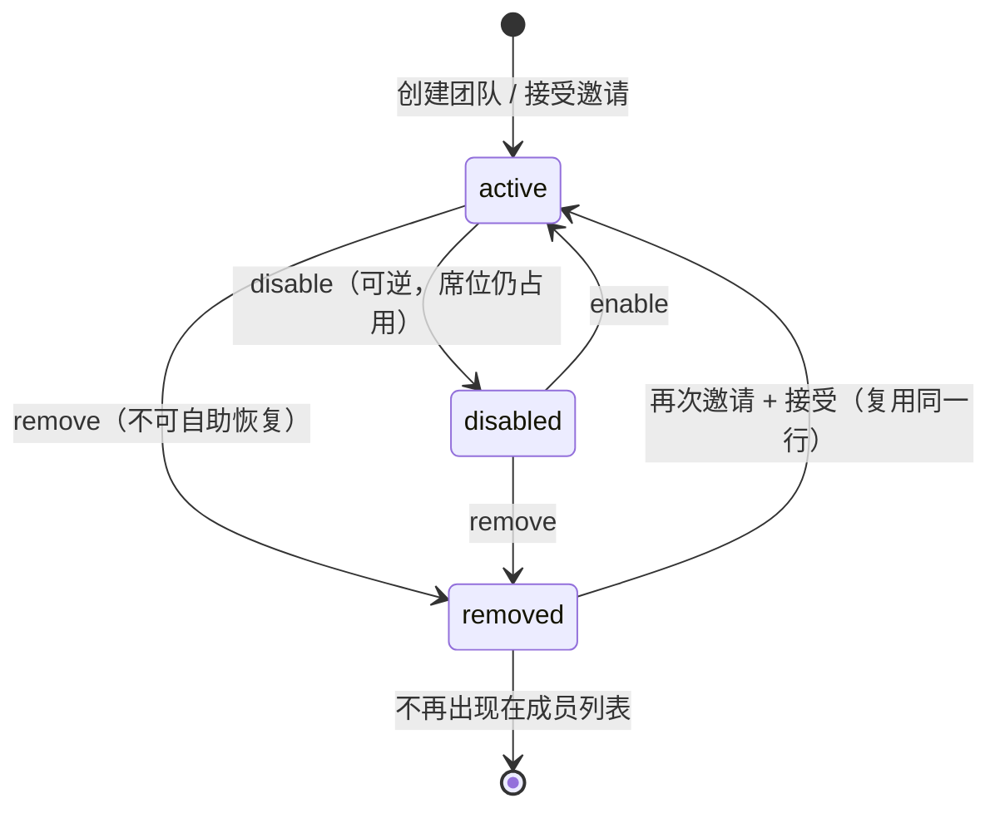

# 05 成员与邀请

> 版本 v1.2 ｜ 更新 2026-11-11 ｜ 状态：已实现（v1.2 只改范围界定与流程说明，实现落在 01）
> 确认：李顺 · 2026-11-11 ｜ 变更：v1.2 受邀注册改道——受邀请但尚无账号的人，注册时不再建默认团队、验证邮箱即入团（方案在 `01-注册与登录` §2.5），本文 §1.3 与 §2.1 相应改写；v1.1 实现完成（迁移 `20261111011742_member_invites`、后端 `modules/members`、前端成员页与 `/join`），偏差见 §6
> 关联：《需求文档》§5.1 成员生命周期、《技术方案设计》§4.6 权限渲染、§5.5 RBAC、《数据库设计与数据字典》§3 memberships、`06-RBAC与审计`（角色判定与审计机制）、`04-租户创建与切换`（多租户来源与自救页）、`01-注册与登录`（邮箱验证链路）
>
> **一页速览**
> 接口：`GET /members`、`POST /invites`、`DELETE /invites/:id`、`POST /invites/:id/resend`、`GET /invites/:token`、`POST /invites/accept`、`PATCH /members/:id`、`POST /members/:id/disable`、`POST /members/:id/enable`、`DELETE /members/:id`、`POST /members/:id/transfer-owner`
> 前端落点：`pages/app/members`（成员页，含待接受区）、`pages/_guarded/join`（接受邀请）、`shared/api/member.ts`、`components/MemberRoleSelect` 等
> 后端落点：`src/modules/members/{members,invites}.controller.ts`、`members.service.ts`、`src/common/mail/`（从 auth 上移）、`prisma/schema.prisma`（新增 `invites`）
> 关键异常：`MEMBER_STATE_INVALID` / `OWNER_TRANSFER_INVALID` / `ROLE_DENIED` / `TOKEN_INVALID` / `EMAIL_TAKEN`
> 施工顺序：见 [`05-实施步骤.md`](./05-实施步骤.md)（九步、每步自证与易错点）

---

## 1. 需求

### 1.1 用户故事

| 编号 | 角色 | 诉求 | 目的 |
|------|------|------|------|
| US-01 | 租户 owner / admin | 用邮箱邀请同事加入当前团队，对方点链接就能进 | 团队扩员不需要运维介入 |
| US-02 | 租户 owner / admin | 看到成员列表与「已邀请待接受」名单，能撤销/重发邀请 | 不出现"发了没人收到、也不知道发没发出去" |
| US-03 | 租户 owner | 调整成员角色（提 admin / 降 member）、禁用、移除 | 权限随人员职责收敛 |
| US-04 | 租户 owner | 把所有权转给另一个成员，自己降为 admin | 离职/交接时团队不会失去 owner |
| US-05 | 租户 member | 看到团队成员名单（只读），改不了任何人 | 知道同事是谁，但动不了别人 |
| US-06 | 被邀请人 | 收到邀请链接，点开即可加入；还没有账号时，注册完验证邮箱就在团队里了 | 加入路径短，不用先「自立门户」再切过去 |

### 1.2 验收标准

| 编号 | 标准 |
|------|------|
| AC-01 | `GET /members` 返回 `{ members, invites }`：`members` 为当前租户 `status in (active, disabled)` 的成员（含 `isSelf`），`invites` 为 `status=pending` 且未过期的邀请（`expired` 由 `expiresAt` 现算）。**全员可读**（member 也能看名单），不含 `removed` |
| AC-02 | `POST /invites` 入参 `{ email, role }`，`role` 只接受 `admin` / `member`（邀请 owner 走转让，不在本接口）；成功返回 `201` + `InviteItem & { joinUrl }`，`joinUrl` 形如 `{APP_WEB_URL}/join?token=<32位>`，**明文 token 只出现在这一次响应里**，库中仅存 `sha256` 哈希 |
| AC-03 | 同一 `(tenantId, email)` 已存在未过期 pending 邀请时，再次邀请**复用该行**：轮换 token、`expiresAt` 顺延 7 天、重发邮件，不新建第二条 |
| AC-04 | 邀请有效期 7 天；过期后 `GET /members` 仍返回该行但 `expired=true`，接受时返回 `410 TOKEN_INVALID`；`POST /invites/:id/resend` 轮换 token 并重置 7 天（仅 pending 行可重发，否则 `409 MEMBER_STATE_INVALID`） |
| AC-05 | `DELETE /invites/:id` 撤销：`status=revoked`，该行不再出现在 `invites` 里；撤销后 token 立即失效（`410 TOKEN_INVALID`） |
| AC-06 | `GET /invites/:token` 需登录（`@SkipTenant`），返回 `{ tenantName, role, inviterName, email, expired, accepted }`；token 不存在/已撤销 → `410 TOKEN_INVALID`。**不做匿名预览**：未登录访问前端 `/join` 先跳登录并带 `returnTo`；注册页同样拿不到团队名（不调本接口），只提示「你正在通过邀请加入团队」 |
| AC-07 | `POST /invites/accept { token }` 需登录（`@SkipTenant`）：登录邮箱必须与邀请邮箱一致，否则 `409 MEMBER_STATE_INVALID`（防止链接转发给他人使用）；成功后建 `memberships(role=邀请里的 role, status=active)` 或把 `removed` 行改回 `active`，邀请置 `accepted`，**同事务**，返回 `TenantListItem`（前端直接 append 进 `['tenants']` 缓存并切换过去） |
| AC-08 | 接受邀请时若该用户在本租户已是 `active` → 幂等返回 `TenantListItem`（邀请置 `accepted`），不重复插行、不报错；若为 `disabled` → `409 MEMBER_STATE_INVALID`（禁用必须由管理员解除，不能被邀请绕过） |
| AC-09 | 邀请的邮箱已是 `active` 成员 / 已是 `disabled` 成员 / 等于操作人自己 → 均为 `409 MEMBER_STATE_INVALID`，不落库不发信 |
| AC-10 | `PATCH /members/:id { role }`：`admin` 只能改 `member` 的角色；`owner` 可改 `admin` / `member`；目标是 `owner` → `409 OWNER_TRANSFER_INVALID`（转让走独立接口）；改自己 → `409 MEMBER_STATE_INVALID`；角色未变化时幂等返回 |
| AC-11 | `POST /members/:id/disable` 与 `/enable`：对象规则同 AC-10；`enable` 只对 `disabled` 生效（对 `active` 幂等返回）；`disable` 对 `active` 生效 |
| AC-12 | `DELETE /members/:id` 移除：`status=removed`（**不删行**，留痕），成员列表不再出现；再次邀请并接受时**复用该行**改回 `active`（`@@unique(tenantId,userId)` 决定只能复用）；不能移除自己 → `409 MEMBER_STATE_INVALID` |
| AC-13 | `POST /members/:id/transfer-owner`：仅 `owner`（`@Roles('owner')`）；目标必须是本租户 `active` 成员；**同一事务**内改 `tenants.ownerId` + 目标 `role=owner` + 原 owner `role=admin`；目标已是 owner → `409 OWNER_TRANSFER_INVALID`；无冷静期 |
| AC-14 | 上述 6 类写操作各落一条 `audit_logs`（`member.invite` / `role_change` / `disable` / `enable` / `remove` / `transfer_owner`），`result=success`；撤销与重发复用 `member.invite`。`objectType` / `objectId` 由审计拦截器统一口径决定（06 方案 §4.3：只记 `method/path/durationMs`），本期不在审计 `detail` 里追加成员 id |
| AC-15 | 登录成功写一条 `audit_logs`（`action='auth.login'`、`tenantId=null`）；**失败登录不写**（`actor_user_id` 是 NOT NULL，且失败登录可被刷量） |
| AC-16 | 禁用 / 移除后对方**下一个请求即失效**：`tenant.guard.ts` 与 `GET /tenants` 都只认 `status='active'`，无需令牌黑名单；对方前端命中 `403 TENANT_MISMATCH` 后走 04 的兜底（清上下文 → 有别的团队则回落，否则落 `/select-tenant` 并提示） |
| AC-17 | 邀请邮件发送失败**不回滚**邀请行：接口仍返回 `201` 与 `joinUrl`（前端提示"邮件可能未送达，可复制链接发送"）；库抖动同理只记日志 |
| AC-18 | 席位不设上限（`QUOTA_EXCEEDED_SEATS` 留到 M4）；口径固定为 `active memberships + 未过期 pending invites`，M4 直接复用 |
| AC-19 | 全部既有单测通过；新增 `members.service.spec.ts` 与 `pages/app/members/page.test.tsx` 通过 |

### 1.3 范围外

- **邀请码（短码）形态**：只做链接 token。短码必须额外做防枚举限流（6 位数字 10 分钟可撞完），收益不抵成本；链接本身就是"码"，复制粘贴即可
- **匿名预览邀请**：`GET /invites/:token` 需登录。未登录探测 token 会让枚举成本降到零，且页面也没有"未登录状态下的加入"这种确定性文案
- **注册流程改造（v1.3 已改道）**：被邀请人尚无账号时的注册链路移到 `01-注册与登录` §2.5——注册不建默认团队，验证邮箱时自动加入本团队。本文只约定终点一致（`invites.status=accepted` + 一条 `status=active` 的 membership）；已注册用户的接受动作不变，仍是显式点「加入团队」
- **退出团队（自愿离开）**：本期的"离开"只有被移除，成员不能自己退出。需要 owner 先转让才能离开的场景留到后续
- **席位计费与成员上限**：M4 配额模块落地
- **批量邀请 / CSV 导入**：一次一条，前端可重复操作
- **通知中心与站内信**：邀请只发邮件，站内通知随 M3 通知模块
- **审计查询页**：`GET /audit-logs` 与筛选页不在本篇，见 `06-RBAC与审计` §1.3
- **owner 转让冷静期 / 二次邮件确认**：演示项目不做，`modal.confirm` 二次确认即可

---

## 2. 交互逻辑

### 2.1 邀请 → 接受 主流程



> **被邀请人还没有账号时**（v1.2 起）：上图从「已登录」开始。对方若没有账号，登录页 → 注册这段会带上邀请令牌，注册不建默认团队，**验证邮箱时自动加入本团队**，不需要再回来点「加入团队」。这段属于认证链路，方案在 `01-注册与登录` §2.5；本文只要求终点一致——`invites.status=accepted` 加一条 `status=active` 的 membership。

### 2.2 成员状态流转



### 2.3 异常分支表

| 触发条件 | HTTP | 错误码 | 前端表现 |
|---|---|---|---|
| 邀请邮箱已是 active 成员 | 409 | `MEMBER_STATE_INVALID` | 表单红字「该邮箱已是团队成员」 |
| 邀请邮箱是 disabled 成员 | 409 | `MEMBER_STATE_INVALID` | 表单红字「该成员已被禁用，请先在列表中启用」 |
| 邀请自己 | 409 | `MEMBER_STATE_INVALID` | 表单红字「不能邀请自己」 |
| 邀请已撤销/已接受/过期的 token | 410 | `TOKEN_INVALID` | `/join` 页显示「邀请已失效，请联系管理员重新发送」 |
| 接受的账号邮箱 ≠ 邀请邮箱 | 409 | `MEMBER_STATE_INVALID` | `/join` 页提示「该邀请不是发给当前账号的（<email>）」 |
| 接受的账号在该租户被 disabled | 409 | `MEMBER_STATE_INVALID` | 同上提示「你已被移出该团队的管理范围，请联系管理员」 |
| admin 改 admin / owner 的角色 | 403 | `ROLE_DENIED` | 行内下拉对该行不可用（前端先隐藏，后端兜底） |
| 改自己的角色 / 移除自己 | 409 | `MEMBER_STATE_INVALID` | 当前用户那一行的操作项 disabled |
| 目标已是 owner 还点转让 | 409 | `OWNER_TRANSFER_INVALID` | toast「该成员已是所有者」 |
| member 打开成员页做写操作 | 403 | `ROLE_DENIED` | 按钮不渲染（`can('member.invite')` 等） |
| 邮件通道报错 | 201 | — | toast「邀请已创建，但邮件可能未送达，请复制链接发送」 |

---

## 3. 前端改动

### 3.1 现状

| 文件 | 现状 |
|------|------|
| `pages/app/members/page.tsx` | `PlaceholderPage`，仅渲染「功能建设中」 |
| `pages/app/invite/page.tsx` | `PlaceholderPage`，独立菜单项 |
| `pages/_guarded/select-tenant/page.tsx` | 空态已有「创建团队」表单 + 邀请说明文案（`inviteHint`），无邀请入口 |
| `shared/api/tenants.ts` | 已有 `listTenants` / `createTenant` |
| `hooks/useSwitchTenant.ts` | 切换租户 + 清业务缓存，加入团队后复用 |
| `packages/shared/src/permissions.ts` | `member.invite / role_change / disable / remove / transfer_owner` 五个权限位已就绪，无接口消费 |

### 3.2 待改动（文件级）

| 文件 | 改动 |
|------|------|
| `shared/api/member.ts`（新增） | 11 个接口的薄封装，类型全部来自 `@saas/shared` |
| `pages/app/members/page.tsx`（重写） | `ProTable` 两张：「成员」（昵称/邮箱/角色/状态/加入时间/操作）与「待接受的邀请」（邮箱/角色/邀请人/有效期/操作），后者空则整块不渲染。行内操作（角色下拉、禁用/启用、移除 `Popconfirm`、转让 `modal.confirm`）直接写在列的 `render` 里：它们与行的权限判定强耦合，抽成组件只是把一层 props 搬来搬去 |
| `pages/app/members/InviteModal.tsx`（新增） | 邮箱 + 角色（`admin`/`member`）两个字段；成功后**不关窗**，切到「链接已生成」态并给复制按钮（`joinUrl` 是明文 token 唯一出处，关掉只能重发） |
| `pages/_guarded/join/page.tsx`（新增） | 读 `?token`，`GET /invites/:token` 预览 → 「加入团队」→ `POST /invites/accept` → `switchTenant` → `/app`；失效态与邮箱不匹配态分别给文案。**未注册的人走不到这里**：登录页去注册时会带上邀请令牌，验证邮箱即入团（`01` §2.5） |
| `pages/app/invite/`（删除） | 邀请并入成员页，菜单项随之消失（路由由 `import.meta.glob` 扫描目录生成，删目录即删路由） |
| `pages/_guarded/select-tenant/constants.ts` | `inviteHint` 文案改为「收到邀请链接后直接打开即可加入」，不再暗示输入邀请码 |
| `app/routes/icons.tsx` | 若 `invite` 图标仅此处使用则一并清理 |

**权限口径**：`GET /members` 全员可读，页面按钮按 `can()` 渲染——`member.invite` 控制「邀请成员」、`member.role_change` 控制角色下拉、`member.disable` 控制禁用/启用、`member.remove` 控制移除、`member.transfer_owner` 控制转让。`member` 角色看到的是只读通讯录。前端隐藏只是体验优化，真正的拦截在后端（AC-09 ~ AC-13）。

**行内可用性判定**（前端与后端同源，抽成 `canOperateOn(role, targetRole, isSelf)`）：

| 操作人 | 目标 member | 目标 admin | 目标 owner | 自己 |
|---|---|---|---|---|
| owner | 可改/禁/移除 | 可改/禁/移除 | 不可（只能转让） | 不可 |
| admin | 可改/禁/移除 | 不可 | 不可 | 不可 |
| member | — | — | — | — |

### 3.3 错误码 → 文案映射

| 错误码 | 文案 |
|--------|------|
| `MEMBER_STATE_INVALID` | 按场景定制（见 §2.3），无场景信息时「成员状态已变化，请刷新后重试」 |
| `OWNER_TRANSFER_INVALID` | 「该成员已是所有者」/「只能把所有权转给有效成员」 |
| `TOKEN_INVALID` | 「邀请已失效，请联系管理员重新发送」 |
| `ROLE_DENIED` | 「当前角色无权执行该操作」 |
| 其它 | 沿用 `shared/api/errorText` |

---

## 4. 后端接口

### 4.1 接口清单

| 方法 | 路径 | 入参 | 出参 | 状态码 | 鉴权 |
|------|------|------|------|--------|------|
| GET | `/members` | — | `{ members, invites }` | 200 | 登录（任意角色） |
| POST | `/invites` | `{ email, role }` | `InviteItem & { joinUrl }` | 201 | `admin`/`owner` |
| DELETE | `/invites/:id` | — | `{ id }` | 200 | `admin`/`owner` |
| POST | `/invites/:id/resend` | — | `InviteItem & { joinUrl }` | 200 | `admin`/`owner` |
| GET | `/invites/:token` | — | `InvitePreview` | 200 | 登录，`@SkipTenant` |
| POST | `/invites/accept` | `{ token }` | `TenantListItem` | 200 | 登录，`@SkipTenant` |
| PATCH | `/members/:id` | `{ role }` | `MemberItem` | 200 | `admin`/`owner`（对象规则见 AC-10） |
| POST | `/members/:id/disable` | — | `MemberItem` | 200 | 同上 |
| POST | `/members/:id/enable` | — | `MemberItem` | 200 | 同上 |
| DELETE | `/members/:id` | — | `{ id }` | 200 | 同上 |
| POST | `/members/:id/transfer-owner` | — | `{ tenantId, ownerId }` | 200 | 仅 `owner` |

路由顺序注意：`GET /invites/:token` 与 `POST /invites/accept` 方法不同不冲突；但 `POST /invites/accept` 必须声明在 `POST /invites/:id/resend` 之外，避免 `accept` 被当成 id（当前路径段不同，无冲突，保持两条分开声明即可）。

### 4.2 数据模型变更

新增枚举与表（迁移 `prisma migrate dev --name member_invites`）：

```prisma
enum InviteStatus {
  pending
  accepted
  revoked
}

model Invite {
  id         String       @id @default(cuid())
  tenantId   String       @map("tenant_id")
  email      String       @db.VarChar(254)   // 与 users.email 同长度口径
  role       MemberRole   @default(member)   // 只能是 admin / member（owner 走转让）
  tokenHash  String       @unique @map("token_hash") @db.VarChar(64) // sha256 hex
  status     InviteStatus @default(pending)
  invitedBy  String       @map("invited_by")
  expiresAt  DateTime     @map("expires_at")
  acceptedAt DateTime?    @map("accepted_at")
  acceptedBy String?      @map("accepted_by")
  createdAt  DateTime     @default(now()) @map("created_at")
  updatedAt  DateTime     @updatedAt @map("updated_at")

  tenant   Tenant @relation(fields: [tenantId], references: [id], onDelete: Cascade)
  inviter  User   @relation("InviteInviter", fields: [invitedBy], references: [id])
  accepter User?  @relation("InviteAccepter", fields: [acceptedBy], references: [id])

  @@index([tenantId, status])
  @@index([email])
  @@map("invites")
}
```

**为什么不在 `invites` 上加 `@@unique([tenantId, email, status])`**：该约束会把同一邮箱的**历史**记录（accepted / revoked）也算进去，第二次邀请直接撞约束。Prisma schema 不支持 partial unique index，所以「同一租户同一邮箱只有一条 pending」由 service 在事务内查重保证（AC-03）。极端并发下可能出现两条 pending，都能用、不影响正确性，由 `GET /members` 并列展示。

**为什么不给 `memberships.status` 加 `pending`**：`memberships.userId` 是 NOT NULL，而"已邀请未注册"的人根本没有 user 行；把该列改成可空会让 `tenant.guard`、`@@unique(tenantId,userId)`、审计三处的语义全部松动。邀请是"还没有成员关系"的状态，放在独立表里语义更准。

### 4.3 关键约束

- **token 存储与轮换**：明文 token 只在「创建 / 重发」响应与邮件链接里出现，库中只存 `sha256(token)`。每次创建/重发都轮换，旧链接立即失效——这同时解决"多条 pending 并存时撤销不干净"的问题（同一 `(tenant,email)` 最多一条 pending，且只有最后一枚 token 有效）
- **接受邀请的事务边界**：`invites` 置 `accepted` + `memberships` upsert 必须同事务。分开写会出现"邀请已消费但没有成员关系"，用户重开链接得到 `410`，团队里也查不到人
- **转让事务边界**：`tenants.ownerId` + 两条 `memberships.role` 同事务，否则中途失败会出现「两个 owner」或「没有 owner」，后者直接让团队失去可转让的起点
- **移除不删行**：`status=removed` 保留 `joinedAt` / `invitedBy` 供追溯；`GET /members` 显式过滤掉，避免列表出现"幽灵成员"
- **对象级规则放 service，不放 `@Roles`**：`@Roles` 只表达「这个接口 admin/owner 能进」，「admin 不能改 owner」「不能改自己」是业务校验，返回 `409 MEMBER_STATE_INVALID` / `OWNER_TRANSFER_INVALID` 而不是 403（06 方案 §1.3 已约定）
- **审计**：`@Audit` 标在 6 个写接口上；拦截器写的是统一口径的 `detail`（`method/path/durationMs`），
  `objectType` / `objectId` 不在本期追加（要加先改拦截器，属 06 的增量）。登录审计不走拦截器
  （`@Public` 接口执行时 `req.user` 还不存在），在 `AuthService.login` 成功后
  `void audit.record({ tenantId: null, actorUserId: user.id, action: 'auth.login', result: 'success', ip })`
- **邮件通道上移**：`modules/auth/mail.service.ts` → `common/mail/mail.service.ts`，新增 `sendInviteEmail(to, tenantName, inviterName, url)`。devMode 仍把链接打到终端（Resend 本地域名未验证，真发会被拒）。M3 通知中心在这层之上加模板与偏好，不再搬第二次
- **席位口径**：`active memberships + 未过期 pending invites`。本期不做限制，M4 直接复用该口径（含"禁用仍占席位"的语义：disabled 计入，removed 不计入）
- **限流**：本期不引入限流器。邀请接口本身需要 admin/owner 身份，token 是 32 位 base62（约 190 bit），枚举不可行

---

## 5. 测试

### 5.1 单测

`members.service.spec.ts`（mock `prisma` + `MailService`）：

| 用例 | 断言 |
|------|------|
| 邀请新邮箱 | `invite.create` 收到 `tokenHash`（不等于明文）、`role`、`expiresAt` 约 7 天后；返回 `joinUrl` 含明文 token |
| 重复邀请同一邮箱 | 不调 `invite.create`，改调 `invite.update`；`tokenHash` 已变化（轮换） |
| 邀请已是成员 | 抛 `ConflictException` 且 `code=MEMBER_STATE_INVALID`；不调 `invite.create` |
| 邀请自己 | 同上 |
| 接受：正常 | 事务内 `membership.create` + `invite.update(status=accepted)`；返回 `TenantListItem` |
| 接受：removed 行复用 | `membership.update` 而非 `create`，`status='active'` |
| 接受：disabled 成员 | 抛 `409 MEMBER_STATE_INVALID`，不改 membership |
| 接受：邮箱不匹配 | 抛 `409`，不消费邀请 |
| 接受：过期 | 抛 `410 TOKEN_INVALID`，`status` 不变 |
| 改角色：admin 改 admin | 抛 `409`；admin 改 member 放行 |
| 改角色：目标 owner | 抛 `409 OWNER_TRANSFER_INVALID` |
| 转让 owner | 事务内三条写入：`tenant.update(ownerId)`、目标 `role=owner`、原 owner `role=admin` |
| 移除 | `membership.update(status='removed')`，不调 `delete` |

`pages/app/members/page.test.tsx`：

| 用例 | 断言 |
|------|------|
| member 角色 | 不渲染「邀请成员」按钮，行内无角色下拉/移除 |
| owner 角色 + 待接受邀请 | 渲染待接受区，行内出现「重发」「撤销」 |
| 无待接受邀请 | 待接受区整块不渲染 |

### 5.2 e2e 用例矩阵

| 类型 | # | 场景 | 期望 |
|------|---|------|------|
| 正常 | 1 | admin 邀请新邮箱 → 被邀请人打开链接并接受 | 201 / 200，`memberships` 多一行 `status=active`，`GET /tenants` 可见新团队 |
| 正常 | 2 | 重复邀请同一邮箱 | 200/201，`invites` 仍只有一条 pending，旧 token 失效 |
| 正常 | 3 | admin 把 member 提为 admin → 再降回 member | 两次 200，`memberships.role` 相应变化 |
| 正常 | 4 | 禁用 → 对方请求业务接口 | 200 后对方 `403 TENANT_MISMATCH`（守卫只认 active） |
| 正常 | 5 | 启用 → 对方恢复访问 | 200，业务接口恢复 200 |
| 正常 | 6 | owner 转让给 admin | `tenants.owner_id` 变更，原 owner 变 admin，新 owner 可再转让 |
| 边界 | 7 | 接受已过期（>7 天）邀请 | 410 `TOKEN_INVALID` |
| 边界 | 8 | 撤销后再接受 | 410 `TOKEN_INVALID` |
| 边界 | 9 | 已 active 成员重复接受同一邀请 | 200 幂等，不新增 membership |
| 异常 | 10 | 用 B 账号接受发给 A 的邀请 | 409 `MEMBER_STATE_INVALID` |
| 异常 | 11 | 邀请已是成员的邮箱 | 409 `MEMBER_STATE_INVALID` |
| 异常 | 12 | admin 试图改 owner 的角色 / 移除 owner | 409 / 403 |
| 越权 | 13 | member 调 `POST /invites`、`PATCH /members/:id`、`DELETE /members/:id` | 403 `ROLE_DENIED` |
| 越权 | 14 | 用 A 租户 token 操作 B 租户的 membership id | 404（member 表未进租户扩展白名单时按 `tenantId` 显式过滤，查不到即 404） |
| 审计 | 15 | 依次做邀请/改角色/禁用/启用/移除/转让 | 6 条 `audit_logs`，`action` 与 `result=success` 正确 |
| 审计 | 16 | 登录成功 | 1 条 `auth.login`，`tenant_id` 为 null |

### 5.3 手工验证清单

```bash
# 0 shared 改完必须先构建，否则两端读到的还是旧 dist
pnpm --filter @saas/shared build

# 1 迁移 + 起服务
pnpm --filter @saas/api db:migrate
pnpm --filter @saas/api dev
pnpm --filter @saas/web dev
```

1. owner 登录 → 成员页 → 邀请一个**未注册**邮箱 → 终端（devMode）能看到邀请链接
2. 用该链接在同一浏览器隐身窗口打开 → 跳登录 → 点「注册」：
   - **v1.3 落地后**：团队名字段消失（顶部提示受邀）→ 注册 → 验证邮箱 → 登录即在该团队，头像下拉只有这一个团队，**没有自建的空团队**
   - **v1.3 落地前**：仍要填团队名，验证后需再点一次邀请链接才「加入团队」，最终有两个团队
3. 回到原团队：成员列表出现该用户（角色为邀请时选的），待接受区少一行（v1.3 下在「验证邮箱」那一刻就已完成，不等他点加入）
4. 把该用户提为 admin → 用他的账号登录，成员页能邀请但不能动另一个 admin
5. 禁用他 → 他的下一个请求被踢（提示「你已不在该团队中」或自动回落到自己的团队）
6. owner 转让给他 → 刷新两个账号，owner 标记互换，原 owner 的转让按钮消失

---

## 6. 实际与方案的偏差

- **审计对象列不写**：拦截器统一只记 `detail.method/path/durationMs`，`objectType` / `objectId` 留空。
  AC-14 已按实现改写（要加得先改拦截器，属 06 的增量，不在本期偷偷扩口径）。
- **登录审计的 `detail` 只有 `method` / `path`**：这次审计由 `AuthService.login` 直接调
  `audit.record`（`@Public` 接口拿不到 `req.user`），service 侧没有拦截器那套计时器，
  所以没有 `durationMs`。`ip` 由 controller 透传 `req.ip`。
- **撤销的失效方式比方案更严**：方案写「按 `status` 判断」，实现里撤销时把 `tokenHash`
  一并换成随机值 —— 旧链接连行都查不到，少一条可漏的分支（AC-05 的断言不变）。
- **前端行内操作没有单独组件**：`MemberActions.tsx` 未落地，操作列直接写在 `ProColumns.render`
  里。它们与行的权限判定（`canOperate`）强耦合，拆出去只是搬 props。
- **成员页没有 `PageContainer`**：两张 `ProTable` 自带卡片外壳，外面再套一层容器会出现
  双层内边距（布局层的 `p-6` 已提供页面留白）。
- **未做**：§5.3 的手工清单只跑到「服务能启动 + `/members` 未登录返回 401」，
  完整邀请链路（注册第二账号 → 收信 → 接受）需要另一个可用邮箱，留给联调时人工验收。
- **受邀注册不在本篇**（v1.2）：未注册被邀请人的注册链路走 `01-注册与登录` §2.5，本篇只保留「已注册用户的显式接受」。所以上面「完整邀请链路待人工验收」里的「注册第二账号」那一段，要按 01 §2.5 验收（注册页团队名字段应消失、验证邮箱即入团）。
- 自动化验证：`pnpm turbo run lint typecheck test` → 8/8 tasks，api 12 文件 80 用例、
  web 20 文件 61 用例全绿；迁移 `20261111011742_member_invites` 已应用到 dev 库。
