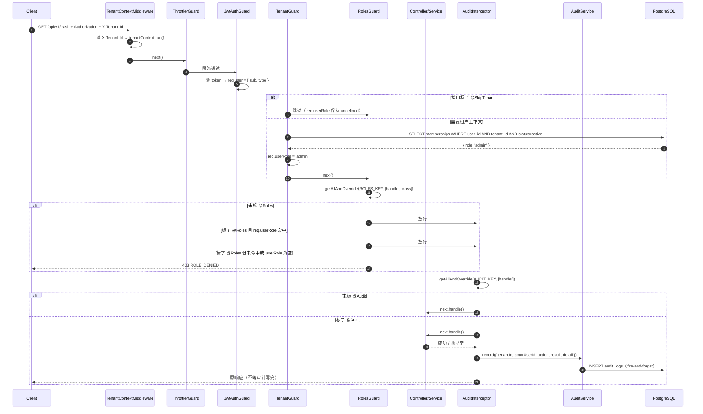

# 06 RBAC 与审计

> 版本 v1.1 ｜ 更新 2026-11-05 ｜ 状态：已实现
> 确认：李顺 · 2026-11-05
> 关联：《技术方案设计》§4.6 权限渲染、§5.5 RBAC 设计、《需求文档》§审计日志、《数据库设计与数据字典》§3 audit_logs、`03-多租户行级隔离`、`_docs/安全规范.md`
>
> **一页速览**
> 接口：本期**无新增对外接口**（机制层，成员管理与审计查询接口留待 05 / 审计页）
> 前端落点：`packages/shared` 的权限矩阵常量供 `usePermission()` 复用（本期后端先行，前端落点下一功能点）
> 后端落点：`src/common/{guards/roles.guard.ts,decorators/{roles,audit,skip-tenant}.decorator.ts,interceptors/audit.interceptor.ts}`、`src/modules/audit/`、`prisma/schema.prisma`
> 关键异常：`ROLE_DENIED` / `TENANT_MISMATCH`

---

## 1. 需求

### 1.1 用户故事

| 编号 | 角色 | 诉求 | 目的 |
|------|------|------|------|
| US-01 | 租户 owner | 普通成员（member）不能进回收站、不能查看审计日志 | 按角色收敛敏感操作入口 |
| US-02 | 租户 owner | 管理员（admin）不能改动我的角色、也不能给自己降级 | 防止租户被内部人夺权或陷入无主 |
| US-03 | 安全负责人 | 每个敏感操作都有留痕：谁、什么时间、从哪个 IP、对什么对象、成功还是失败 | 事后追溯与合规（保留 180 天） |
| US-04 | 后端开发者 | 在 Controller 上用一行装饰器声明「这个接口需要什么角色」，不写 `if (role !== 'owner')` | 权限规则集中、可 review、不漏判 |

### 1.2 验收标准

| 编号 | 标准 |
|------|------|
| AC-01 | 接口标 `@Roles('owner')`，`req.userRole='admin'` 访问 → `403 ROLE_DENIED` |
| AC-02 | 接口标 `@Roles('admin','owner')`，`req.userRole='member'` 访问 → `403 ROLE_DENIED` |
| AC-03 | 接口标 `@Roles('admin','owner')`，`req.userRole='admin'` 或 `'owner'` → 放行 |
| AC-04 | 接口**未标** `@Roles` → 任何通过 `JwtAuthGuard` 的请求都放行（角色校验是额外收紧，不是默认拒绝） |
| AC-05 | 接口标了 `@Roles`，但 `req.userRole` 为 `undefined`（未过 `TenantGuard`，或接口标了 `@SkipTenant`）→ `403 ROLE_DENIED`，不放行 |
| AC-06 | `@Roles` 既标在 handler 也标在 controller 时，**handler 优先**（`getAllAndOverride` 语义） |
| AC-07 | 权限矩阵 `PERMISSIONS` 与 `canDo(role, permission)` 在 `packages/shared`，取值与《技术方案设计》§4.6 逐格一致 |
| AC-08 | 接口标 `@Audit('resource.delete')` 且执行成功 → 落一条 `result=success` 的 `audit_logs`，含 `actorUserId`、`tenantId`、`action`、`ip`、`detail.durationMs` |
| AC-09 | 同接口执行抛异常 → 落一条 `result=failed` 的记录，且**原异常照常抛给调用方**（审计不吞异常、不改响应） |
| AC-10 | 审计写入失败（如数据库抖动）→ 只记 error 日志，**主请求仍返回原本的成功/失败结果**，接口可用性不受影响 |
| AC-11 | 审计 `detail` 不包含密码、令牌、cookie、请求体原文等敏感内容；成功只记 `method`、`path`、`durationMs`，失败额外记 `statusCode`（取自异常的 HTTP 状态，**不读 `res.statusCode`**——Nest 在拦截器 `tap` 之后才写入该值） |
| AC-12 | `GET /tenants`、`GET /auth/me` 标 `@SkipTenant()`，**不带 `X-Tenant-Id` 也返回 200**（修复 03 遗留缺陷，见 §4.3） |
| AC-13 | 未标 `@Audit` 的接口不产生任何审计记录（拦截器直接放行，不查库） |
| AC-14 | 全部现有单测通过；新增 `roles.guard.spec.ts`、`audit.interceptor.spec.ts`、`audit.service.spec.ts` 通过 |

### 1.3 范围外

- **成员管理接口**（邀请 / 改角色 / 禁用 / 启用 / 移除 / owner 转让）→ `05-成员与邀请`。本期只建判定机制，"admin 不能改 owner"这类**业务边界规则属于成员管理，不在 `@Roles` 里表达**
- **登录审计**（`auth.login`）：登录是 `@Public` 接口，执行时 `req.user` 还不存在，且失败登录无法确定 actor（数据库 `actor_user_id` 为 NOT NULL），需与成员管理一并设计 → `05-成员与邀请`
- **审计查询接口** `GET /audit-logs`（筛选/分页）→ 审计日志页
- **180 天清理任务** → M3 引入 BullMQ 后落地
- **前端按钮级渲染**（`usePermission` / `<AuthButton>`）：本期常量就绪，前端接入随成员管理页
- **IP 归属地、User-Agent 解析**：`audit_logs` 表结构不含这两列（按数据库设计文档），不擅自扩展

---

## 2. 交互逻辑

### 2.1 请求链路上的四道守卫 + 一层拦截器



**执行顺序不可调整**：`ThrottlerGuard → JwtAuthGuard → TenantGuard → RolesGuard`。`RolesGuard` 读的 `req.userRole` 由 `TenantGuard` 写入，顺序颠倒会读到 `undefined`，所有带 `@Roles` 的接口一律 403。

### 2.2 RolesGuard 判定分支

```mermaid
flowchart TD
    A[RolesGuard.canActivate] --> B{handler/class 上有 @Roles?}
    B -- 否 --> Z[return true<br/>角色校验不介入]
    B -- 是 --> C[读出 required: Role[]]
    C --> D{required 为空数组?}
    D -- 是 --> Z
    D -- 否 --> E[读 req.userRole]
    E --> F{userRole 存在?}
    F -- 否 --> X[throw 403 ROLE_DENIED]
    F -- 是 --> G{required.includes(userRole)?}
    G -- 是 --> Z
    G -- 否 --> X
```

### 2.3 异常分支表

| # | 触发条件 | HTTP | 错误码 | 前端表现 |
|---|---------|------|--------|---------|
| 1 | 未带 / 无效 access token | 401 | `UNAUTHORIZED` / `TOKEN_EXPIRED` | 走静默刷新，失败跳登录 |
| 2 | 缺 `X-Tenant-Id`，且接口未标 `@SkipTenant` | 403 | `TENANT_MISMATCH` | 切租户提示 / 回租户选择页 |
| 3 | `X-Tenant-Id` 指向的租户内无 active membership | 403 | `TENANT_MISMATCH` | 提示无权限访问该租户 |
| 4 | 角色不满足 `@Roles` | 403 | `ROLE_DENIED` | 按钮级提示「当前角色无权执行该操作」 |
| 5 | 接口标了 `@Roles` 但 `req.userRole` 为空（如误标 `@SkipTenant`） | 403 | `ROLE_DENIED` | 同上；属配置错误，靠单测兜住 |
| 6 | 审计写入失败 | 不影响 | — | 无感知；服务端记 error 日志 + 监控 |

> 分支 5 是**配置错误**而非正常业务分支：同时标 `@Roles` 和 `@SkipTenant` 在语义上矛盾（没有租户上下文就没有角色）。`roles.guard.spec.ts` 用一条用例钉住这个行为。

---

## 3. 前端改动

### 3.1 现状

前端尚未接入权限体系：`apps/web` 里没有 `usePermission`、`<AuthButton>`，也没有按角色隐藏按钮的逻辑。`packages/shared` 只有 `ROLE` / `MEMBER_STATUS` 常量，没有权限矩阵。

### 3.2 待改动（随 05-成员与邀请 / 审计页落地）

| # | 文件 | 动作 | 说明 |
|---|------|------|------|
| F-01 | `packages/shared/src/permissions.ts`、`audit-actions.ts` | 本期落地 | 新增 `PERMISSIONS`、`canDo()`、`AUDIT_ACTIONS`——本期就要改，因为后端 `@Roles` 与前端 `usePermission` 必须同源（拆分方案见 §4.1.1，消费方仍从 `@saas/shared` 导入） |
| F-02 | `hooks/usePermission.ts` | 下一功能点 | `const { role, can } = usePermission()`；`can('trash.manage')` 直接读 shared 的 `canDo` |
| F-03 | `components/AuthButton.tsx` | 下一功能点 | `roles` 或 `permission` 属性不满足时隐藏（而非 disabled），避免暴露功能存在性 |
| F-04 | `constants/errorCode.ts` | 下一功能点 | 补 `ROLE_DENIED` → 「当前角色无权执行该操作」 |

> F-01 是本期唯一的前端侧改动（改的是 shared 契约包），因为它同时是后端守卫的判定依据。

### 3.3 错误码 → 文案映射

| 错误码 | 文案 | 展示位置 |
|--------|------|---------|
| `ROLE_DENIED` | 当前角色无权执行该操作 | Toast / 按钮级提示 |
| `TENANT_MISMATCH` | 无权访问该租户 | 页面级 403 |

---

## 4. 后端实现

### 4.1 实现清单

统一前缀 `/api/v1`，本期**无新增接口**。

| # | 文件 | 动作 | 职责 |
|---|------|------|------|
| B-01a | `packages/shared/src/roles.ts` | 新增 | `ROLE` / `Role` / `MEMBER_STATUS` / `MemberStatus` 从 `index.ts` 迁出（零依赖，最底层） |
| B-01b | `packages/shared/src/permissions.ts` | 新增 | `PERMISSIONS` 矩阵 + `Permission` + `canDo()`（只依赖 `roles.ts`） |
| B-01c | `packages/shared/src/audit-actions.ts` | 新增 | `AUDIT_ACTIONS` 词表 + `AuditAction`（零依赖） |
| B-01d | `packages/shared/src/contracts/auth.ts` | 新增 | 认证域 14 个 schema + 14 个 type 从 `index.ts` 迁出 |
| B-01e | `packages/shared/src/contracts/tenant.ts` | 新增 | 租户域 2 个 schema + 2 个 type 从 `index.ts` 迁出 |
| B-01f | `packages/shared/src/contracts/envelope.ts` | 新增 | `ApiSuccess` / `ApiFailure` 从 `index.ts` 迁出 |
| B-01g | `packages/shared/src/index.ts` | 改造 | 收敛为纯 barrel：只留纪律注释 + `export *`，不再有 schema 定义 |
| B-02 | `apps/api/prisma/schema.prisma` | 改造 | 新增 `AuditResult` 枚举 + `AuditLog` model |
| B-03 | `prisma/migrations/<ts>_audit_logs/` | 新增 | `pnpm --filter @saas/api db:migrate -- --name audit_logs` 生成 |
| B-04 | `src/common/decorators/roles.decorator.ts` | 新增 | `ROLES_KEY` + `Roles(...roles: Role[])` |
| B-05 | `src/common/decorators/audit.decorator.ts` | 新增 | `AUDIT_KEY` + `Audit(action: AuditAction)` |
| B-06 | `src/common/decorators/skip-tenant.decorator.ts` | 新增 | `SKIP_TENANT_KEY` + `SkipTenant()` |
| B-07 | `src/common/guards/roles.guard.ts` | 新增 | 读元数据 + 比对 `req.userRole` |
| B-08 | `src/common/guards/tenant.guard.ts` | 改造 | 开头检查 `@SkipTenant`，命中则直接放行 |
| B-09 | `src/modules/audit/audit.service.ts` | 新增 | `record()` 写库 + 内部 try/catch |
| B-10 | `src/modules/audit/audit.module.ts` | 新增 | `@Global()` 导出 `AuditService`（拦截器要注入） |
| B-11 | `src/common/interceptors/audit.interceptor.ts` | 新增 | `tap({ next, error })` 两个分支各写一条 |
| B-12 | `src/common/types/authenticated-request.ts` | 改造 | `userRole?: string` → `userRole?: Role` |
| B-13 | `src/modules/auth/auth.controller.ts` | 改造 | `GET /auth/me` 标 `@SkipTenant()` |
| B-14 | `src/modules/tenants/tenants.controller.ts` | 改造 | `GET /tenants` 标 `@SkipTenant()` |
| B-14b | `src/modules/health/health.controller.ts` | 改造 | `GET /health`、`GET /health/db` 补 `@SkipTenant()`（仅有 `@Public()` 不够） |
| B-16 | `src/main.ts` | 改造 | 首行 `import 'dotenv/config'`，修 `start:prod` 下 `DATABASE_URL` 为 undefined 导致的 500 |
| B-15 | `src/app.module.ts` | 改造 | `AuditModule` 进 imports；`RolesGuard` 进 `APP_GUARD`（末位）；`AuditInterceptor` 进 `APP_INTERCEPTOR` |

#### 4.1.1 shared 包拆分（B-01a ~ B-01g）

**为什么要拆**：把 `PERMISSIONS` / `canDo()` / `AUDIT_ACTIONS` 直接加进现有 `index.ts`，会让它从 369 行涨到约 460 行，同时混着 7 类内容（错误码门面、角色词表、入参契约、出参契约、传输包裹、权限矩阵、审计词表）。其中认证域契约占 253 行、租户域只占 34 行——小域被大域淹没，找东西只能靠 grep。

**拆分后的目录与体量**：

| 文件 | 来源 | 约行数 | 性质 |
|---|---|---|---|
| `src/index.ts` | 改造（B-01g） | ~20 | 纯 barrel，不含定义 |
| `src/errors.ts` | 不动 | 47 | 错误码 |
| `src/roles.ts` | 迁出（B-01a） | ~32 | 角色 / 成员状态 |
| `src/permissions.ts` | 新增（B-01b） | ~55 | 权限矩阵 + 判定函数 |
| `src/audit-actions.ts` | 新增（B-01c） | ~35 | 审计动作词表 |
| `src/contracts/auth.ts` | 迁出（B-01d） | ~255 | 认证域 14 schema + 14 type |
| `src/contracts/tenant.ts` | 迁出（B-01e） | ~40 | 租户域 2 schema + 2 type |
| `src/contracts/envelope.ts` | 迁出（B-01f） | ~42 | `ApiSuccess` / `ApiFailure` |

合计 8 个文件（6 新增 + `index.ts` 改造 + `errors.ts` 不动）。

**迁移映射（按当前 `index.ts` 行号）**：

| 当前行号 | 内容 | 去向 |
|---|---|---|
| 16–47 | `ROLE` / `Role` / `MEMBER_STATUS` / `MemberStatus` | `roles.ts` |
| 49–154 | 入参 5 个 schema + 5 个 type | `contracts/auth.ts` |
| 160–179 | `authUserSchema` / `AuthUser` | `contracts/auth.ts` |
| 181–201 | `tenantListItemSchema` / `TenantListItem` | `contracts/tenant.ts` |
| 203–316 | 认证域出参 8 个 schema + 8 个 type | `contracts/auth.ts` |
| 318–330 | `tenantListResultSchema` / `TenantListResult` | `contracts/tenant.ts` |
| 332–369 | `ApiSuccess` / `ApiFailure` | `contracts/envelope.ts` |
| 1–22 | 纪律注释 + `import z` + `ERROR_CODES` re-export | `index.ts`（注释改写，见下） |

**依赖方向必须单向无环**：

```
index.ts ─┬→ errors.ts
          ├→ roles.ts                  （零依赖）
          ├→ permissions.ts ──→ roles.ts
          ├→ audit-actions.ts          （零依赖）
          ├→ contracts/auth.ts         （只依赖 zod）
          ├→ contracts/tenant.ts ──→ roles.ts
          └→ contracts/envelope.ts     （零依赖）
```

- **`roles.ts` 必须独立成文件，不能留在 `index.ts`**：否则 `permissions.ts` 需要 `import type { Role } from './index.js'`，而 `index.ts` 又 `export * from './permissions.js'`，形成环。`PERMISSIONS` 是用 `as const` 在模块初始化时求值的，环一旦让求值顺序错位，运行时会拿到 `undefined`——且只在特定入口复现，极难排查。
- **`audit-actions.ts` 不并入 `permissions.ts`**：使用者不同（前者是 Controller / Interceptor，后者是 `@Roles` / `canDo`），增长节奏也不同（每个新功能点都会加审计动作，权限矩阵相对稳定）。
- **纪律**：shared 内部任何文件都禁止 `from './index.js'` 反向导入，依赖只能指向更底层的兄弟文件。

**`index.ts` 头部注释改口径**（原文写「所有契约只在这里定义」，拆分后不再成立）：

> 前后端契约的**唯一入口**。
>
> 纪律（见根 AGENTS.md）：
> - 契约本体在 `contracts/` 下按域分文件（auth / tenant / envelope）；角色与权限在 `roles.ts` / `permissions.ts`，错误码在 `errors.ts`。本文件只做汇总 re-export，不再定义任何 schema。
> - 包内文件禁止互相 `import './index.js'`（会成环），依赖只能指向更底层的兄弟文件。判据：某个文件需要另一个文件的类型时，说明后者该下沉——`Role` 下沉到 `roles.ts`，`permissions.ts` 才有合法的依赖方向。
> - `apps/web` 与 `apps/api` 一律从 `@saas/shared` 导入，**禁止在两端各写一份副本**（改一处漏一处必然导致联调时字段对不上），也不为拆出的文件开子路径导出。
> - schema 同时承担运行时校验职责：后端 `StandardSchemaValidationPipe` 直接拿它校验请求体，前端 RHF 用 `zodResolver` 校验表单，两边规则因此天然一致。
> - 改本包任何文件之后必须 `pnpm --filter @saas/shared build`，否则消费方读到的还是旧 `dist`。相对导入必须带 `.js` 扩展名——产物是原生 ESM，`moduleResolution: nodenext` 会在构建期拦住漏写。

**消费方影响：0 处改动**

- 实测 `apps/api` 10 处 + `apps/web` 2 处 import 语句，全部是 `from '@saas/shared'`，没有任何深路径导入。`index.ts` 保持 re-export，一行都不用改。
- 不要为拆出的文件加 `exports` 子路径（如 `@saas/shared/permissions`）：`package.json` 的 `exports` 目前只有 `"."`，加了会分裂契约入口，前端多出一种 import 写法。
- `dist/` 会多出 `contracts/` 一层目录，但 `index.d.ts` 仍汇总全部导出，消费方无感。

**执行顺序**：先做 B-01a~B-01f（新建 + 迁出），最后改 B-01g（`index.ts` 收敛为 barrel）。每步之后跑一次 `pnpm --filter @saas/shared build`——这批改动属于「零行为变更重构」，拆错会一片红，先隔离验证比混在 06 的其他改动里好定位。

### 4.2 数据模型变更

新增 1 张表 + 1 个枚举，**与《数据库设计与数据字典》§3 `audit_logs` 逐列对齐**。

```prisma
// audit_result：审计结果。与 shared 的 result 字段取值一致
enum AuditResult {
  success
  failed
}

// audit_logs：敏感操作留痕，保留 180 天（M3 cleanup 队列删除）
//
// 刻意不加任何 FK：
//   1. 审计记录必须独立存活 —— 用户注销、租户删除后仍要能查到"谁在何时删了什么"
//   2. 符合建模纪律「跨域外键一律不级联」，避免删租户把留痕一起带走
//   所以 tenant_id / actor_user_id 只存 id 快照，不做约束
model AuditLog {
  id          String      @id @default(cuid())
  // NULL = 账号级事件（当前无此类写入，登录审计随 05 落地后启用）
  tenantId    String?     @map("tenant_id")
  actorUserId String      @map("actor_user_id")
  // 'member.disable' / 'resource.delete' / 'subscription.refund'，常量在 shared 的 AUDIT_ACTIONS
  action      String      @db.VarChar(50)
  objectType  String?     @map("object_type") @db.VarChar(30)
  objectId    String?     @map("object_id")
  // PostgreSQL INET 原生类型；Prisma 7 支持 @db.Inet（已实测 validate 通过）
  ip          String?     @db.Inet
  result      AuditResult
  // 脱敏上下文：只放 method / path / durationMs / statusCode，禁止明文凭证
  detail      Json?
  createdAt   DateTime    @default(now()) @map("created_at")

  // 审计页按「租户 + 时间倒序」翻页
  @@index([tenantId, createdAt])
  // 按动作类型筛选（member.* / resource.* / subscription.*）
  @@index([tenantId, action])
  @@map("audit_logs")
}
```

**字段长度校验**：`cuid()` 产出 25 字符，`VARCHAR(32)` 够；`action` 最长按 `subscription.cancel` 量级控制在 50 内。

**迁移命令**：

```bash
cd apps/api
pnpm db:migrate -- --name audit_logs
```

> 迁移走 `prisma7.config.ts` 里的 `DIRECT_URL`（直连），不走应用运行时的池化地址——Neon 的 PgBouncer 会让迁移的 prepared statement 报错。

### 4.3 关键约束

**`@Roles` 是「额外收紧」，不是「默认拒绝」**
- 未标 `@Roles` 的接口对任何通过 `JwtAuthGuard` 的请求放行。这与 `@Public()` 的方向相反：`JwtAuthGuard` 是**默认拦、白名单放行**，`RolesGuard` 是**默认放、标注收紧**。
- 理由：绝大多数接口只需要"登录 + 属于该租户"，只有少数敏感操作需要角色限制。若默认拒绝，每个接口都要标一遍角色，标漏就 403，可用性代价更大。

**`req.userRole` 的唯一来源是 `TenantGuard`**
- `RolesGuard` **不查库**，只读 `TenantGuard` 写入的 `req.userRole`。这样每个请求最多一次 membership 查询，不会因两层守卫各查一次而翻倍。
- 因此 `@Roles` 只能用在**需要租户上下文**的接口上。标了 `@SkipTenant` 又标 `@Roles` 是配置矛盾，行为是 403（AC-05 / 分支 5）。

**修复 03 遗留缺陷：`@SkipTenant` 的必要性**
- 03 把 `TenantGuard` 注册成了全局 `APP_GUARD`，而它的规则是「没有 `X-Tenant-Id` 就 403」。后果是 `GET /tenants` 和 `GET /auth/me` 这类**本来不需要租户上下文**的接口全部 403。
- 03 的 AC-08 明确要求「现有接口行为不变」，实际落地违反了它——这是 03 的偏差，本篇一并修复。
- 修法沿用 `@Public()` 的既有模式：加 `@SkipTenant()` 白名单，`TenantGuard` 开头检查后直接 `return true`。**不放宽 TenantGuard 的默认行为**——否则"需要租户却漏带头"的接口会静默通过，比现在更危险。
- **受影响的不止两个接口**：`GET /health` 与 `GET /health/db` 只标了 `@Public()`（跳过 JwtAuthGuard），同样被 TenantGuard 拦成 403 TENANT_MISMATCH。健康检查是探活入口，被拦等于负载均衡/K8s 把实例判死。**凡是 `@Public()` 的非租户接口，都必须同时标 `@SkipTenant()`**；两个守卫是独立的两道闸，跳过一个不等于跳过另一个。

**`main.ts` 必须首行加载 dotenv**
- `prisma.service.ts` 在**模块顶层**执行 `new PrismaClient({ adapter: new PrismaPg({ connectionString: process.env.DATABASE_URL }) })`。ESM 按依赖图深度优先求值，`app.module.js` 会连带求值 `prisma.service.js`，而这个时机早于 `ConfigModule.forRoot()` 加载 `.env`。
- 结果：`node dist/main.js`（`start:prod`）读到的 `DATABASE_URL` 是 `undefined`，Prisma 连到 localhost 默认端口，**所有查库请求 500**。`nest start` 看不出问题——Nest CLI 自己加载了 `.env` 并让子进程继承，典型的「dev 正常、上线即挂」。
- 修法：`src/main.ts` 第一行 `import 'dotenv/config';`（必须是第一条 import）。生产环境用真实环境变量时 dotenv 不覆盖已存在的值，行为不变。
- 同类风险适用于任何"在模块顶层读 `process.env`"的代码；新增此类代码前先确认执行时机。

**审计是旁路，绝不能影响主流程**
- `AuditInterceptor` 用 `tap({ next, error })` 只做"观察"，不 `switchMap`、不改响应体、不吞异常。
- `AuditService.record()` 内部 `try/catch` 全包 + `Logger.error`，且调用方用 `void` 不 await。三条一起才成立：
  - 若 await，主请求要多等一次 INSERT（在 Neon 这种远程库上约 5–20ms）；
  - 若不 catch，审计故障会变成业务故障（审计库抖动 → 全站写操作 500）；
  - 若在 interceptor 里 catch 而不在 service 内 catch，单测里更容易漏测。

**审计 detail 的脱敏边界**
- 允许记：`method`、`path`、`durationMs`；失败时额外记 `statusCode`（从抛出的 `HttpException` 取，不读 `res.statusCode`——Nest 的成功状态码在拦截器退出后才落到 `res` 上，读到的会是默认值 200，失真）。
- 禁止记：请求体原文、`Authorization` 头、cookie、密码、令牌、`detail` 里的用户隐私字段。
- 原因：`audit_logs.detail` 是 JSONB 且保留 180 天，一旦写入密码就等同于长期留存明文凭证。这条与《安全规范》的"日志脱敏"策略对应。

**action 的命名规范**
- 格式 `域.动作`，域与 `objectType` 同源（`String(action).split('.')[0]`）。
- 常量集中在 shared 的 `AUDIT_ACTIONS`，禁止在 controller 里写裸字符串——否则前端筛选器的枚举值会和后端写入值漂移。

**IP 与反向代理**
- `req.ip` 依赖 Express 的 `trust proxy` 配置。当前 `setup-app.ts` 未开，本地直连时取到的是真实 IP，部署到 nginx/Cloudflare 之后会取到代理 IP。
- 部署时需要设 `app.set('trust proxy', 1)`，否则审计里的 IP 全是网关地址。**本期不做**（本地无代理），但在 §5.3 手工清单里记一笔。

**权限矩阵与业务边界的分工**
- `PERMISSIONS` 只表达「哪个角色能进这个功能」。例如 `member.role_change: ['admin','owner']`。
- "admin 不能改 owner"、"不能自降级"属于**同功能内的对象级校验**，必须在 `MembersService` 里写，不能塞进 `@Roles`。`@Roles` 只知道调用者角色，不知道被操作对象的角色。
- 这是最容易混淆的一点：把对象级规则塞进 `@Roles` 会导致 admin 连 member 都改不了（因为 `@Roles('owner')` 把 admin 一起挡了）。

**shared 包内禁止反向依赖 `index.ts`**
- 拆分后 `index.ts` 只是 barrel，包内文件（`permissions.ts`、`contracts/tenant.ts` 等）只能依赖更底层的兄弟文件，**禁止** `import ... from './index.js'`。
- 理由：`index.ts` 会 re-export 所有文件，包内反向导入立刻成环。而 `PERMISSIONS` / `ROLE` 都是 `as const` 顶层求值，环导致的求值顺序错位会表现为运行时 `undefined`，不在编译期暴露。
- 判据：如果某个文件需要另一个文件的类型，说明后者应该下沉——例如 `Role` 下沉到 `roles.ts` 才让 `permissions.ts` 有了合法的依赖方向。

---

## 5. 测试

### 5.1 单测（Vitest）

| 目标 | 文件 | 用例 |
|------|------|------|
| `RolesGuard` | `src/common/guards/roles.guard.spec.ts` | 无 `@Roles` 放行；`@Roles('owner')` + admin → 403 `ROLE_DENIED`；`@Roles('admin','owner')` + member → 403；admin/owner → 放行；`userRole` 为 undefined 但标了 `@Roles` → 403；handler 上 `@Roles` 覆盖 class 上的 |
| `AuditInterceptor` | `src/common/interceptors/audit.interceptor.spec.ts` | 无 `@Audit` → 不调 `record`，直接透传；成功 → `record` 收到 `result:'success'`；抛异常 → `record` 收到 `result:'failed'` 且异常继续抛出；`record` reject 时不影响原流；`tenantId` 取自 `tenantContext`，无上下文时为 `null` |
| `AuditService` | `src/modules/audit/audit.service.spec.ts` | 正常调用 `prisma.auditLog.create` 且入参映射正确；`create` 抛错时 `record` 自身不抛（`resolves.toBeUndefined`），并触发 `Logger.error` |
| `TenantGuard`（回归） | `src/common/guards/tenant.guard.spec.ts` | 新增：标了 `@SkipTenant` 时直接放行且不查库 |

### 5.2 e2e 用例矩阵

本期仍无受 `@Roles` / `@Audit` 保护的真实业务接口，e2e 只回归"现有接口不被新守卫破坏"。

| # | 场景 | 期望 | 状态 |
|---|------|------|------|
| E-41 | 带 access token 请求 `GET /tenants`（无 `X-Tenant-Id`） | 200，列表正常 | 本期验证（修复 03 偏差） |
| E-42 | 带 access token 请求 `GET /auth/me`（无 `X-Tenant-Id`） | 200，返回当前用户 | 本期验证 |
| E-43 | 带 `X-Tenant-Id` + 有效 membership 请求 `GET /tenants` | 200，且审计表**无新增记录**（该接口未标 `@Audit`） | 本期验证 |
| E-44 | member 访问 `GET /trash` | 403 `ROLE_DENIED` | 随 05 落地 |
| E-45 | admin 修改 owner 的角色 | 403 `ROLE_DENIED` / `MEMBER_STATE_INVALID` | 随 05 落地 |
| E-46 | 审计表能查到 `member.disable` / `resource.delete` | 有对应记录 | 随 05 / 07 落地 |

### 5.3 手工验证清单

```bash
# 1 契约包改完必须先构建，否则后端读到的还是旧 dist
pnpm --filter @saas/shared build

# 2 生成迁移 + 客户端
#   ⚠️ 必须用 pnpm db:migrate --name xxx，不要写 `-- --name xxx`
#   pnpm 会把 `--` 原样拼进命令，prisma 见到 `--` 就停止解析选项，--name 失效后转入交互式询问
cd apps/api && pnpm db:migrate --name audit_logs

# 3 类型检查
pnpm --filter @saas/api typecheck

# 4 单测（新增 3 个 spec + 现有 spec 不回归）
pnpm --filter @saas/api test
```

```bash
# 5 回归：验证 @SkipTenant 真的修好了 03 的缺陷
#    启动服务后，用登录拿到的 accessToken，【不带】X-Tenant-Id：
curl -s -H "Authorization: Bearer $TOKEN" http://localhost:3000/api/v1/tenants
curl -s -H "Authorization: Bearer $TOKEN" http://localhost:3000/api/v1/auth/me
# 期望：两个都返回 200。若仍 403 TENANT_MISMATCH，说明 @SkipTenant 没生效

# 5b 健康检查（探活入口，必须免鉴权且免租户上下文）
curl -s http://localhost:3000/api/v1/health      # 期望 200 {status:"ok"}
curl -s http://localhost:3000/api/v1/health/db   # 期望 200 {status:"ok",latencyMs:N}
# 若 403 TENANT_MISMATCH → health.controller 漏了 @SkipTenant

# 5c 必须用【生产启动方式】验证一次，不能用 pnpm dev
#    dev 下 Nest CLI 会代载 .env，掩盖「模块顶层读 process.env」的时机问题
cd apps/api && pnpm build && node dist/main.js
# 启动后随便打一个查库接口，期望 2xx；若 500 且日志是
#   PrismaClientKnownRequestError: Invalid `prisma.xxx()` invocation（message 为空）
#   → main.ts 没加载 dotenv，DATABASE_URL 是 undefined
```

```sql
-- 6 审计表结构与索引核对（TablePlus 里跑）
SELECT column_name, data_type, is_nullable
FROM information_schema.columns
WHERE table_name = 'audit_logs'
ORDER BY ordinal_position;

SELECT indexname FROM pg_indexes WHERE tablename = 'audit_logs';
-- 期望：idx_audit_tenant_created、idx_audit_action
```

**部署时补记**：反向代理后需在 `setup-app.ts` 加 `app.set('trust proxy', 1)`，否则 `audit_logs.ip` 记的是网关地址。本期本地无代理，不处理，但在 M3 上云前必须补。

---

## 6. 与 03 的偏差修正记录

03《多租户行级隔离》落地时，`TenantGuard` 被注册成全局 `APP_GUARD` 且「无头即 403」，违反了 03 自己的 AC-08（现有接口行为不变）。本篇通过 `@SkipTenant()` 修正，具体：

| 03 写的 | 03 实际落地 | 本篇修正 |
|---------|------------|---------|
| AC-08：`GET /tenants`、`/auth/*` 不受守卫影响 | 全局 `TenantGuard` 使这些接口都需要 `X-Tenant-Id`，否则 403 | 加 `@SkipTenant()`，标在 `GET /tenants` 与 `GET /auth/me` |
| §4.3 守卫执行顺序 | 一致（Throttler → JwtAuth → Tenant） | 追加 `RolesGuard` 到末位 |

> 03 文档 §5.3 的手工清单里其实已经列了"登录后 `GET /tenants` 正常返回"，但当时只跑了单测、没跑这一步，所以偏差没被发现。本篇的 §5.3 把这条挪成必跑项。
