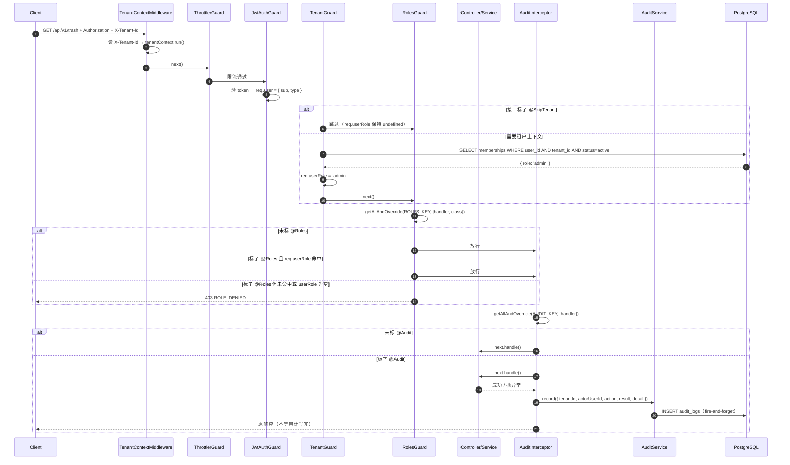
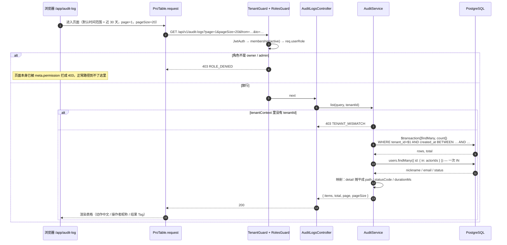

# 06 RBAC 与审计

> 版本 v1.3 ｜ 更新 2026-11-13 ｜ 状态：v1.1 机制层已实现 · v1.2 / v1.3 审计页已实现
> 确认：李顺 · 2026-11-05（v1.1）· 2026-11-11（v1.2）· 2026-11-13（v1.3）
> 关联：《技术方案设计》§4.6 权限渲染、§5.5 RBAC 设计、《需求文档》§审计日志、《数据库设计与数据字典》§3 audit_logs、`03-多租户行级隔离`、`05-成员与邀请`、`07-资源CRUD与回收站`、`_docs/安全规范.md`
>
> **一页速览**
> 接口：v1.1 无新增接口（机制层）；**v1.2 新增 `GET /audit-logs`**（§7）
> 前端落点：`packages/shared` 的权限矩阵常量供 `usePermission()` 复用；**v1.2 新增 `pages/app/audit-log/`、`shared/api/audit.ts`**
> 后端落点：`src/common/{guards/roles.guard.ts,decorators/{roles,audit,skip-tenant}.decorator.ts,interceptors/audit.interceptor.ts}`、`src/modules/audit/`、`prisma/schema.prisma`
> 关键异常：`ROLE_DENIED` / `TENANT_MISMATCH`
>
> **v1.2 变更**：把 v1.1 留下的尾巴补完——`GET /audit-logs` 查询接口 + 审计日志页；同时修掉一处**数据缺陷**：`object_type` / `object_id` 两列自建表起从未写入（13 处 `@Audit` 全部只记动作不记对象），审计记录看不出「对谁做的」。§7 一并改造装饰器与拦截器，让对象信息自动落库（**无需迁移**，列已存在）。

> **v1.3 变更**：实现期补两处偏差。①契约增加 `actorRole`，取值来自**写入时快照**而非查询时回查 `memberships`（§7.4.6）——读侧 join 拿到的是「现在」的角色，会把历史改写成假的，且漏掉已 `removed` 的成员。②`list` 的 `count` / `findMany` 由 `$transaction([...])` 改为 `Promise.all`（§7.4.4 末）。

---

## 1. 需求

### 1.1 用户故事

| 编号 | 角色 | 诉求 | 目的 |
|------|------|------|------|
| US-01 | 租户 owner | 普通成员（member）不能进回收站、不能查看审计日志 | 按角色收敛敏感操作入口 |
| US-02 | 租户 owner | 管理员（admin）不能改动我的角色、也不能给自己降级 | 防止租户被内部人夺权或陷入无主 |
| US-03 | 安全负责人 | 每个敏感操作都有留痕：谁、什么时间、从哪个 IP、对什么对象、成功还是失败 | 事后追溯与合规（保留 180 天） |
| US-04 | 后端开发者 | 在 Controller 上用一行装饰器声明「这个接口需要什么角色」，不写 `if (role !== 'owner')` | 权限规则集中、可 review、不漏判 |

### 1.2 验收标准

| 编号 | 标准 |
|------|------|
| AC-01 | 接口标 `@Roles('owner')`，`req.userRole='admin'` 访问 → `403 ROLE_DENIED` |
| AC-02 | 接口标 `@Roles('admin','owner')`，`req.userRole='member'` 访问 → `403 ROLE_DENIED` |
| AC-03 | 接口标 `@Roles('admin','owner')`，`req.userRole='admin'` 或 `'owner'` → 放行 |
| AC-04 | 接口**未标** `@Roles` → 任何通过 `JwtAuthGuard` 的请求都放行（角色校验是额外收紧，不是默认拒绝） |
| AC-05 | 接口标了 `@Roles`，但 `req.userRole` 为 `undefined`（未过 `TenantGuard`，或接口标了 `@SkipTenant`）→ `403 ROLE_DENIED`，不放行 |
| AC-06 | `@Roles` 既标在 handler 也标在 controller 时，**handler 优先**（`getAllAndOverride` 语义） |
| AC-07 | 权限矩阵 `PERMISSIONS` 与 `canDo(role, permission)` 在 `packages/shared`，取值与《技术方案设计》§4.6 逐格一致 |
| AC-08 | 接口标 `@Audit('resource.delete')` 且执行成功 → 落一条 `result=success` 的 `audit_logs`，含 `actorUserId`、`tenantId`、`action`、`ip`、`detail.durationMs` |
| AC-09 | 同接口执行抛异常 → 落一条 `result=failed` 的记录，且**原异常照常抛给调用方**（审计不吞异常、不改响应） |
| AC-10 | 审计写入失败（如数据库抖动）→ 只记 error 日志，**主请求仍返回原本的成功/失败结果**，接口可用性不受影响 |
| AC-11 | 审计 `detail` 不包含密码、令牌、cookie、请求体原文等敏感内容；成功只记 `method`、`path`、`durationMs`，失败额外记 `statusCode`（取自异常的 HTTP 状态，**不读 `res.statusCode`**——Nest 在拦截器 `tap` 之后才写入该值） |
| AC-12 | `GET /tenants`、`GET /auth/me` 标 `@SkipTenant()`，**不带 `X-Tenant-Id` 也返回 200**（修复 03 遗留缺陷，见 §4.3） |
| AC-13 | 未标 `@Audit` 的接口不产生任何审计记录（拦截器直接放行，不查库） |
| AC-14 | 全部现有单测通过；新增 `roles.guard.spec.ts`、`audit.interceptor.spec.ts`、`audit.service.spec.ts` 通过 |

### 1.3 范围外

- **成员管理接口**（邀请 / 改角色 / 禁用 / 启用 / 移除 / owner 转让）→ `05-成员与邀请`。本期只建判定机制，"admin 不能改 owner"这类**业务边界规则属于成员管理，不在 `@Roles` 里表达**
- **登录审计**（`auth.login`）：登录是 `@Public` 接口，执行时 `req.user` 还不存在，且失败登录无法确定 actor（数据库 `actor_user_id` 为 NOT NULL），需与成员管理一并设计 → `05-成员与邀请`
- **审计查询接口** `GET /audit-logs`（筛选/分页）→ **v1.2 已收回本篇，见 §7**
- **180 天清理任务** → M3 引入 BullMQ 后落地（v1.2 仍不做，见 §7.1.3）
- **前端按钮级渲染**（`usePermission` / `<AuthButton>`）：本期常量就绪，前端接入随成员管理页
- **IP 归属地、User-Agent 解析**：`audit_logs` 表结构不含这两列（按数据库设计文档），不擅自扩展

---

## 2. 交互逻辑

### 2.1 请求链路上的四道守卫 + 一层拦截器



**执行顺序不可调整**：`ThrottlerGuard → JwtAuthGuard → TenantGuard → RolesGuard`。`RolesGuard` 读的 `req.userRole` 由 `TenantGuard` 写入，顺序颠倒会读到 `undefined`，所有带 `@Roles` 的接口一律 403。

### 2.2 RolesGuard 判定分支

```mermaid
flowchart TD
    A[RolesGuard.canActivate] --> B{handler/class 上有 @Roles?}
    B -- 否 --> Z[return true<br/>角色校验不介入]
    B -- 是 --> C[读出 required: Role[]]
    C --> D{required 为空数组?}
    D -- 是 --> Z
    D -- 否 --> E[读 req.userRole]
    E --> F{userRole 存在?}
    F -- 否 --> X[throw 403 ROLE_DENIED]
    F -- 是 --> G{required.includes(userRole)?}
    G -- 是 --> Z
    G -- 否 --> X
```

### 2.3 异常分支表

| # | 触发条件 | HTTP | 错误码 | 前端表现 |
|---|---------|------|--------|---------|
| 1 | 未带 / 无效 access token | 401 | `UNAUTHORIZED` / `TOKEN_EXPIRED` | 走静默刷新，失败跳登录 |
| 2 | 缺 `X-Tenant-Id`，且接口未标 `@SkipTenant` | 403 | `TENANT_MISMATCH` | 切租户提示 / 回租户选择页 |
| 3 | `X-Tenant-Id` 指向的租户内无 active membership | 403 | `TENANT_MISMATCH` | 提示无权限访问该租户 |
| 4 | 角色不满足 `@Roles` | 403 | `ROLE_DENIED` | 按钮级提示「当前角色无权执行该操作」 |
| 5 | 接口标了 `@Roles` 但 `req.userRole` 为空（如误标 `@SkipTenant`） | 403 | `ROLE_DENIED` | 同上；属配置错误，靠单测兜住 |
| 6 | 审计写入失败 | 不影响 | — | 无感知；服务端记 error 日志 + 监控 |

> 分支 5 是**配置错误**而非正常业务分支：同时标 `@Roles` 和 `@SkipTenant` 在语义上矛盾（没有租户上下文就没有角色）。`roles.guard.spec.ts` 用一条用例钉住这个行为。

---

## 3. 前端改动

### 3.1 现状

前端尚未接入权限体系：`apps/web` 里没有 `usePermission`、`<AuthButton>`，也没有按角色隐藏按钮的逻辑。`packages/shared` 只有 `ROLE` / `MEMBER_STATUS` 常量，没有权限矩阵。

### 3.2 待改动（随 05-成员与邀请 / 审计页落地）

| # | 文件 | 动作 | 说明 |
|---|------|------|------|
| F-01 | `packages/shared/src/permissions.ts`、`audit-actions.ts` | 本期落地 | 新增 `PERMISSIONS`、`canDo()`、`AUDIT_ACTIONS`——本期就要改，因为后端 `@Roles` 与前端 `usePermission` 必须同源（拆分方案见 §4.1.1，消费方仍从 `@saas/shared` 导入） |
| F-02 | `hooks/usePermission.ts` | 下一功能点 | `const { role, can } = usePermission()`；`can('trash.manage')` 直接读 shared 的 `canDo` |
| F-03 | `components/AuthButton.tsx` | 下一功能点 | `roles` 或 `permission` 属性不满足时隐藏（而非 disabled），避免暴露功能存在性 |
| F-04 | `constants/errorCode.ts` | 下一功能点 | 补 `ROLE_DENIED` → 「当前角色无权执行该操作」 |

> F-01 是本期唯一的前端侧改动（改的是 shared 契约包），因为它同时是后端守卫的判定依据。

### 3.3 错误码 → 文案映射

| 错误码 | 文案 | 展示位置 |
|--------|------|---------|
| `ROLE_DENIED` | 当前角色无权执行该操作 | Toast / 按钮级提示 |
| `TENANT_MISMATCH` | 无权访问该租户 | 页面级 403 |

---

## 4. 后端实现

### 4.1 实现清单

统一前缀 `/api/v1`，本期**无新增接口**。

| # | 文件 | 动作 | 职责 |
|---|------|------|------|
| B-01a | `packages/shared/src/roles.ts` | 新增 | `ROLE` / `Role` / `MEMBER_STATUS` / `MemberStatus` 从 `index.ts` 迁出（零依赖，最底层） |
| B-01b | `packages/shared/src/permissions.ts` | 新增 | `PERMISSIONS` 矩阵 + `Permission` + `canDo()`（只依赖 `roles.ts`） |
| B-01c | `packages/shared/src/audit-actions.ts` | 新增 | `AUDIT_ACTIONS` 词表 + `AuditAction`（零依赖） |
| B-01d | `packages/shared/src/contracts/auth.ts` | 新增 | 认证域 14 个 schema + 14 个 type 从 `index.ts` 迁出 |
| B-01e | `packages/shared/src/contracts/tenant.ts` | 新增 | 租户域 2 个 schema + 2 个 type 从 `index.ts` 迁出 |
| B-01f | `packages/shared/src/contracts/envelope.ts` | 新增 | `ApiSuccess` / `ApiFailure` 从 `index.ts` 迁出 |
| B-01g | `packages/shared/src/index.ts` | 改造 | 收敛为纯 barrel：只留纪律注释 + `export *`，不再有 schema 定义 |
| B-02 | `apps/api/prisma/schema.prisma` | 改造 | 新增 `AuditResult` 枚举 + `AuditLog` model |
| B-03 | `prisma/migrations/<ts>_audit_logs/` | 新增 | `pnpm --filter @saas/api db:migrate -- --name audit_logs` 生成 |
| B-04 | `src/common/decorators/roles.decorator.ts` | 新增 | `ROLES_KEY` + `Roles(...roles: Role[])` |
| B-05 | `src/common/decorators/audit.decorator.ts` | 新增 | `AUDIT_KEY` + `Audit(action: AuditAction)` |
| B-06 | `src/common/decorators/skip-tenant.decorator.ts` | 新增 | `SKIP_TENANT_KEY` + `SkipTenant()` |
| B-07 | `src/common/guards/roles.guard.ts` | 新增 | 读元数据 + 比对 `req.userRole` |
| B-08 | `src/common/guards/tenant.guard.ts` | 改造 | 开头检查 `@SkipTenant`，命中则直接放行 |
| B-09 | `src/modules/audit/audit.service.ts` | 新增 | `record()` 写库 + 内部 try/catch |
| B-10 | `src/modules/audit/audit.module.ts` | 新增 | `@Global()` 导出 `AuditService`（拦截器要注入） |
| B-11 | `src/common/interceptors/audit.interceptor.ts` | 新增 | `tap({ next, error })` 两个分支各写一条 |
| B-12 | `src/common/types/authenticated-request.ts` | 改造 | `userRole?: string` → `userRole?: Role` |
| B-13 | `src/modules/auth/auth.controller.ts` | 改造 | `GET /auth/me` 标 `@SkipTenant()` |
| B-14 | `src/modules/tenants/tenants.controller.ts` | 改造 | `GET /tenants` 标 `@SkipTenant()` |
| B-14b | `src/modules/health/health.controller.ts` | 改造 | `GET /health`、`GET /health/db` 补 `@SkipTenant()`（仅有 `@Public()` 不够） |
| B-16 | `src/main.ts` | 改造 | 首行 `import 'dotenv/config'`，修 `start:prod` 下 `DATABASE_URL` 为 undefined 导致的 500 |
| B-15 | `src/app.module.ts` | 改造 | `AuditModule` 进 imports；`RolesGuard` 进 `APP_GUARD`（末位）；`AuditInterceptor` 进 `APP_INTERCEPTOR` |

#### 4.1.1 shared 包拆分（B-01a ~ B-01g）

**为什么要拆**：把 `PERMISSIONS` / `canDo()` / `AUDIT_ACTIONS` 直接加进现有 `index.ts`，会让它从 369 行涨到约 460 行，同时混着 7 类内容（错误码门面、角色词表、入参契约、出参契约、传输包裹、权限矩阵、审计词表）。其中认证域契约占 253 行、租户域只占 34 行——小域被大域淹没，找东西只能靠 grep。

**拆分后的目录与体量**：

| 文件 | 来源 | 约行数 | 性质 |
|---|---|---|---|
| `src/index.ts` | 改造（B-01g） | ~20 | 纯 barrel，不含定义 |
| `src/errors.ts` | 不动 | 47 | 错误码 |
| `src/roles.ts` | 迁出（B-01a） | ~32 | 角色 / 成员状态 |
| `src/permissions.ts` | 新增（B-01b） | ~55 | 权限矩阵 + 判定函数 |
| `src/audit-actions.ts` | 新增（B-01c） | ~35 | 审计动作词表 |
| `src/contracts/auth.ts` | 迁出（B-01d） | ~255 | 认证域 14 schema + 14 type |
| `src/contracts/tenant.ts` | 迁出（B-01e） | ~40 | 租户域 2 schema + 2 type |
| `src/contracts/envelope.ts` | 迁出（B-01f） | ~42 | `ApiSuccess` / `ApiFailure` |

合计 8 个文件（6 新增 + `index.ts` 改造 + `errors.ts` 不动）。

**迁移映射（按当前 `index.ts` 行号）**：

| 当前行号 | 内容 | 去向 |
|---|---|---|
| 16–47 | `ROLE` / `Role` / `MEMBER_STATUS` / `MemberStatus` | `roles.ts` |
| 49–154 | 入参 5 个 schema + 5 个 type | `contracts/auth.ts` |
| 160–179 | `authUserSchema` / `AuthUser` | `contracts/auth.ts` |
| 181–201 | `tenantListItemSchema` / `TenantListItem` | `contracts/tenant.ts` |
| 203–316 | 认证域出参 8 个 schema + 8 个 type | `contracts/auth.ts` |
| 318–330 | `tenantListResultSchema` / `TenantListResult` | `contracts/tenant.ts` |
| 332–369 | `ApiSuccess` / `ApiFailure` | `contracts/envelope.ts` |
| 1–22 | 纪律注释 + `import z` + `ERROR_CODES` re-export | `index.ts`（注释改写，见下） |

**依赖方向必须单向无环**：

```
index.ts ─┬→ errors.ts
          ├→ roles.ts                  （零依赖）
          ├→ permissions.ts ──→ roles.ts
          ├→ audit-actions.ts          （零依赖）
          ├→ contracts/auth.ts         （只依赖 zod）
          ├→ contracts/tenant.ts ──→ roles.ts
          └→ contracts/envelope.ts     （零依赖）
```

- **`roles.ts` 必须独立成文件，不能留在 `index.ts`**：否则 `permissions.ts` 需要 `import type { Role } from './index.js'`，而 `index.ts` 又 `export * from './permissions.js'`，形成环。`PERMISSIONS` 是用 `as const` 在模块初始化时求值的，环一旦让求值顺序错位，运行时会拿到 `undefined`——且只在特定入口复现，极难排查。
- **`audit-actions.ts` 不并入 `permissions.ts`**：使用者不同（前者是 Controller / Interceptor，后者是 `@Roles` / `canDo`），增长节奏也不同（每个新功能点都会加审计动作，权限矩阵相对稳定）。
- **纪律**：shared 内部任何文件都禁止 `from './index.js'` 反向导入，依赖只能指向更底层的兄弟文件。

**`index.ts` 头部注释改口径**（原文写「所有契约只在这里定义」，拆分后不再成立）：

> 前后端契约的**唯一入口**。
>
> 纪律（见根 AGENTS.md）：
> - 契约本体在 `contracts/` 下按域分文件（auth / tenant / envelope）；角色与权限在 `roles.ts` / `permissions.ts`，错误码在 `errors.ts`。本文件只做汇总 re-export，不再定义任何 schema。
> - 包内文件禁止互相 `import './index.js'`（会成环），依赖只能指向更底层的兄弟文件。判据：某个文件需要另一个文件的类型时，说明后者该下沉——`Role` 下沉到 `roles.ts`，`permissions.ts` 才有合法的依赖方向。
> - `apps/web` 与 `apps/api` 一律从 `@saas/shared` 导入，**禁止在两端各写一份副本**（改一处漏一处必然导致联调时字段对不上），也不为拆出的文件开子路径导出。
> - schema 同时承担运行时校验职责：后端 `StandardSchemaValidationPipe` 直接拿它校验请求体，前端 RHF 用 `zodResolver` 校验表单，两边规则因此天然一致。
> - 改本包任何文件之后必须 `pnpm --filter @saas/shared build`，否则消费方读到的还是旧 `dist`。相对导入必须带 `.js` 扩展名——产物是原生 ESM，`moduleResolution: nodenext` 会在构建期拦住漏写。

**消费方影响：0 处改动**

- 实测 `apps/api` 10 处 + `apps/web` 2 处 import 语句，全部是 `from '@saas/shared'`，没有任何深路径导入。`index.ts` 保持 re-export，一行都不用改。
- 不要为拆出的文件加 `exports` 子路径（如 `@saas/shared/permissions`）：`package.json` 的 `exports` 目前只有 `"."`，加了会分裂契约入口，前端多出一种 import 写法。
- `dist/` 会多出 `contracts/` 一层目录，但 `index.d.ts` 仍汇总全部导出，消费方无感。

**执行顺序**：先做 B-01a~B-01f（新建 + 迁出），最后改 B-01g（`index.ts` 收敛为 barrel）。每步之后跑一次 `pnpm --filter @saas/shared build`——这批改动属于「零行为变更重构」，拆错会一片红，先隔离验证比混在 06 的其他改动里好定位。

### 4.2 数据模型变更

新增 1 张表 + 1 个枚举，**与《数据库设计与数据字典》§3 `audit_logs` 逐列对齐**。

```prisma
// audit_result：审计结果。与 shared 的 result 字段取值一致
enum AuditResult {
  success
  failed
}

// audit_logs：敏感操作留痕，保留 180 天（M3 cleanup 队列删除）
//
// 刻意不加任何 FK：
//   1. 审计记录必须独立存活 —— 用户注销、租户删除后仍要能查到"谁在何时删了什么"
//   2. 符合建模纪律「跨域外键一律不级联」，避免删租户把留痕一起带走
//   所以 tenant_id / actor_user_id 只存 id 快照，不做约束
model AuditLog {
  id          String      @id @default(cuid())
  // NULL = 账号级事件（当前无此类写入，登录审计随 05 落地后启用）
  tenantId    String?     @map("tenant_id")
  actorUserId String      @map("actor_user_id")
  // 'member.disable' / 'resource.delete' / 'subscription.refund'，常量在 shared 的 AUDIT_ACTIONS
  action      String      @db.VarChar(50)
  objectType  String?     @map("object_type") @db.VarChar(30)
  objectId    String?     @map("object_id")
  // PostgreSQL INET 原生类型；Prisma 7 支持 @db.Inet（已实测 validate 通过）
  ip          String?     @db.Inet
  result      AuditResult
  // 脱敏上下文：只放 method / path / durationMs / statusCode，禁止明文凭证
  detail      Json?
  createdAt   DateTime    @default(now()) @map("created_at")

  // 审计页按「租户 + 时间倒序」翻页
  @@index([tenantId, createdAt])
  // 按动作类型筛选（member.* / resource.* / subscription.*）
  @@index([tenantId, action])
  @@map("audit_logs")
}
```

**字段长度校验**：`cuid()` 产出 25 字符，`VARCHAR(32)` 够；`action` 最长按 `subscription.cancel` 量级控制在 50 内。

**迁移命令**：

```bash
cd apps/api
pnpm db:migrate -- --name audit_logs
```

> 迁移走 `prisma7.config.ts` 里的 `DIRECT_URL`（直连），不走应用运行时的池化地址——Neon 的 PgBouncer 会让迁移的 prepared statement 报错。

### 4.3 关键约束

**`@Roles` 是「额外收紧」，不是「默认拒绝」**
- 未标 `@Roles` 的接口对任何通过 `JwtAuthGuard` 的请求放行。这与 `@Public()` 的方向相反：`JwtAuthGuard` 是**默认拦、白名单放行**，`RolesGuard` 是**默认放、标注收紧**。
- 理由：绝大多数接口只需要"登录 + 属于该租户"，只有少数敏感操作需要角色限制。若默认拒绝，每个接口都要标一遍角色，标漏就 403，可用性代价更大。

**`req.userRole` 的唯一来源是 `TenantGuard`**
- `RolesGuard` **不查库**，只读 `TenantGuard` 写入的 `req.userRole`。这样每个请求最多一次 membership 查询，不会因两层守卫各查一次而翻倍。
- 因此 `@Roles` 只能用在**需要租户上下文**的接口上。标了 `@SkipTenant` 又标 `@Roles` 是配置矛盾，行为是 403（AC-05 / 分支 5）。

**修复 03 遗留缺陷：`@SkipTenant` 的必要性**
- 03 把 `TenantGuard` 注册成了全局 `APP_GUARD`，而它的规则是「没有 `X-Tenant-Id` 就 403」。后果是 `GET /tenants` 和 `GET /auth/me` 这类**本来不需要租户上下文**的接口全部 403。
- 03 的 AC-08 明确要求「现有接口行为不变」，实际落地违反了它——这是 03 的偏差，本篇一并修复。
- 修法沿用 `@Public()` 的既有模式：加 `@SkipTenant()` 白名单，`TenantGuard` 开头检查后直接 `return true`。**不放宽 TenantGuard 的默认行为**——否则"需要租户却漏带头"的接口会静默通过，比现在更危险。
- **受影响的不止两个接口**：`GET /health` 与 `GET /health/db` 只标了 `@Public()`（跳过 JwtAuthGuard），同样被 TenantGuard 拦成 403 TENANT_MISMATCH。健康检查是探活入口，被拦等于负载均衡/K8s 把实例判死。**凡是 `@Public()` 的非租户接口，都必须同时标 `@SkipTenant()`**；两个守卫是独立的两道闸，跳过一个不等于跳过另一个。

**`main.ts` 必须首行加载 dotenv**
- `prisma.service.ts` 在**模块顶层**执行 `new PrismaClient({ adapter: new PrismaPg({ connectionString: process.env.DATABASE_URL }) })`。ESM 按依赖图深度优先求值，`app.module.js` 会连带求值 `prisma.service.js`，而这个时机早于 `ConfigModule.forRoot()` 加载 `.env`。
- 结果：`node dist/main.js`（`start:prod`）读到的 `DATABASE_URL` 是 `undefined`，Prisma 连到 localhost 默认端口，**所有查库请求 500**。`nest start` 看不出问题——Nest CLI 自己加载了 `.env` 并让子进程继承，典型的「dev 正常、上线即挂」。
- 修法：`src/main.ts` 第一行 `import 'dotenv/config';`（必须是第一条 import）。生产环境用真实环境变量时 dotenv 不覆盖已存在的值，行为不变。
- 同类风险适用于任何"在模块顶层读 `process.env`"的代码；新增此类代码前先确认执行时机。

**审计是旁路，绝不能影响主流程**
- `AuditInterceptor` 用 `tap({ next, error })` 只做"观察"，不 `switchMap`、不改响应体、不吞异常。
- `AuditService.record()` 内部 `try/catch` 全包 + `Logger.error`，且调用方用 `void` 不 await。三条一起才成立：
  - 若 await，主请求要多等一次 INSERT（在 Neon 这种远程库上约 5–20ms）；
  - 若不 catch，审计故障会变成业务故障（审计库抖动 → 全站写操作 500）；
  - 若在 interceptor 里 catch 而不在 service 内 catch，单测里更容易漏测。

**审计 detail 的脱敏边界**
- 允许记：`method`、`path`、`durationMs`；失败时额外记 `statusCode`（从抛出的 `HttpException` 取，不读 `res.statusCode`——Nest 的成功状态码在拦截器退出后才落到 `res` 上，读到的会是默认值 200，失真）。
- 禁止记：请求体原文、`Authorization` 头、cookie、密码、令牌、`detail` 里的用户隐私字段。
- 原因：`audit_logs.detail` 是 JSONB 且保留 180 天，一旦写入密码就等同于长期留存明文凭证。这条与《安全规范》的"日志脱敏"策略对应。

**action 的命名规范**
- 格式 `域.动作`，域与 `objectType` 同源（`String(action).split('.')[0]`）。
- 常量集中在 shared 的 `AUDIT_ACTIONS`，禁止在 controller 里写裸字符串——否则前端筛选器的枚举值会和后端写入值漂移。

**IP 与反向代理**
- `req.ip` 依赖 Express 的 `trust proxy` 配置。当前 `setup-app.ts` 未开，本地直连时取到的是真实 IP，部署到 nginx/Cloudflare 之后会取到代理 IP。
- 部署时需要设 `app.set('trust proxy', 1)`，否则审计里的 IP 全是网关地址。**本期不做**（本地无代理），但在 §5.3 手工清单里记一笔。

**权限矩阵与业务边界的分工**
- `PERMISSIONS` 只表达「哪个角色能进这个功能」。例如 `member.role_change: ['admin','owner']`。
- "admin 不能改 owner"、"不能自降级"属于**同功能内的对象级校验**，必须在 `MembersService` 里写，不能塞进 `@Roles`。`@Roles` 只知道调用者角色，不知道被操作对象的角色。
- 这是最容易混淆的一点：把对象级规则塞进 `@Roles` 会导致 admin 连 member 都改不了（因为 `@Roles('owner')` 把 admin 一起挡了）。

**shared 包内禁止反向依赖 `index.ts`**
- 拆分后 `index.ts` 只是 barrel，包内文件（`permissions.ts`、`contracts/tenant.ts` 等）只能依赖更底层的兄弟文件，**禁止** `import ... from './index.js'`。
- 理由：`index.ts` 会 re-export 所有文件，包内反向导入立刻成环。而 `PERMISSIONS` / `ROLE` 都是 `as const` 顶层求值，环导致的求值顺序错位会表现为运行时 `undefined`，不在编译期暴露。
- 判据：如果某个文件需要另一个文件的类型，说明后者应该下沉——例如 `Role` 下沉到 `roles.ts` 才让 `permissions.ts` 有了合法的依赖方向。

---

## 5. 测试

### 5.1 单测（Vitest）

| 目标 | 文件 | 用例 |
|------|------|------|
| `RolesGuard` | `src/common/guards/roles.guard.spec.ts` | 无 `@Roles` 放行；`@Roles('owner')` + admin → 403 `ROLE_DENIED`；`@Roles('admin','owner')` + member → 403；admin/owner → 放行；`userRole` 为 undefined 但标了 `@Roles` → 403；handler 上 `@Roles` 覆盖 class 上的 |
| `AuditInterceptor` | `src/common/interceptors/audit.interceptor.spec.ts` | 无 `@Audit` → 不调 `record`，直接透传；成功 → `record` 收到 `result:'success'`；抛异常 → `record` 收到 `result:'failed'` 且异常继续抛出；`record` reject 时不影响原流；`tenantId` 取自 `tenantContext`，无上下文时为 `null` |
| `AuditService` | `src/modules/audit/audit.service.spec.ts` | 正常调用 `prisma.auditLog.create` 且入参映射正确；`create` 抛错时 `record` 自身不抛（`resolves.toBeUndefined`），并触发 `Logger.error` |
| `TenantGuard`（回归） | `src/common/guards/tenant.guard.spec.ts` | 新增：标了 `@SkipTenant` 时直接放行且不查库 |

### 5.2 e2e 用例矩阵

本期仍无受 `@Roles` / `@Audit` 保护的真实业务接口，e2e 只回归"现有接口不被新守卫破坏"。

| # | 场景 | 期望 | 状态 |
|---|------|------|------|
| E-41 | 带 access token 请求 `GET /tenants`（无 `X-Tenant-Id`） | 200，列表正常 | 本期验证（修复 03 偏差） |
| E-42 | 带 access token 请求 `GET /auth/me`（无 `X-Tenant-Id`） | 200，返回当前用户 | 本期验证 |
| E-43 | 带 `X-Tenant-Id` + 有效 membership 请求 `GET /tenants` | 200，且审计表**无新增记录**（该接口未标 `@Audit`） | 本期验证 |
| E-44 | member 访问 `GET /trash` | 403 `ROLE_DENIED` | 随 05 落地 |
| E-45 | admin 修改 owner 的角色 | 403 `ROLE_DENIED` / `MEMBER_STATE_INVALID` | 随 05 落地 |
| E-46 | 审计表能查到 `member.disable` / `resource.delete` | 有对应记录 | 随 05 / 07 落地 |

### 5.3 手工验证清单

```bash
# 1 契约包改完必须先构建，否则后端读到的还是旧 dist
pnpm --filter @saas/shared build

# 2 生成迁移 + 客户端
#   ⚠️ 必须用 pnpm db:migrate --name xxx，不要写 `-- --name xxx`
#   pnpm 会把 `--` 原样拼进命令，prisma 见到 `--` 就停止解析选项，--name 失效后转入交互式询问
cd apps/api && pnpm db:migrate --name audit_logs

# 3 类型检查
pnpm --filter @saas/api typecheck

# 4 单测（新增 3 个 spec + 现有 spec 不回归）
pnpm --filter @saas/api test
```

```bash
# 5 回归：验证 @SkipTenant 真的修好了 03 的缺陷
#    启动服务后，用登录拿到的 accessToken，【不带】X-Tenant-Id：
curl -s -H "Authorization: Bearer $TOKEN" http://localhost:3000/api/v1/tenants
curl -s -H "Authorization: Bearer $TOKEN" http://localhost:3000/api/v1/auth/me
# 期望：两个都返回 200。若仍 403 TENANT_MISMATCH，说明 @SkipTenant 没生效

# 5b 健康检查（探活入口，必须免鉴权且免租户上下文）
curl -s http://localhost:3000/api/v1/health      # 期望 200 {status:"ok"}
curl -s http://localhost:3000/api/v1/health/db   # 期望 200 {status:"ok",latencyMs:N}
# 若 403 TENANT_MISMATCH → health.controller 漏了 @SkipTenant

# 5c 必须用【生产启动方式】验证一次，不能用 pnpm dev
#    dev 下 Nest CLI 会代载 .env，掩盖「模块顶层读 process.env」的时机问题
cd apps/api && pnpm build && node dist/main.js
# 启动后随便打一个查库接口，期望 2xx；若 500 且日志是
#   PrismaClientKnownRequestError: Invalid `prisma.xxx()` invocation（message 为空）
#   → main.ts 没加载 dotenv，DATABASE_URL 是 undefined
```

```sql
-- 6 审计表结构与索引核对（TablePlus 里跑）
SELECT column_name, data_type, is_nullable
FROM information_schema.columns
WHERE table_name = 'audit_logs'
ORDER BY ordinal_position;

SELECT indexname FROM pg_indexes WHERE tablename = 'audit_logs';
-- 期望：idx_audit_tenant_created、idx_audit_action
```

**部署时补记**：反向代理后需在 `setup-app.ts` 加 `app.set('trust proxy', 1)`，否则 `audit_logs.ip` 记的是网关地址。本期本地无代理，不处理，但在 M3 上云前必须补。

---

## 6. 与 03 的偏差修正记录

03《多租户行级隔离》落地时，`TenantGuard` 被注册成全局 `APP_GUARD` 且「无头即 403」，违反了 03 自己的 AC-08（现有接口行为不变）。本篇通过 `@SkipTenant()` 修正，具体：

| 03 写的 | 03 实际落地 | 本篇修正 |
|---------|------------|---------|
| AC-08：`GET /tenants`、`/auth/*` 不受守卫影响 | 全局 `TenantGuard` 使这些接口都需要 `X-Tenant-Id`，否则 403 | 加 `@SkipTenant()`，标在 `GET /tenants` 与 `GET /auth/me` |
| §4.3 守卫执行顺序 | 一致（Throttler → JwtAuth → Tenant） | 追加 `RolesGuard` 到末位 |

> 03 文档 §5.3 的手工清单里其实已经列了"登录后 `GET /tenants` 正常返回"，但当时只跑了单测、没跑这一步，所以偏差没被发现。本篇的 §5.3 把这条挪成必跑项。

---

## 7. 审计日志查询（v1.2）

> 本篇 v1.1 只建了「写」的一半：`audit_logs` 有数据的入口，没有读的出口。§7 补上 `GET /audit-logs` 与审计日志页，M2 由此闭合（《需求文档》§10.2「审计日志：记录敏感操作，仅 owner / admin 可查看与筛选」）。
>
> **为什么把查询页并进本篇而不另开 `08`**：它与 v1.1 共用同一张表、同一套 `AUDIT_ACTIONS` 词表、同一套守卫链。拆成两篇，动作词表的解释必然出现两份，改一处漏一处。代价是本文超过 400 行——这是有意接受的，不是疏漏。

### 7.1 需求

#### 7.1.1 用户故事

| 编号 | 角色 | 诉求 | 目的 |
|------|------|------|------|
| US-05 | 租户 owner | 打开「审计日志」能按时间 / 动作 / 操作者 / 结果筛选，看清「谁在什么时候对谁做了什么」 | 出问题时能定位到具体操作与操作人 |
| US-06 | 租户 admin | 想知道某个成员最近都干了什么（改过哪些资源、动过哪些人） | 内部排查与交接 |
| US-07 | 安全负责人 | 看到失败的操作（403 / 404 / 500），判断是否存在越权尝试 | 合规检查与异常发现 |

#### 7.1.2 验收标准

| 编号 | 标准 |
|------|------|
| AC-15 | owner / admin 打开 `/app/audit-log` 看到审计列表；member 侧栏**无该菜单项**，直连 URL 原地渲染 403（`audit.view` 权限，走 `meta.permission` 而非接口报错兜底） |
| AC-16 | 列表**只返回当前 `X-Tenant-Id` 对应租户**的记录：同一用户同时是 A、B 两租户的 admin，用 A 的 header 查不到 B 的任何一条 |
| AC-17 | `tenantId IS NULL` 的账号级事件（如 `auth.login`）**不出现**在租户审计页：查询条件恒带 `tenantId = 当前租户`，NULL 永不等于任何值 |
| AC-18 | 未传 `from` 时默认取近 30 天；排序为 `createdAt DESC, id DESC`（同秒多条时用 id 做 tie-break，避免翻页出现重复行或漏行）；`total` 是**过滤后**的总数而非当页条数 |
| AC-19 | 分页参数 `page` / `pageSize`，`pageSize` 上限 100；`pageSize=101` 或 `page=0` → `422 VALIDATION_FAILED`；页码越界返回空数组 + 真实 `total`，不报错 |
| AC-20 | `action` 过滤只接受 `AUDIT_ACTIONS` 的取值（17 个），非法值 → `422 VALIDATION_FAILED`；不传则不过滤 |
| AC-21 | `result` 过滤接受 `success` / `failed`，非法值 → 422 |
| AC-22 | `actorUserId` 精确过滤；`from` / `to` 为 ISO datetime，**闭区间**（`gte` / `lte`）；`from > to` 返回空结果而不是报错（空区间是合法查询） |
| AC-23 | 每条记录带 `actorName`（`users.nickname`）：**一次 `IN` 查询批量取**，不是每行一次；`users` 行缺失（注销/脏数据）时为 `null`，前端显示「已注销用户」 |
| AC-24 | 新写入的审计必须带 `objectType` + `objectId`：13 处 `@Audit` 全部声明 `objectType`；`objectId` 成功时取响应体 `id` / `inviteId`，取不到时与失败分支一样退回 `req.params[objectIdParam]` |
| AC-25 | 成功时 `detail.objectName` 按 `name` → `nickname` → `email` 取第一个命中的（邀请记录因此显示被邀请邮箱，比 id 可读）；三者都不存在（`transfer-owner`、`purge`）或失败时为 `null`，不影响 `objectId` 落库 |
| AC-26 | **令牌永不进审计**：`GET /invites/:token` 不标 `@Audit`；邀请的三个写接口只声明 `objectIdParam: 'id'`（`invites.id`），路径里的 `:token` 不会被写成 `objectId` |
| AC-27 | 页面「对象」列降级顺序：`objectName` → `{对象类型中文} · {id 前 8 位}` → 「—」 |
| AC-28 | 详情抽屉展示：动作（中文）、操作者（昵称 + 邮箱）、时间、IP、请求路径、HTTP 状态码（仅失败）、耗时、对象、结果；内容全部来自列表项已返回的字段，**不为此单开详情接口**，也不额外请求 |
| AC-29 | 审计记录只读：后端只有 `GET`，前端无删除 / 编辑 / 批量操作入口 |
| AC-30 | 列表为空时给空态文案「当前筛选条件下没有审计记录」+ 「重置筛选」，而不是空白表格 |

#### 7.1.3 范围外

- **导出 CSV**：要处理大结果集、导出动作自身的审计、脱敏复核。有合规需求时单开一篇。
- **180 天清理任务**：M3 引入 BullMQ 后与通知、软删清理同批做。本期只保 AC-18 的默认时间窗，防止无意识全表扫。
- **关键词全文搜索**：`detail` 是 JSONB，模糊匹配要建 GIN 索引并处理中文分词，本期不值。筛选维度已覆盖「谁 / 何时 / 干了什么 / 成败」。
- **跨租户视图**：平台运营视角不在本期产品范围。
- **登录明细**（`auth.login`）：账号级事件 `tenantId=null`，租户 owner 无权看别人的登录记录（AC-17）。将来做「账号安全」页时按 `actorUserId = 自己` 单独查。
- **实时刷新**：进页拉一次 + 手动刷新 + 筛选变化重查。审计不是需要秒级感知的数据。
- **对象名的历史快照**：`detail.objectName` 是写入时的值。资源改名后，历史记录仍显示旧名——这是**有意为之**（审计要记录当时的事实），但与当前名称不一致时以资源详情页为准。

### 7.2 交互逻辑

#### 7.2.1 打开审计页



#### 7.2.2 异常分支表

| # | 触发条件 | HTTP | 错误码 | 前端表现 |
|---|---------|------|--------|---------|
| 1 | 未登录 / access 过期且刷新失败 | 401 | `UNAUTHORIZED` / `TOKEN_EXPIRED` | 跳登录页（带 `returnTo`） |
| 2 | 缺 `X-Tenant-Id` | 403 | `TENANT_MISMATCH` | 回租户选择页 |
| 3 | member 角色访问 | 403 | `ROLE_DENIED` | 页面级 403；侧栏本就无入口 |
| 4 | `pageSize > 100`、`page < 1`、`action` 非法、时间非 ISO | 422 | `VALIDATION_FAILED` | toast「筛选条件不合法，请调整后重试」 |
| 5 | `from > to` | 200 | — | 空列表 + 空态文案（空区间是合法查询） |
| 6 | 该租户尚无审计记录 | 200 | — | 空态：当前筛选条件下没有审计记录 |

> 分支 3 是**双保险**：`meta.permission` 让正常入口到不了接口；但接口自身的 `@Roles` 不能省——前端守卫只挡 UI，直接构造请求仍要落到后端判定。

### 7.3 前端改动

#### 7.3.1 现状

`apps/web` 已有 `ProTable` 的成熟用法（`pages/app/resources/page.tsx`）、`usePermission()`、`meta.ts` 的 `permission` 字段（`pages/app/trash` 已在用）。**没有**任何审计相关代码：无 `shared/api/audit.ts`，无 `/app/audit-log` 路由，顶栏搜索也不覆盖审计。`IconName` 联合类型无审计图标。

#### 7.3.2 待改动

| # | 文件 | 动作 | 说明 |
|---|------|------|------|
| F-17 | `packages/shared/src/contracts/audit.ts` | 新增 | `auditLogQuerySchema` / `auditLogItemSchema` / `auditLogListResultSchema` + 三个 type |
| F-18 | `packages/shared/src/audit-actions.ts` | 改造 | 追加 `AUDIT_ACTION_LABELS`（17 条）、`AUDIT_DOMAIN_LABELS`、`AUDIT_OBJECT_TYPE_LABELS`、`auditActionLabel()` |
| F-19 | `shared/api/audit.ts` | 新增 | `auditApi.list(query)`，与 `resourceApi.list` 同风格（`client.get` + 泛型） |
| F-20 | `pages/app/audit-log/page.tsx` | 新增 | ProTable + 详情 Drawer；时间范围列用 `valueType: 'dateRange'` + `initialValue`（近 30 天），`search.transform` 转 `from` / `to` |
| F-21 | `pages/app/audit-log/{meta,constants}.ts` | 新增 | `meta`：`{ title: '审计日志', icon: 'audit', order: 60, permission: 'audit.view' }`；`constants`：列标题、空态、抽屉标签、结果 Tag 颜色 |
| F-22 | `app/routes/{types,icons}.tsx` | 改造 | `IconName` 加 `'audit'`；`ICONS` 加 `<AuditOutlined />` |
| F-23 | `pages/app/audit-log/page.test.tsx` | 新增 | 渲染 / 筛选参数 / 失败标记 / 空态 / 对象列降级 |

**列定义**

| 列 | 来源 | 表格 | 搜索 | 说明 |
|---|---|---|---|---|
| 时间 | `createdAt` | `YYYY-MM-DD HH:mm:ss` | — | 默认排序，不可点表头改排序 |
| 时间范围 | — | 隐藏 | `dateRange` | 唯一的时间筛选入口，默认 `[今天-30天, 今天]`，`transform` 成 `from`/`to`（`startOf('day')` / `endOf('day')` 后 `toISOString()`） |
| 操作者 | `actorUserId` | 昵称 + 角色 Tag，`null` → 「已注销用户」 | `select` | 选项来自 `GET /members` 的 `nickname`，值发 `userId`。**角色 Tag 不来自这里**，读接口自带的 `actorRole`（写入时快照，见 §7.4.6） |
| 动作 | `action` | `auditActionLabel()` | `select` | 17 项扁平下拉，label 带域前缀（「成员 · 移除成员」），`valueEnum` 由 `AUDIT_ACTION_LABELS` 生成 |
| 对象 | `objectName` | 见 AC-27 降级 | 隐藏 | `objectType='resource'` 且有 `objectId` 时渲染为链接到 `/app/resources/:id` |
| 结果 | `result` | Tag：成功（绿）/ 失败（红） | `select` | `failed` 时 Tag 上挂状态码 tooltip |
| 操作 | — | 「详情」 | — | 打开 Drawer |

> 时间范围用 `dateRange` 而不是两个独立输入框：两个输入框允许 `from > to`，用户会在那儿反复试；`dateRange` 组件本身保证顺序，`transform` 里不用再判。

#### 7.3.3 错误码 → 文案

| 错误码 | 文案 | 展示位置 |
|--------|------|---------|
| `ROLE_DENIED` | 当前角色无权查看审计日志 | 页面级 403（`RequirePermission` 渲染） |
| `VALIDATION_FAILED` | 筛选条件不合法，请调整后重试 | toast |
| `TENANT_MISMATCH` | 无权访问该租户 | 页面级 403 |

### 7.4 后端接口

#### 7.4.1 接口清单

统一前缀 `/api/v1`，v1.2 新增 1 个接口。

| # | 方法 | 路径 | 鉴权 | 入参 | 出参 |
|---|------|------|------|------|------|
| 1 | GET | `/audit-logs` | 登录 + **租户内** + `@Roles('owner','admin')` | query：`page` / `pageSize` / `actorUserId?` / `action?` / `result?` / `from?` / `to?` | `{ items, total, page, pageSize }` |

**不加 `@SkipTenant()`**：审计按租户隔离，必须走 `TenantGuard` 拿 `tenantId`。这与 05 的邀请接受侧正好相反——那里调用时用户还没租户上下文，这里从头到尾都在租户内。

#### 7.4.2 契约（`contracts/audit.ts`）

```ts
import * as z from 'zod';
import { AUDIT_ACTIONS } from '../audit-actions.js';
import { ROLE } from '../roles.js';

/**
 * 审计列表查询。`from` / `to` 用 `z.iso.datetime({ offset: true })`：
 * 同时接受 `…Z` 与 `…+08:00` 两种写法（前端 `toISOString()` 产的是前者）。
 * 注意空串会校验失败——前端不选时间时不要传 `from=''`，要么不传，要么传合法 ISO。
 */
export const auditLogQuerySchema = z.object({
  page: z.coerce.number().int().min(1).default(1),
  pageSize: z.coerce.number().int().min(1).max(100).default(20),
  /** 精确匹配 audit_logs.actor_user_id */
  actorUserId: z.string().optional(),
  /** 只接受 AUDIT_ACTIONS 的取值，非法值 422（避免前端拼错动作名静默返回全量） */
  action: z.enum(Object.values(AUDIT_ACTIONS), { error: '动作取值不合法' }).optional(),
  result: z.enum(['success', 'failed'], { error: '结果取值不合法' }).optional(),
  from: z.iso.datetime({ offset: true }).optional(),
  to: z.iso.datetime({ offset: true }).optional(),
});

export const auditLogItemSchema = z.object({
  id: z.string(),
  action: z.string(),
  /** 'member' / 'resource' / 'invite'；历史数据为 null */
  objectType: z.string().nullable(),
  objectId: z.string().nullable(),
  /** 写入时快照的对象名，历史数据为 null */
  objectName: z.string().nullable(),
  actorUserId: z.string(),
  /** users.nickname；用户已注销时为 null */
  actorName: z.string().nullable(),
  actorEmail: z.string().nullable(),
  /** 写入时快照的角色（detail.actorRole）；历史数据与无租户上下文的接口为 null */
  actorRole: z.enum([ROLE.owner, ROLE.admin, ROLE.member]).nullable(),
  result: z.enum(['success', 'failed']),
  ip: z.string().nullable(),
  /** detail 摊平：只这三列是列表 / 抽屉要用的键 */
  path: z.string().nullable(),
  statusCode: z.number().nullable(),
  durationMs: z.number().nullable(),
  createdAt: z.string(),
});

export const auditLogListResultSchema = z.object({
  items: z.array(auditLogItemSchema),
  total: z.number(),
  page: z.number(),
  pageSize: z.number(),
});
```

**为什么摊平 `detail` 而不返回原始 JSON**：`detail` 当前只有 `method` / `path` / `durationMs` / `statusCode` 四个键，摊平后信息完整且类型安全；返回原文会让前端写 `detail.path as string` 这类收窄。将来 `detail` 加键时同步加契约字段——一次改动、编译期能发现漏改。

#### 7.4.3 对象信息的写入改造（本次唯一的既有代码改动）

**问题**：`object_type` / `object_id` 两列从建表起**从未写过**（全仓 grep 零命中），13 处 `@Audit` 只声明了动作。所以现有记录只能回答「谁在何时干了什么动作」，回答不了「对谁干的」——审计页的「对象」列会整列为空。

**改法**：给装饰器加第二参数，拦截器在成功分支从响应体提取。

```ts
// decorators/audit.decorator.ts
export interface AuditMeta {
  action: AuditAction;
  /** 对象类型，取值与 action 的域同源（member / resource / invite） */
  objectType?: AuditObjectType;
  /**
   * 失败分支从 req.params 取 objectId 的键名。
   * **必须显式声明**，不声明就不取——`invites/:token` 这类路径参数是明文令牌，
   * 一旦默认「有 id 就记」，令牌会随审计留存 180 天（AC-26）。
   */
  objectIdParam?: string;
}

export const Audit = (action: AuditAction, meta: Omit<AuditMeta, 'action'> = {}) =>
  SetMetadata(AUDIT_KEY, { action, ...meta } satisfies AuditMeta);
```

> **`AUDIT_KEY` 的值从字符串变成对象**，`audit.interceptor.ts` 与 `audit.interceptor.spec.ts` 要同步改（spec 里若有 `Reflect.defineMetadata(AUDIT_KEY, 'xxx')` 会从「静默不审计」变成「读不到 action」）。这是 v1.2 唯一的破坏性改动，改完先跑 interceptor 的 spec。

**拦截器提取规则**

| 分支 | `objectId` | `objectName` |
|---|---|---|
| 成功 | 响应体 `id` ?? `inviteId` ?? `req.params[objectIdParam]` ?? `null` | 响应体 `name` ?? `nickname` ?? `email` ?? `null` |
| 失败 | `req.params[objectIdParam]` ?? `null` | `null`（没有响应体） |

成功分支也要 params 兜底，因为有两个接口的响应体里没有 `id`：`POST /members/:id/transfer-owner` 返回 `{ tenantId, ownerId }`、`DELETE /trash/:id` 返回 `{ id }`（无名字）。补齐后转移所有权仍能记到 `objectId`；`objectName` 只能为 null，页面按 AC-27 降级成「成员 · id 前 8 位」。

提取只在内存里做，写库仍然 fire-and-forget，**不改变「审计不阻塞主请求」的既有契约**（§4.3）。

> **实现前先验证一件事**：`tap({ next })` 里的 `value` 必须是 controller 的最终返回值。Nest 内部会把 Promise 解开，正常情况下拿到的就是对象。**若实测拿到的是未解包的 Promise**，改用 `mergeMap`：在回调里 `await` 一次取对象、同步提取、`void audit.record()` 后 `return of(value)`——提取不等数据库，契约不变。不要在没验证的情况下直接改成 `mergeMap`（它会引入一次微任务延迟，虽无害但没必要）。

**13 处标注清单**

| 接口 | action | objectType | objectIdParam |
|---|---|---|---|
| `PATCH /members/:id` | `member.role_change` | `member` | `id` |
| `POST /members/:id/disable` | `member.disable` | `member` | `id` |
| `POST /members/:id/enable` | `member.enable` | `member` | `id` |
| `DELETE /members/:id` | `member.remove` | `member` | `id` |
| `POST /members/:id/transfer-owner` | `member.transfer_owner` | `member` | `id` |
| `POST /invites` | `member.invite` | `invite` | —（成功取响应体 `id`） |
| `DELETE /invites/:id` | `member.invite` | `invite` | `id` |
| `POST /invites/:id/resend` | `member.invite` | `invite` | `id` |
| `POST /resources` | `resource.create` | `resource` | — |
| `PATCH /resources/:id` | `resource.update` | `resource` | `id` |
| `DELETE /resources/:id` | `resource.delete` | `resource` | `id` |
| `POST /trash/:id/restore` | `resource.restore` | `resource` | `id` |
| `DELETE /trash/:id` | `resource.purge` | `resource` | `id` |

> `member.*` 的 `objectId` 存的是 **`memberships.id`**（与接口路径参数一致），不是 `userId`。这样「审计记录里点开的对象」与「当时调用的 URL」能对上；成员被移出后该行被复用（05 的实现），id 不变，历史记录不会指向另一个人的 membership。

#### 7.4.4 查询实现要点

```ts
// modules/audit/audit.service.ts 追加（列表读是只读查询，与 record 的「永不抛」契约并列但方向不同）
async list(query: AuditLogQuery): Promise<AuditLogListResult> {
  // tenantId 只从 AsyncLocalStorage 取：AuditLog **不在** TENANT_SCOPE 白名单，
  // 扩展不会自动注入 tenant_id，漏写 where 不报错、只是把别租户的数据一起返回。
  const tenantId = tenantContext.getStore()?.tenantId;
  if (!tenantId) throw new ForbiddenException({ code: ERROR_CODES.TENANT_MISMATCH, ... });

  const from = query.from ? new Date(query.from) : new Date(Date.now() - 30 * 24 * 3600_000);
  const to = query.to ? new Date(query.to) : undefined;

  const where = {
    tenantId,                                  // AC-16 / AC-17：NULL 永不命中
    ...(query.action && { action: query.action }),
    ...(query.result && { result: query.result }),
    ...(query.actorUserId && { actorUserId: query.actorUserId }),
    createdAt: { gte: from, ...(to && { lte: to }) },   // 闭区间（AC-22）
  };

  const [rows, total] = await this.prisma.$transaction([
    this.prisma.auditLog.findMany({
      where,
      orderBy: [{ createdAt: 'desc' }, { id: 'desc' }],  // tie-break（AC-18）
      skip: (query.page - 1) * query.pageSize,
      take: query.pageSize,
    }),
    this.prisma.auditLog.count({ where }),
  ]);

  // 一次 IN 取昵称，不是每行一次（AC-23）。users 也不在白名单，不会被注入 tenantId；
  // id 集合只来自已按租户过滤的审计行，不存在跨租户泄漏。
  const actors = await this.prisma.user.findMany({
    where: { id: { in: [...new Set(rows.map((r) => r.actorUserId))] } },
    select: { id: true, nickname: true, email: true },
  });
  const byId = new Map(actors.map((u) => [u.id, u]));

  return { items: rows.map((row) => toItem(row, byId.get(row.actorUserId))), total, page: query.page, pageSize: query.pageSize };
}
```

三个易错点：

1. **`where` 里必须显式 `tenantId`**。`AuditLog` 不在 `TENANT_SCOPE` 白名单（§4.3 已说明原因），扩展不会兜底；漏掉就是跨租户泄漏，且**查询成功、不报错**，只有人工比对才能发现。测试用 AC-16 钉住。
2. **`count` 与 `findMany` 共用一个 `where`**。两处各写一份，改动时必然漏一处，表现为「翻页翻到第 3 页突然空了，但总数写着 60」。
3. **排序必须带 `id` 兜底**。审计在同一秒内可能写入多条（一次操作失败后立刻重试），只按 `createdAt` 排序时 PostgreSQL 不保证稳定顺序，翻页会重复。

> **实现期改为 `Promise.all`**（v1.3）：`count` 与 `findMany` 是两个独立只读查询，没有一致性要求，差一两条 `total` 对分页体验无影响；`$transaction([...])` 在 Neon + PgBouncer 事务池下多出往返，换来的强一致快照没人会感知。改后与 `resources.service.list` 同一种写法，仓库里只有一种列表模式。

#### 7.4.5 关键约束

**审计页是只读的，且这一点必须是结构性的**
- 只提供 `GET`。没有 `DELETE /audit-logs/:id`，也不做「批量清理」入口——可删的审计等于不可信的审计。
- 前端不加任何写操作按钮，连「标记已读」这类软状态都不引入。将来若要「已归档」标记，属于新功能，单独定方案。

**`tenantId` 的来源只有 `tenantContext`**
- 不从 query / header 直接读：`X-Tenant-Id` 已在 `TenantGuard` 里校验过 membership，`tenantContext` 存的就是校验通过的租户，直接读 header 会绕过这层。
- 宁可 403 也不猜：取不到 `tenantId` 说明接口装配错了（误标 `@SkipTenant`），此时返回 `TENANT_MISMATCH`，不做「查全部」的降级。

**筛选参数不参与拼 SQL**
- 全部走 Prisma 的 `where` 对象，不接受字段名 / 排序字段由前端指定。排序固定为 `createdAt desc, id desc`——允许前端改排序就要做白名单校验，收益只是「按动作排序」，不值。

**对象链接只允许站内路径**
- 前端把 `objectType='resource'` 映射成 `/app/resources/${objectId}`。**不接受后端返回任意 URL**，与 05 的 `payload.link` 同一条纪律（开放重定向的入口往往就是这么来的）。

**历史数据不回填**
- v1.2 上线前的记录 `objectType` / `objectId` / `detail.objectName` 都是 null，页面按 AC-27 降级显示。不做回填脚本：`detail.path` 里虽有 id，但路径参数的含义随接口变化（`/members/:id` 是 membershipId、`/resources/:id` 是 resourceId），靠字符串解析回填必然错配，把「没有对象信息」变成「有错误的对象信息」更糟。

#### 7.4.6 操作者角色：写入时快照（v1.3 补充）

**问题**：审计记录的「操作者」只有 `actor_user_id`，看不到身份。而审计最常见的两个追问正是身份相关的——「这条是谁授意做的（owner 还是普通 admin）」和「那个已经被移出团队的人，当初是什么身份」。

**三条路，只能选一条**：

| 方案 | 额外查询 | 角色语义 | 覆盖 `removed` | 结论 |
|---|---|---|---|---|
| 前端用 `actorUserId` 回 `GET /members` 推 | 0（复用已有请求） | 现在 | ❌ | 曾短暂采用，放弃 |
| 查询时按 `actorUserId` 批量查 `memberships` | +1 次 / 每页 | 现在 | ✅ | 次优 |
| **写入时把 `req.userRole` 抄进 `detail`** | **0** | **操作当时** | ✅ | **采用** |

**为什么「快照」是唯一正确的语义**：审计记录是一张已经拍好的照片，不是一个能往外看的窗口。用 `actorUserId` 现查，得到的是「现在是什么角色」——当事人从 admin 被降成 member 后，他三个月前那条「邀请成员」会显示成「成员」。而审计的用途恰恰是追责，历史一旦跟着现状漂移就不再可信。

**为什么这是免费的**：`TenantGuard` 在请求入口为了做 RBAC 已经查过 `memberships`，并把结果挂在 `req.userRole` 上（`tenant.guard.ts:71`）。拦截器只是读一个内存字段，一次库都不查——比读侧 join 每页还少一次往返。

```ts
// audit.interceptor.ts 的 snapshot().detail 里
// 只写值、不写 null：历史记录「没这个键」与「写了 null」在读侧都归一到 null，
// 但库里能一眼区分出「这条是新版写的」。@SkipTenant 的接口 userRole 恒 undefined，
// 自然落到不写这个键。
...(req.userRole ? { actorRole: req.userRole } : {}),
```

```ts
// audit.service.ts 的 toItem 里
// 三个 === 而不是 (ROLES as string[]).includes：顺带完成类型收窄，不需要 as Role
const pickRole = (v: unknown): Role | null =>
  v === ROLE.owner || v === ROLE.admin || v === ROLE.member ? v : null;

actorRole: pickRole(detail.actorRole),
```

**三个必须守住的点**：

1. **不要在查询侧再补一次 `memberships` join**。哪怕是为了「补全历史数据的角色」也不行——那会把「操作当时」悄悄换成「现在」，正好毁掉这个字段存在的理由。历史记录显示空角色，比显示一个错的角色好。
2. **角色只在 `detail` 里，不在 `audit_logs` 的列里**。新增列要迁移，而 `detail` 是 jsonb，加键零成本；代价是读侧必须窄化（见上），不能 `detail.actorRole as Role`。
3. **前端不要回退到「用成员列表现查」**。`GET /members` 的 where 排除了 `removed`，恰好漏掉审计最常追查的那批人；页面上那份 `members` 只用来喂操作者下拉的昵称。

**已知代价**：v1.3 之前写入的记录没有这个键，`actorRole` 为 null、不渲染 Tag。与「历史数据不回填」同一处理原则。

### 7.5 测试

#### 7.5.1 单测（Vitest）

| 目标 | 文件 | 用例 |
|------|------|------|
| 审计列表 | `src/modules/audit/audit.service.spec.ts`（扩） | `where` 必带 `tenantId`；`tenantId` 缺失 → 403 `TENANT_MISMATCH`；不传 `from` → 默认 30 天前；`action` / `result` / `actorUserId` / `from` / `to` 分别透传；`from > to` 不抛错；`orderBy` 含 `id` 兜底；`count` 与 `findMany` 用同一个 `where`；昵称一次 `IN` 查询（`user.findMany` 只调一次）；用户缺失时 `actorName=null`；`detail` 摊平成 `path` / `statusCode` / `durationMs`，`detail` 为 null 时三者为 null；**`actorRole` 取自 `detail.actorRole`（与 memberships 现值无关）；缺失 / 非法 / 非字符串值一律归 null** |
| 契约 | `packages/shared`（构建即校验） | `pageSize=101` 失败；`action='member.nope'` 失败且文案「动作取值不合法」；`from=''` 失败；`from='…+08:00'` 通过 |
| 拦截器 | `src/common/interceptors/audit.interceptor.spec.ts`（扩） | 元数据从字符串改为对象后仍能读到 action；成功时 `objectId` / `objectName` 取自响应体；响应体无 `id` → 两者为 null；失败时 `objectId` 取自 `req.params[objectIdParam]`；未声明 `objectIdParam` 的失败记录不带 objectId（令牌不落库）；未声明 `objectType` 时两列为 null；**成功与失败两条分支都把 `req.userRole` 写进 `detail.actorRole`；无 `userRole` 时整个键不出现** |
| 前端页面 | `pages/app/audit-log/page.test.tsx`（新增） | 渲染 3 条记录（动作中文 / 昵称 / 结果 Tag）；`result=failed` 显示红色「失败」+ 状态码；`actorName=null` 显示「已注销用户」；对象列三级降级；动作筛选触发请求带 `action` 参数；空结果显示空态文案；**角色 Tag 三档直接来自 `actorRole`（成员列表为空时也能显示）；快照与成员列表现值冲突时以快照为准；`actorRole=null` 不渲染 Tag 且不回退去查成员列表** |

#### 7.5.2 e2e 用例矩阵

| # | 场景 | 期望 |
|---|------|------|
| E-47 | owner 打开 `GET /audit-logs`（带 `X-Tenant-Id`） | 200，`items` 每条 `tenantId` 属于该租户 |
| E-48 | 同一用户用 A 租户 header 查，B 租户有记录 | 返回里不含任何 B 租户记录（AC-16） |
| E-49 | member 角色请求 | 403 `ROLE_DENIED` |
| E-50 | 不带 `X-Tenant-Id` | 403 `TENANT_MISMATCH` |
| E-51 | `pageSize=101` | 422 `VALIDATION_FAILED` |
| E-52 | `action=member.nope` | 422，文案「动作取值不合法」 |
| E-53 | 造一条 40 天前的记录 + 一条今天的 | 不传 `from` 时只返回今天那条（默认 30 天） |
| E-54 | `from` > `to` | 200 + 空数组 |
| E-55 | 执行一次「移除成员」后查列表 | 最新一条 `action=member.remove`、`objectType=member`、`objectId` 非空、`detail.objectName` 为被移除者昵称 |
| E-56 | 执行一次失败的「改角色」（对 owner 操作）后查列表 | `result=failed`、`statusCode=403`、`objectId` = 路径里的 membershipId、`objectName=null` |
| E-57 | `GET /invites/:token` 调用后查审计 | 无新增记录，且任何记录的 `objectId` 都不等于该 token（AC-26） |

#### 7.5.3 手工验证清单

```bash
# 1 契约包改完先构建（否则后端读旧 dist，`action` 枚举会出现「合法值报 422」）
pnpm --filter @saas/shared build

# 2 类型 + 单测（拦截器 spec 会因 AUDIT_KEY 形状变化先红，这是预期的信号）
pnpm --filter @saas/api typecheck && pnpm --filter @saas/api test
pnpm --filter @saas/web typecheck && pnpm --filter @saas/web test

# 3 造数据：登录拿 token 后做一次「移除成员」，再查审计
curl -s -X DELETE "$BASE/members/<membershipId>" -H "Authorization: Bearer $TOKEN" -H "X-Tenant-Id: $TID"
curl -s "$BASE/audit-logs?pageSize=5" -H "Authorization: Bearer $TOKEN" -H "X-Tenant-Id: $TID" | jq '.data.items[0]'
# 期望：objectType=member、objectId=<membershipId>、objectName=<被移除者昵称>、path=/api/v1/members/...
```

```sql
-- 4 对象列从「全 null」变为「有值」：这条 SQL 在改造前后各跑一次，对比结果
SELECT action, object_type, object_id, detail->>'objectName' AS object_name, created_at
FROM audit_logs
WHERE tenant_id = '<tid>'
ORDER BY created_at DESC
LIMIT 10;
-- 改造前：object_type / object_id / object_name 全为 NULL
-- 改造后：新产生的记录三者都有值
```

浏览器里走一遍：owner 进「审计日志」→ 默认近 30 天有数据 → 按动作筛「成员 · 移除成员」只剩对应行 → 点「详情」看到 IP / 路径 / 状态码 → 切 member 账号，侧栏无此菜单，直连 `/app/audit-log` 渲染 403 → 用另一租户的 header 查接口，看不到第一个租户的记录。
