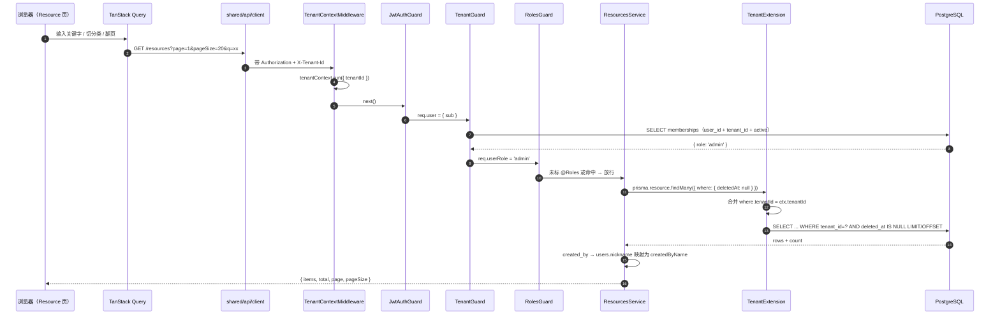
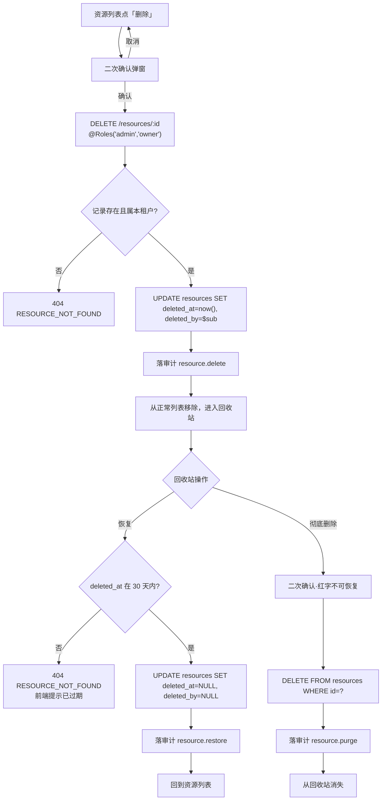

# 07 资源 CRUD + 回收站

> 版本 v1.3 ｜ 更新 2026-11-09 ｜ 状态：已确认
> 确认：李顺 · 2026-11-06 ｜ 变更：v1.1 校验失败状态码由 400 修正为 422（对齐 `setup-app.ts` 实际装配的 `StandardSchemaValidationPipe`）；v1.2 前端实现期拍板——表单改用 pro-components `ModalForm`（组件优先 pro-components 的既定偏好），当前租户角色从 tenants 列表经 `usePermission` 派生（tenant store 实际无 `role` 字段）；v1.3 §1.3 的「侧边栏 ProLayout 改造」经用户拍板提前落地，布局依据 `_docs/原型图.html` 应用内线框（Ardot 高保真稿待设计侧导出后校准）
> 关联：《技术方案设计》§4.6 权限渲染、§4.7 关键页面设计要点、《数据库设计与数据字典》§3.2 resources、《原型图》S3/S4/S5、《需求文档》§核心特性「业务域 CRUD」、`03-多租户行级隔离`、`06-RBAC与审计`、`_docs/前端开发规范.md`、`_docs/后端实施指南.md` §9
>
> **一页速览**
> 接口：`GET|POST /resources`、`GET|PATCH|DELETE /resources/:id`、`GET /trash`、`POST /trash/:id/restore`、`DELETE /trash/:id`
> 前端落点：`pages/Resource/{index,Detail}`、`pages/Trash/`、`shared/api/resource.ts`
> 后端落点：`src/modules/resources/`、`prisma/schema.prisma`、`prisma/tenant.extension.ts`
> 关键异常：`RESOURCE_NOT_FOUND` / `ROLE_DENIED` / `VALIDATION_FAILED` / `TENANT_MISMATCH`

---

## 1. 需求

### 1.1 用户故事

| 编号 | 角色 | 诉求 | 目的 |
|------|------|------|------|
| US-01 | 租户 admin / owner | 新建、编辑、删除本租户的资源，列表能按名称搜索与分类过滤 | 日常业务数据的组织与检索 |
| US-02 | 租户 member | 浏览与检索资源，但**不能**新建 / 编辑 / 删除 | 权限收敛：普通成员不应改动团队资产 |
| US-03 | 租户 admin / owner | 误删的资源在 30 天内可恢复，也能立即彻底删除 | 降低误操作损失，删除语义与真实物理删除分离 |
| US-04 | 平台方 | 任何资源查询都被限制在请求所属租户内，跨租户 id 一律按「不存在」处理 | 越权不暴露存在性，杜绝 id 探测 |

### 1.2 验收标准

| 编号 | 标准 |
|------|------|
| AC-01 | `GET /resources` 返回 `{ items, total, page, pageSize }`；不带参数时 `page=1`、`pageSize=20` |
| AC-02 | `pageSize=101` 或 `page=0` → `422 VALIDATION_FAILED`（由 shared 的 `resourceQuerySchema` 拦截） |
| AC-03 | `q` 按名称模糊匹配且大小写不敏感；`category` 等值匹配；两者可叠加，`total` 是过滤后的总数 |
| AC-04 | 列表只返回 `deleted_at IS NULL` 的记录；软删除后的记录不在列表出现 |
| AC-05 | `POST /resources` 成功返回 `201`；`created_by` 取自 access token 的 `sub`，`tenant_id` 由租户扩展注入（请求体不含这两个字段） |
| AC-06 | `member` 调用 `POST` / `PATCH` / `DELETE /resources/:id` → `403 ROLE_DENIED` |
| AC-07 | `member` 调用 `GET /resources`、`GET /resources/:id` → `200` |
| AC-08 | `PATCH /resources/:id` 传 `{}` → `200`，返回内容与更新前完全一致（幂等空更新） |
| AC-09 | `DELETE /resources/:id` → `200`，该记录 `deleted_at` 非空，正常列表查不到，`GET /trash` 能查到 |
| AC-10 | `GET /trash` 只返回 `deleted_at > now() - 30d` 的记录，`total` 同样只统计窗口内条数 |
| AC-11 | `POST /trash/:id/restore` → `200`，`deleted_at` 置空，记录回到正常列表原位置（按 `created_at` 排序位置不变） |
| AC-12 | 恢复 `deleted_at < now() - 30d` 的记录 → `404 RESOURCE_NOT_FOUND`（视同已不存在） |
| AC-13 | `DELETE /trash/:id` → `200`，该行**物理删除**；再修同 id 的详情 → `404` |
| AC-14 | 用 A 租户的 token + `X-Tenant-Id: B` 访问 A 租户资源的 id → `404 RESOURCE_NOT_FOUND`（不是 403、不泄露存在性） |
| AC-15 | `member` 调用 `/trash` 下任一接口 → `403 ROLE_DENIED` |
| AC-16 | 新建 / 更新 / 删除 / 恢复 / 彻底删除各落一条 `audit_logs`，`action` 分别为 `resource.create` / `resource.update` / `resource.delete` / `resource.restore` / `resource.purge` |
| AC-17 | 全部既有单测通过；新增 `resources.service.spec.ts`、`tenant.extension.spec.ts`（补 `Resource` 用例）通过 |

### 1.3 范围外

- **附件能力**（上传 / 下载 / 列表「附件」列 / 详情附件区 / 删除级联）：`files` 表属 M3，本期返回恒 0 的假字段只会制造后续返工。原型 S3 的「附件」列本期**隐藏**
- **到期自动清理**（`cleanup` 队列每日扫描物理删除）：M3 引入 BullMQ 后落地。本期只有用户主动「彻底删除」这一条物理删除路径
- **分类字典化**：本期分类是自由文本，等值过滤；M3 租户设置里固化为字典后再换 `z.enum` + 下拉
- **列表排序切换**（按更新时间 / 名称 / 附件数）：固定 `created_at DESC`
- **批量操作**（批量删除 / 批量恢复）：原型未定义交互
- **并发编辑乐观锁**：不加 `version` 字段，`updated_at` 仅供展示
- **回收站记录「剩余天数」**：由前端用 `deletedAt` + 30 天现算，后端不返回
- **侧边栏 ProLayout 改造**：影响全部页面，属独立功能点。本期沿用现有 `AuthLayout` 顶部导航，仅追加「回收站」入口

---

## 2. 交互逻辑

### 2.1 列表查询与新建



### 2.2 删除 → 回收站 → 恢复 / 彻底删除



### 2.3 异常分支表

| # | 触发条件 | HTTP | 错误码 | 前端表现 |
|---|---------|------|--------|---------|
| 1 | 未带 / 无效 access token | 401 | `UNAUTHORIZED` / `TOKEN_EXPIRED` | 走静默刷新，失败跳登录（沿用 01 方案） |
| 2 | 缺 `X-Tenant-Id` | 403 | `TENANT_MISMATCH` | 切租户提示 / 回租户选择页 |
| 3 | `name` 为空或超 100 字、`category` 为空或超 50 字、`description` 超 2000 字 | 422 | `VALIDATION_FAILED` | 表单对应字段红字（按 `details.path` 回填） |
| 4 | `page` < 1 或 `pageSize` > 100 | 422 | `VALIDATION_FAILED` | 分页参数由组件控制，正常不触发；触发时 toast |
| 5 | `member` 调用写接口或 `/trash` | 403 | `ROLE_DENIED` | 按钮本就隐藏；直接调接口时 toast「当前角色无权执行该操作」 |
| 6 | 资源 id 不存在，或存在但不属当前租户 | 404 | `RESOURCE_NOT_FOUND` | 列表刷新 + toast「资源不存在或已被删除」 |
| 7 | 恢复超 30 天窗口的记录 | 404 | `RESOURCE_NOT_FOUND` | toast「该资源已超过 30 天可恢复期」 |
| 8 | 彻底删除 / 恢复一个已被并发删除的 id | 404 | `RESOURCE_NOT_FOUND` | 与 #6 同 |

> 分支 6 是本方案的安全要点：**跨租户访问统一返回 404 而不是 403**。返回 403 等于确认「这个 id 真实存在于别的租户」，构成 id 枚举通道。实现上无需额外判断——租户扩展会把 `tenantId` 合并进 `where`，查不到自然落到 404。

> **校验失败是 422 不是 400**：`apps/api/src/setup-app.ts` 的全局 `StandardSchemaValidationPipe` 构造参数里明确写了 `errorHttpStatusCode: HttpStatus.UNPROCESSABLE_ENTITY`。`_docs/后端实施指南.md` §4.2 与附录 A 第 20 条记载的「400」是早期口径，以代码为准。前端一样按 `code === 'VALIDATION_FAILED'` 分支，不按状态码分支。

---

## 3. 前端改动

### 3.1 现状

| 文件 | 现状 |
|------|------|
| `pages/Resource/index.tsx` | 7 行占位，渲染 `<h1>Resource Page</h1>`，无任何请求 |
| `app/router.tsx` | 已有 `/app/resources` 路由（`lazy` + `ErrorBoundary` 包裹），无详情页与回收站路由 |
| `app/AuthLayout.tsx` | 顶部两个链接（Dashboard / Resources），无侧边栏、无权限过滤 |
| `shared/api/client.ts` | 已具备 401 静默刷新、`X-Tenant-Id` 注入、统一错误码解析 |
| `stores/tenant.ts` | 已持 `currentTenantId` 与 `tenants` 列表；角色在列表项上，由 `usePermission` 派生，见 §3.2 |

### 3.2 待改动（文件级）

| 文件 | 改动 |
|------|------|
| `shared/api/resource.ts`（新增） | 7 个接口的薄封装，返回 `Promise<ResourceItem>` / `ResourceListResult` 等，类型全部来自 `@saas/shared` |
| `pages/Resource/index.tsx`（重写） | AntD `Table` + 搜索框 + 分类过滤 + 分页；列：名称 / 分类 / 创建人 / 更新时间 / 操作（编辑、删除）；空态插画 + 「创建第一个资源」引导 |
| `pages/Resource/CreateModal.tsx`（新增） | 新建 / 编辑复用同一弹窗，pro-components `ModalForm`（ProFormText / ProFormTextArea），校验规则与 `resourceCreateSchema` / `resourceUpdateSchema` 同源；422 `details.path` 回填字段错误 |
| `hooks/usePermission.ts`（新增） | `useCurrentRole` 从 tenant store 的 `tenants` 列表按 `currentTenantId` 派生当前角色；`usePermission().can(permission)` 是 shared `canDo` 的 hook 封装 |
| `pages/Resource/Detail.tsx`（新增） | 详情卡片：名称、分类、创建人、创建/更新时间、描述；右上有编辑 / 删除 |
| `pages/Trash/index.tsx`（新增） | 顶部 30 天保留提示条；列：名称 / 删除人 / 删除时间 / 剩余天数 / 操作（恢复、彻底删除）；剩余 < 7 天标橙 |
| `app/router.tsx` | 追加 `/app/resources/:id`、`/app/trash`，均走 `lazy` + `ErrorBoundary` |
| `app/AuthLayout.tsx` | 顶部追加「回收站」入口，用 `canDo(role, 'trash.manage')` 过滤显隐 |
| `pages/Resource/{index,Detail}.test.tsx`（新增） | 至少覆盖：member 不渲染新建按钮、删除确认后调用接口、空态渲染 |

**权限渲染口径**：`member` 不渲染「新建资源」按钮，行内操作列只剩「查看」；回收站入口对 `member` 不渲染。前端隐藏只是体验优化，**真正的拦截在后端**——AC-06 / AC-15 断言的就是绕过前端直接调接口的情形。

### 3.3 错误码 → 文案映射

| 错误码 | 文案 |
|--------|------|
| `VALIDATION_FAILED` | 按 `details` 逐字段回填；无字段信息时「提交内容有误，请检查后重试」 |
| `ROLE_DENIED` | 「当前角色无权执行该操作」 |
| `RESOURCE_NOT_FOUND` | 「资源不存在或已被删除」；恢复场景用「该资源已超过 30 天可恢复期」 |
| `TENANT_MISMATCH` | 「无权访问该租户，请重新选择」 |
| 其它 `INTERNAL_ERROR` | 「服务异常，请稍后重试」 |

---

## 4. 后端接口

### 4.1 接口清单

| # | 方法 路径 | 说明 | 鉴权 | 成功码 |
|---|----------|------|------|--------|
| 1 | `GET /resources` | 分页列表，支持 `q` / `category` | `resource.read`（member+） | 200 |
| 2 | `GET /resources/:id` | 详情 | `resource.read` | 200 |
| 3 | `POST /resources` | 新建 | `resource.write` → `@Roles('admin','owner')` | 201 |
| 4 | `PATCH /resources/:id` | 更新（允许空对象） | 同上 | 200 |
| 5 | `DELETE /resources/:id` | 软删除 | 同上 | 200 |
| 6 | `GET /trash` | 回收站列表（30 天窗口） | `trash.manage` → `@Roles('admin','owner')` | 200 |
| 7 | `POST /trash/:id/restore` | 恢复 | 同上 | 200 |
| 8 | `DELETE /trash/:id` | 彻底删除（物理） | 同上 | 200 |

契约全部来自 `packages/shared/src/contracts/resource.ts`：`resourceCreateSchema` / `resourceUpdateSchema` / `resourceQuerySchema` / `resourceItemSchema` / `resourceListResultSchema` / `trashItemSchema` / `trashListResultSchema`。

Controller 用 `@Query()` / `@Body()` 直接标 `z.infer` 类型，由 `StandardSchemaValidationPipe` 用同一份 schema 校验，**不写 class-validator DTO**。

### 4.2 数据模型变更

新增 `Resource` 模型（字段与《数据库设计与数据字典》§3.2 一致，补 `deleted_by`）：

| 字段 | 类型 | 约束 | 说明 |
|------|------|------|------|
| `id` | `String` | `@id @default(cuid())` | — |
| `tenantId` | `String` | `@map("tenant_id") @db.VarChar(32)` | 隔离键 |
| `name` | `String` | `@db.VarChar(100)` | — |
| `description` | `String?` | `@db.Text` | — |
| `category` | `String?` | `@db.VarChar(50)` | 接口必填，列留 NULL |
| `createdBy` | `String` | `@map("created_by") @db.VarChar(32)` | FK→`users.id` |
| `deletedBy` | `String?` | `@map("deleted_by") @db.VarChar(32)` | **本期新增列**，FK→`users.id`；清理任务删除时为空 |
| `deletedAt` | `DateTime?` | `@map("deleted_at")` | NULL=正常 |
| `purgedAt` | `DateTime?` | `@map("purged_at")` | 本期建列但**不写入**，留给 M3 清理任务改异步标记 |
| `createdAt` / `updatedAt` | `DateTime` | `@default(now())` / `@updatedAt` | — |

索引：

- `@@index([tenantId, deletedAt])` — 正常列表与回收站共用
- `@@index([tenantId, category])` — 分类过滤

关系：`creator User @relation("ResourceCreator", fields: [createdBy], references: [id])`、`deleter User? @relation("ResourceDeleter", fields: [deletedBy], references: [id])`。两个关系指向同一张 `users` 表，必须显式命名，否则 Prisma 报歧义。

迁移：`pnpm --filter @saas/api db:migrate --name resource_crud`（注意是 `db:migrate --name`，不要写成 `-- --name`，见 06 方案 §5.3 的坑）。

### 4.3 关键约束

**1）租户隔离必须显式加白名单（本方案最高风险点）**

`apps/api/src/prisma/tenant.extension.ts` 的 `TENANT_SCOPE` 目前只有 `AiDocument` / `AiChunk`。新建 `Resource` 后**必须加入 `'Resource'`**，否则扩展对资源表完全放行：`findMany` 不报错，但会跨租户返回数据，且只测 Service 逻辑发现不了。

`tenant.extension.spec.ts` 需补三条 `Resource` 用例：create 注入 `tenantId`、findMany 合并 `where.tenantId`、不在上下文时原样放行。

**2）Service 里不写 `where: { tenantId }`**

扩展已自动合并。手写会在 `where` 里被覆盖（同名键后写覆盖前写）掩盖扩展失效，测试也测不出来。Service 只写业务条件。

**3）软删除过滤不由扩展负责**

扩展只管 `tenantId`，不管 `deletedAt`。所以：

- 正常列表：`where: { deletedAt: null, ...业务条件 }`
- 回收站：`where: { deletedAt: { gt: 三十天前 } }`
- 详情：`where: { id, deletedAt: null }` —— 已软删除的资源详情应按 404 处理

**4）跨租户统一 404**

查询一律走 `findFirst`（带 `deletedAt` 条件），返回 `null` 即抛 `404 RESOURCE_NOT_FOUND`，不区分「不存在」与「不属于本租户」。`update` / `delete` 前先 `findFirst` 确认，避免 Prisma `P2025` 直出为 500。

**5）彻底删除是同步物理删除**

`DELETE /trash/:id` 直接 `prisma.resource.delete({ where: { id } })`。理由：`files` 表尚未存在，没有 COS 对象需要级联清理；改为异步反而让「彻底删除」有中间态。M3 引入附件后，此处改为写 `purged_at` + 投递 `cleanup` 队列，接口语义不变。

**6）审计**

五个写操作分别标 `@Audit(AUDIT_ACTIONS.RESOURCE_CREATE | RESOURCE_UPDATE | RESOURCE_DELETE | RESOURCE_RESTORE | RESOURCE_PURGE)`。常量已在 `packages/shared/src/audit-actions.ts` 就位，**不要在 Controller 里写裸字符串**。

**7）权限矩阵已随本方案调整**

`packages/shared/src/permissions.ts` 的 `'resource.write'` 由 `['member','admin','owner']` 改为 `['admin','owner']`。

这**推翻了《技术方案设计》§4.6 的原始矩阵**（该表写「资源增删改：member ✅」）。三份材料里原型图 S3 是唯一带完整交互说明的产品定义，其注释明确「member 不显示新建资源按钮、操作列只有查看、直接调删除接口也会被后端 403 拦截」，故以原型为准。TSD §4.6 需追加一条修订记录（不改原表），提交说明中一并指出。

---

## 5. 测试

### 5.1 单测

`resources.service.spec.ts`（mock `prisma`）：

| 用例 | 断言 |
|------|------|
| 列表分页 | 传入 `{page:2,pageSize:10}` → `skip=10`、`take=10`，返回 `total` 来自 `count` |
| 关键字过滤 | `q='abc'` → `where.name.contains='abc'` 且 `mode='insensitive'` |
| 列表排除软删 | `where.deletedAt === null` |
| 回收站窗口 | `where.deletedAt.gt` 为「当前时间 - 30 天」附近（用假时钟） |
| 详情不存在 | `findFirst` 返回 null → 抛 `NotFoundException`，`code=RESOURCE_NOT_FOUND` |
| 空更新 | `update` 传 `{}` → 返回原记录，不调用 `update`（或调用但不改字段，按实现二选一，用例钉住行为） |
| 恢复超窗 | `deletedAt` 为 31 天前 → 抛 404 |
| 彻底删除 | 先 `findFirst` 再 `delete`；`findFirst` 为 null 时抛 404 且**不调用** `delete` |

`tenant.extension.spec.ts`（补）：`model='Resource'` 且有上下文时 create 注入 `tenantId`、findMany 合并 `where`；无上下文时原样透传。

### 5.2 e2e 用例矩阵

| 类型 | # | 场景 | 期望 |
|------|---|------|------|
| 正常 | 1 | admin 新建 → 列表可见 → 详情 200 | 201 / 列表含该条 / 200 |
| 正常 | 2 | admin 编辑名称 → 详情反映新值 | 200，`name` 已更新 |
| 正常 | 3 | admin 删除 → 列表消失 → 回收站可见 → 恢复 → 列表复现 | 全链路 200 |
| 正常 | 4 | admin 删除 → 彻底删除 → 回收站消失、详情 404 | 200 / 404 |
| 正常 | 5 | `q` + `category` 叠加过滤 | `total` 等于交集条数 |
| 边界 | 6 | `pageSize=100` 通过、`=101` 拒绝 | 200 / 422 |
| 边界 | 7 | `PATCH {}` | 200，字段不变 |
| 边界 | 8 | 恢复 31 天前的记录（直接改库造数据） | 404 |
| 异常 | 9 | `name` 为空串 | 422 `VALIDATION_FAILED` |
| 异常 | 10 | 不传 `category` | 422 `VALIDATION_FAILED` |
| 越权 | 11 | member → `POST /resources` | 403 `ROLE_DENIED` |
| 越权 | 12 | member → `PATCH` / `DELETE` | 403 |
| 越权 | 13 | member → `GET /trash` / `restore` / 彻底删除 | 403 |
| 越权 | 14 | A 租户 token + `X-Tenant-Id: B` 访问 A 的资源 id | 404 `RESOURCE_NOT_FOUND` |
| 越权 | 15 | 不带 `X-Tenant-Id` 调 `GET /resources` | 403 `TENANT_MISMATCH` |
| 审计 | 16 | 依次执行五个写操作后查 `audit_logs` | 5 条记录，`action` 与 `result=success` 正确 |

### 5.3 手工验证清单

```bash
# 0 契约包改完必须先构建，否则后端读到的还是旧 dist
pnpm --filter @saas/shared build

# 1 生成迁移与客户端
pnpm --filter @saas/api db:migrate --name resource_crud
pnpm --filter @saas/api run db:regen

# 2 门禁
pnpm turbo run lint typecheck test

# 3 起服务（MAIL_DEV_MODE 下验证码/令牌从日志取，见 01 方案）
pnpm --filter @saas/api dev

# 4 登录取双令牌后，带 X-Tenant-Id 走一遍主链路
TOKEN=<accessToken>
TENANT=<tenantId>
curl -s -X POST localhost:3000/api/v1/resources \
  -H "Authorization: Bearer $TOKEN" -H "X-Tenant-Id: $TENANT" \
  -H 'Content-Type: application/json' \
  -d '{"name":"产品需求清单 v3","category":"文档","description":"本季度需求汇总"}'

curl -s "localhost:3000/api/v1/resources?page=1&pageSize=20&q=需求&category=文档" \
  -H "Authorization: Bearer $TOKEN" -H "X-Tenant-Id: $TENANT"

# 5 删除 → 查列表应为空 → 查回收站应有一条 → 恢复 → 再查列表
curl -s -X DELETE "localhost:3000/api/v1/resources/$RID" -H "Authorization: Bearer $TOKEN" -H "X-Tenant-Id: $TENANT"
curl -s "localhost:3000/api/v1/trash" -H "Authorization: Bearer $TOKEN" -H "X-Tenant-Id: $TENANT"
curl -s -X POST "localhost:3000/api/v1/trash/$RID/restore" -H "Authorization: Bearer $TOKEN" -H "X-Tenant-Id: $TENANT"

# 6 越权：换一个租户的 id 访问，必须 404 而不是 403
curl -s -o /dev/null -w '%{http_code}\n' "localhost:3000/api/v1/resources/$OTHER_TENANT_RID" \
  -H "Authorization: Bearer $TOKEN" -H "X-Tenant-Id: $TENANT"

# 7 前端联调
pnpm --filter @saas/web dev
#    · member 账号登录 → 资源页无「新建资源」按钮、操作列只有「查看」、无「回收站」入口
#    · admin 账号 → 全链路走通删除 → 回收站 → 恢复 → 彻底删除
```

> **验证顺序不可颠倒**：`db:migrate` 会重新 `generate` 客户端，忘记这一步时 `prisma.resource` 在类型层就不存在。另外在 `apps/api` 装依赖一律加 `--ignore-scripts`，否则 postinstall 的 `prisma generate` 可能把 `src/generated/prisma` 清坏（见 2026-11-06 工作日志）。
