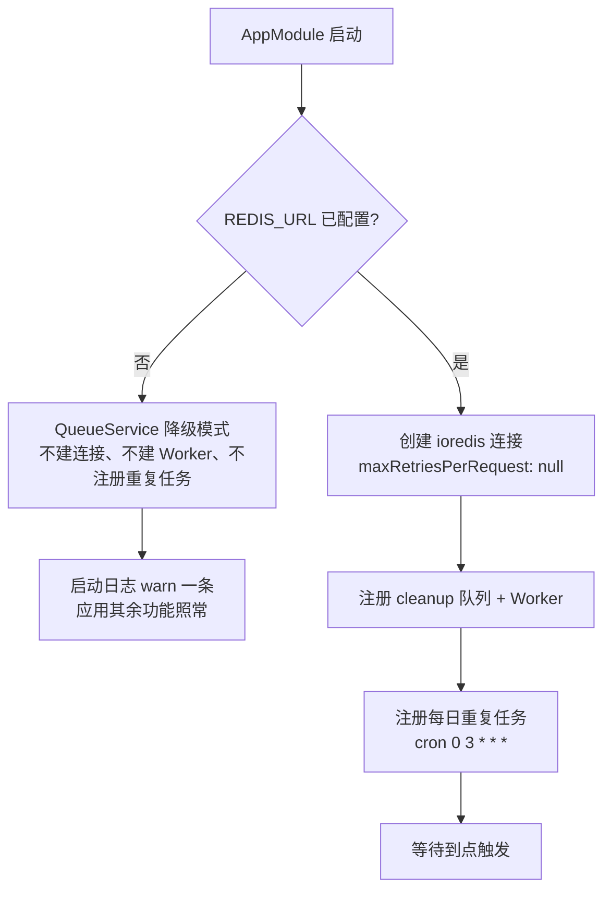
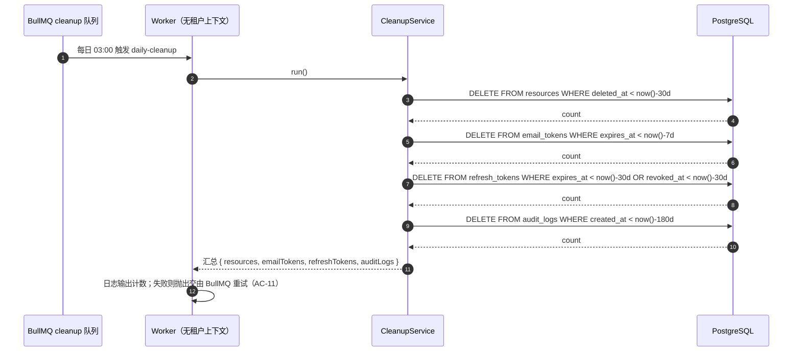

# 08 异步任务队列

> 版本 v1.2 ｜ 更新 2026-11-13 ｜ 状态：已实现
> 确认：李顺 · 2026-11-13 ｜ 变更：v1.1 实现期修订——bullmq@6.7.5 的重复任务 API 由「`queue.add` + `repeat` 选项」变更为 `queue.upsertJobScheduler`（`repeat` 已从 JobsOptions 移除）；ioredis@6 改为具名导出 `Redis`（默认导出不可构造）。v1.2 真实链路验证发现——Upstash 免费档受限用户无 `INFO` 命令权限，BullMQ 建连时的版本探测 `info()` 会报 `NOPERM` 并随重连刷屏，Queue/Worker 均须加 `skipVersionCheck: true`（§4.3-3）
> 关联：《需求文档》§5.1 软删除/回收站、§5.4 消息通知（慢任务后台化）、《数据库设计与数据字典》resources / email_tokens / refresh_tokens / audit_logs 保留口径、《07-资源CRUD与回收站》§1.3、`_docs/资源申请清单.md` Upstash Redis
>
> **一页速览**
> 接口：无新增 HTTP 接口（机制层，同 03）
> 前端落点：无
> 后端落点：`src/common/queue/{queue.module,queue.service,cleanup.service,processors/cleanup.processor}.ts`、`src/config/{env.schema.ts,configuration.ts}`
> 关键约束：`REDIS_URL` 缺失 → 队列整体降级不启动；Worker 内无租户上下文，清理刻意跨租户

---

## 1. 需求

### 1.1 用户故事

| 编号 | 角色 | 诉求 | 目的 |
|------|------|------|------|
| US-01 | 平台方 | 回收站中超过 30 天的软删资源被自动物理删除 | 兑现 07 方案「到期清理」承诺，回收站口径自洽 |
| US-02 | 平台方 | 过期的验证 / 重置令牌、过期的会话令牌定期清除 | 过期数据不留存，缩小攻击面与库体积 |
| US-03 | 平台方 | 审计日志保留 180 天后自动清除 | 数据字典既定保留口径 |
| US-04 | 开发者 | 邮件发送等慢任务有统一的异步执行地基 | 本篇只建队列与调度，业务任务在 09/10 方案接入 |
| US-05 | 开发者 | 本地开发没配 Redis 时，应用照常启动、其余功能不受影响 | 队列是增强项而非启动前置条件 |

### 1.2 验收标准

| 编号 | 标准 |
|------|------|
| AC-01 | 未配置 `REDIS_URL` 时应用正常启动，`GET /health` 返回 200，启动日志出现一条「队列降级」warn，且不抛任何未捕获异常 |
| AC-02 | 配置 `REDIS_URL` 启动后，`cleanup` 队列注册成功，存在每日一次的重复任务（cron `0 3 * * *`，按进程本地时区解释） |
| AC-03 | 清理任务执行后，`deleted_at < now() - 30d` 的 resources 行被**物理删除**，任务日志输出各表删除计数 |
| AC-04 | `deleted_at` 距今不足 30 天的软删资源不被清理，仍可在回收站恢复 |
| AC-05 | `expires_at < now() - 7d` 的 email_tokens 全部删除（含已消费 `used_at` 非空的行） |
| AC-06 | refresh_tokens 满足 `expires_at < now() - 30d` **或** `revoked_at < now() - 30d` 的行全部删除 |
| AC-07 | `created_at < now() - 180d` 的 audit_logs 全部删除 |
| AC-08 | 清理任务不向 audit_logs 写入任何记录（自动清理无操作者，留痕靠任务日志的计数输出） |
| AC-09 | 清理任务发出的 prisma `deleteMany` 的 `where` 中不含 `tenantId`（Worker 无租户上下文，租户扩展按 `applyTenantScope` 的 `!ctx` 分支放行，单测断言） |
| AC-10 | 队列降级模式下调用 `enqueue` 不抛错，只记 warn 并丢弃任务 |
| AC-11 | 任务失败自动重试：`attempts: 3`、指数退避（首次 60s），最终失败的任务保留在失败集（`removeOnFail` 保留 50 条）供排查 |
| AC-12 | `pnpm --filter @saas/api test` 全部通过，含新增 `cleanup.service.spec.ts` 与 `queue.service.spec.ts` |

### 1.3 范围外

- **邮件发送异步化**：MailService 现为请求内同步发送，改投队列属通知域改造，在 10-消息通知方案落地
- **COS 附件连带清理**：清理资源时删除其 COS 对象，依赖 09-文件存储 的 StorageService，届时并入本清理任务（删除顺序见 §4.3）
- **限流计数 / 令牌黑名单上 Redis**：当前限流用 @nestjs/throttler 内存存储，够演示场景，不迁移
- **任务监控面板 / 告警**：失败任务靠日志排查，不接 Bull Board 等面板
- **SSE / WebSocket 推送**：M5 实时协作范畴

---

## 2. 交互逻辑

### 2.1 启动分支

### 2.2 清理任务执行流程

### 2.3 异常分支表

| 触发条件 | 表现 | 前端表现 |
|---------|------|---------|
| `REDIS_URL` 缺失 | 队列模块降级，仅 warn | 无（清理暂不执行，业务功能不受影响） |
| Redis 连接中断 | ioredis 自动重连；重试按 AC-11 退避 | 无 |
| 清理任务单表删除失败 | 整个 job 抛错，BullMQ 重试最多 3 次；deleteMany 幂等，重试安全 | 无 |
| 连续 3 次失败 | 任务进失败集（保留 50 条），error 日志 | 无 |

---

## 3. 前端改动

无（机制层，无接口、无页面、无状态变化）。

---

## 4. 后端设计

### 4.1 模块清单

| 单元 | 职责 |
|------|------|
| `QueueService` | 唯一的队列出入口：按 `redis.url` 判定启用/降级；持有 ioredis 连接与 cleanup 队列；提供 `registerRepeatJobs()` 与受保护的 `enqueueCleanup()`；管理优雅关闭 |
| `CleanupProcessor` | BullMQ Worker 回调，调 CleanupService 并透传异常（重试语义交给 BullMQ） |
| `CleanupService` | 纯 DB 清理逻辑（四张表各一次 deleteMany），不感知队列存在，单测直接实例化 |

依赖注入沿用既有约定：`@Inject(PRISMA)` 注入 `ExtendedPrismaClient`（PrismaModule 为 `@Global`，无需显式 import）。

### 4.2 数据模型变更

无新表、无迁移。清理条件依赖的既有索引：

- `email_tokens`：`@@index([expiresAt])` 已建（schema 注释即为本功能预留）
- `resources` / `refresh_tokens` / `audit_logs`：无命中的单列索引，按现有规模（演示库）每天一次全表扫描可接受；数据量增长后再补 `deleted_at` / `created_at` 单列索引，不提前优化

另注：`resources.purged_at` 列（07 落表时预留）**本方案不使用**——物理删除后行不复存在，列无意义。09 引入 COS 清理时同样不借助它（删除顺序约束见 §4.3）；该列保留不动，待 v2 评估去留。

### 4.3 关键约束

1. **降级是显式状态，不是错误**：`redis.url` 缺失 → `QueueService.enabled = false`，构造函数直接返回，不创建任何连接。降级模式下所有 enqueue 调用 warn 后丢弃（AC-10）。本地开发与单测环境无需 Redis
2. **Worker 内无租户上下文是预期行为**：`applyTenantScope` 在 `getStore()` 为空时对白名单模型（含 Resource）原样放行。清理是平台级操作，`where` 刻意不带 `tenantId`（AC-09）。禁止在 Worker 回调里手工 `tenantContext.run()` 伪造上下文
3. **连接参数**：ioredis 连接必须 `maxRetriesPerRequest: null`（BullMQ Worker 的阻塞命令在默认重试上限下会报错）；Upstash 为 `rediss://` TLS 连接串，ioredis 按协议头自动启用 TLS。Upstash 免费档的受限用户**没有 `INFO` 命令权限**，而 BullMQ 建连时会默认调 `info()` 做版本探测（报 `NOPERM` 且随重连循环刷屏）——Queue 与 Worker 的 options 必须带 `skipVersionCheck: true` 跳过该探测
4. **删除顺序（为 09 预留）**：未来清理资源时，先删 COS 对象、后删 DB 行。COS 删除失败时行尚在（回收站窗口外的行用户不可见），job 重试重删即可，不会产生孤儿对象；顺序颠倒则可能留下指向已删行的孤儿文件
5. **重试与保留**：job 默认 `attempts: 3`、`backoff: { type: 'exponential', delay: 60_000 }`；`removeOnComplete: { count: 7 }`（近 7 次成功记录）、`removeOnFail: { count: 50 }`
6. **重复任务的幂等注册**：BullMQ 6 走 `queue.upsertJobScheduler(jobSchedulerId, { pattern }, template)`，同一 schedulerId 重复 upsert 即更新调度，应用每次重启调用幂等（v1.0 原按 `add` + `repeat` 选项设计，API 已变更）
7. **优雅关闭**：`onModuleDestroy` 依次 `worker.close()` → `queue.close()` → `connection.quit()`，避免部署滚动时任务被硬杀
8. **cron 时区**：`0 3 * * *` 按**进程本地时区**解释。Render 默认 UTC（即北京时间 11:00），演示场景可接受；若要求严格北京时间，部署时设 `TZ=Asia/Shanghai`，不引入时区库
9. **清理不写审计**（AC-08）：审计语义是「用户敏感操作」，自动清理无 actor；`AuditLog.actorUserId` 为 NOT NULL，也不该为它造假数据。留痕依赖任务日志的计数输出

### 4.4 环境变量变更

- `env.schema.ts`：`REDIS_URL` 已声明（optional），**不变**
- `configuration.ts`：新增 `redis.url`（`process.env.REDIS_URL ?? null`）
- `.env.example`：M3+ 段的 `REDIS_URL` 注释补充一行降级说明

---

## 5. 测试

### 5.1 单测

| 文件 | 覆盖 |
|------|------|
| `cleanup.service.spec.ts` | 四个 deleteMany 的 where 条件逐表断言（30d/7d/30d OR/180d，AC-03~07、09）；返回计数汇总；prisma 抛错时异常上抛（AC-11 语义前提） |
| `queue.service.spec.ts` | 无 `redis.url` → `enabled=false`、enqueue warn 不抛（AC-10）、不创建 Queue；有 url → 创建连接并按 pattern upsert 重复任务（AC-02），mock bullmq Queue 验证 `upsertJobScheduler` 参数 |

### 5.2 e2e 用例矩阵

不适用：本功能无 HTTP 接口，队列行为由单测 + 手工验证覆盖。

### 5.3 手工验证清单

- [x] 不配 `REDIS_URL` 启动 `pnpm --filter @saas/api dev`：启动成功、warn 出现、登录/资源 CRUD 正常（AC-01）※2026-11-13 实现期验证
- [x] 配置 Upstash `REDIS_URL` 启动：启动日志出现「定时清理任务已注册」、Upstash 侧 `bull:cleanup:*` 含 `repeat` 调度 key（AC-02）※2026-11-13 实现期验证（Upstash Global 库 ap-southeast-1）
- [x] 向 `resources` 插入一条 `deleted_at = now() - 31d` 的行，手动入队 `daily-cleanup` 任务触发 Worker，日志计数 `resources=1` 且行被删除（AC-03；未临时改 cron，改用手动入队等价验证）※2026-11-13
- [x] 30 天内软删的资源行不受影响（AC-04 回归，与 AC-03 同批对照验证）※2026-11-13

---

## 6. 实际与方案的偏差

- **BullMQ 6 API**（即 v1.1 变更记录）：`upsertJobScheduler` 替代 `add` + `repeat`，ioredis 6 具名导出 `Redis`。类型检查拦截后回写文档再改代码，无返工
- **启动期注册失败不阻断**：`onModuleInit` 里注册重复任务失败只记 error，应用照常启动（方案 §2.3 未穷举「Redis 暂不可达但 REDIS_URL 已配置」的启动场景，实现期补充该降级语义，单测覆盖）
- ~~**手工验证清单未执行**~~：Upstash Redis 已开通（Global 库，主区域 ap-southeast-1，免费档），AC-01~04 已于 2026-11-13 全部验证通过（详见 §5.3 勾选记录）。注意 Upstash 免费档用户无 `INFO` 命令权限，BullMQ 连接必须带 `skipVersionCheck: true`（已实现，v1.2）
