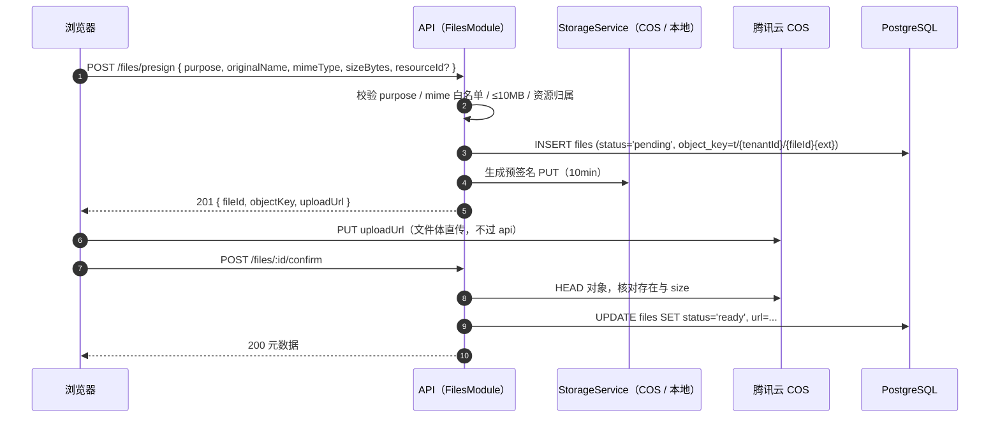
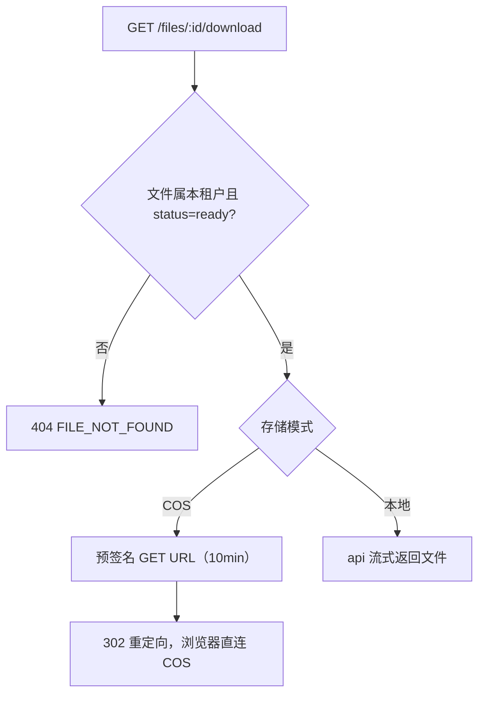

# 09 文件存储

> 版本 v1.0 ｜ 更新 2026-11-13 ｜ 状态：已确认
> 确认：李顺 · 2026-11-13 ｜ 变更：—
> 关联：《需求文档》§5.1 文件存储、《数据库设计与数据字典》§3.x files、`08-异步任务队列`（pending 元数据与过期附件清理复用其 CleanupService）、《07-资源CRUD与回收站》（附件随资源软删）、`_docs/资源申请清单.md` 腾讯云 COS
>
> **一页速览**
> 接口：`POST /files/presign`、`POST /files/:id/confirm`、`GET /files/:id/download`、`DELETE /files/:id`、`POST /resources/:id/attachments`、`PATCH /auth/me/avatar`
> 前端落点：`pages/app/resources/[id]/page.tsx`（附件区）、`shared/api/file.ts`
> 后端落点：`src/modules/files/`、`src/common/storage/{storage.service,cos.storage,local.storage}.ts`、`prisma/schema.prisma`、`prisma/tenant.extension.ts`
> 关键异常：`VALIDATION_FAILED` / `FILE_NOT_FOUND` / `FILE_NOT_UPLOADED` / `ROLE_DENIED` / `STORAGE_NOT_CONFIGURED`（本地模式不出现）

---

## 1. 需求

### 1.1 用户故事

| 编号 | 角色 | 诉求 | 目的 |
|------|------|------|------|
| US-01 | 登录用户 | 上传头像（≤10MB 图片）作为个人资料 | 品牌化 / 个性化基线能力 |
| US-02 | 租户 admin / owner | 给资源上传附件（文档 / 图片等，≤10MB），在资源详情查看与删除 | 07 方案隐藏的「附件」列在本期补全 |
| US-03 | 登录用户 | 下载自己租户内的文件 | 私有读：文件不能拿到 URL 就能匿名访问 |
| US-04 | 平台方 | 文件直传对象存储，不占 api 带宽；元数据入库可配额统计 | M4 用量配额的统计口径（`size_bytes`） |
| US-05 | 开发者 | 本地未配置 COS 时，同样的接口走本地磁盘存储，联调不依赖云资源 | 降低开发与 e2e 的外部依赖 |

### 1.2 验收标准

| 编号 | 标准 |
|------|------|
| AC-01 | `POST /files/presign` 入参 `{ purpose, originalName, mimeType, sizeBytes, resourceId? }`：purpose ∈ `avatar / logo / attachment`，非法值 → `422`；`sizeBytes > 10MB` → `422 VALIDATION_FAILED` |
| AC-02 | `purpose=avatar/logo` 时 `mimeType` 必须 `image/jpeg|png|webp|gif`；`purpose=attachment` 白名单另含 `application/pdf`、`text/plain`、`application/zip`、`text/csv`，其余 `422` |
| AC-03 | presign 成功返回 `201 { fileId, objectKey, uploadUrl }`，files 行落库 `status='pending'`；`uploadUrl` 为 COS 预签名 PUT（10 分钟有效），objectKey 形如 `t/{tenantId}/{fileId}{ext}`（本地模式为 `uploads/{objectKey}`） |
| AC-04 | `purpose=attachment` 必须带 `resourceId`，且该资源属本租户、未软删；不满足 → `422` / `404 RESOURCE_NOT_FOUND`；member 可以为资源传附件，但 `DELETE /files/:id` 仅 owner/admin |
| AC-05 | `POST /files/:id/confirm`：对象确实已 PUT（HEAD 成功且 size 与元数据一致）→ `status='ready'`、回填 `url` 与 `mimeType/sizeBytes` 的服务端核对值，返回 `200 { id, url, originalName, mimeType, sizeBytes }`；未上传 → `400 FILE_NOT_UPLOADED` |
| AC-06 | `GET /files/:id/download` → `302` 到预签名 GET URL（10 分钟有效）；文件不存在（COS 404）→ `404 FILE_NOT_FOUND`；本地模式直接流式返回文件内容 |
| AC-07 | 租户隔离：A 租户 token 访问 B 租户的 fileId → presign/confirm/download/delete 一律 `404 FILE_NOT_FOUND`（`File` 加入 tenant.extension 白名单） |
| AC-08 | `DELETE /files/:id` → `200`：COS 对象删除（失败仅告警，行标记 `deletedAt` 由清理任务重试兜底）+ 行物理删除；member 调用 → `403 ROLE_DENIED` |
| AC-09 | `PATCH /auth/me/avatar` 入参 `{ avatarUrl }` → `200`，users.avatar_url 更新；非本人 token 无法改他人（无 :id 入口，天然按 sub 定位） |
| AC-10 | `POST /resources/:id/attachments` 入参 `{ fileId }`：将该 pending/ready 的 attachment 文件绑定到资源（presign 已落 resource_id 时此接口做幂等校验，返回 200），返回当前附件列表 |
| AC-11 | 资源软删 → 其附件行同事务批量置 `deletedAt`；资源恢复 → 附件 `deletedAt` 复位；资源物理删除 → COS 对象 + 附件行一并清除（08 CleanupService 扩展，先删对象后删行） |
| AC-12 | `status='pending'` 超过 1 天的元数据行由清理任务删除（孤儿 presign 行），并尝试删除对应对象 |
| AC-13 | 未配置 `COS_*` → 本地磁盘模式（`.data/uploads/`），全部接口行为一致，响应不含 `STORAGE_NOT_CONFIGURED`；配置了 `COS_*` 但密钥错误 → 涉 COS 操作 502 `STORAGE_NOT_CONFIGURED`（不暴露云厂商错误细节） |
| AC-14 | 附件随资源详情返回：`GET /resources/:id` 增加 `attachments: [{ id, originalName, mimeType, sizeBytes, url }]`（仅 `status='ready'` 且未软删），07 方案隐藏的附件列按此渲染 |
| AC-15 | `pnpm --filter @saas/api test` 全部通过（新增 files 相关 spec）；e2e 本地模式覆盖上传 → 确认 → 下载 → 删除主链路 |

### 1.3 范围外

- **分片上传 / >10MB 文件**：需求文档明确不计入 v1
- **租户 Logo / 品牌色的设置接口与页面**：属 11-租户设置；本方案只提供 `purpose=logo` 的上传能力
- **图片压缩 / 缩略图**：不处理，原图直出
- **配额校验**：M4 用量配额统一下租户级校验，本期只落 `size_bytes` 统计口径
- **病毒扫描 / 内容审核**：不涉及
- **通知中心 / 通知偏好**：属 10-消息通知方案

---

## 2. 交互逻辑

### 2.1 直传主流程（presign → PUT → confirm）



### 2.2 下载（私有读）



### 2.3 异常分支表

| 触发条件 | HTTP | 错误码 | 前端表现 |
|---------|------|--------|---------|
| purpose / mime / 大小非法 | 422 | `VALIDATION_FAILED` | 表单行内报错 |
| attachment 未带 resourceId / 资源不属本租户或已软删 | 404 | `RESOURCE_NOT_FOUND` | 提示资源不存在 |
| confirm 时对象未上传 | 400 | `FILE_NOT_UPLOADED` | 提示「上传未完成，请重试」 |
| 跨租户 fileId / 对象已不存在 | 404 | `FILE_NOT_FOUND` | 按「不存在」处理，不泄露存在性 |
| member 删除附件 | 403 | `ROLE_DENIED` | 按钮不可见（权限派生） |
| COS 密钥 / 网络错误 | 502 | `STORAGE_NOT_CONFIGURED` | 「存储服务暂不可用」 |
| 上传签名过期（PUT 403） | 400 | `FILE_NOT_UPLOADED` | 引导重新发起 presign |

---

## 3. 前端改动

### 3.1 现状

资源详情页（`pages/app/resources/[id]/page.tsx`）无附件区；07 方案落表时附件列隐藏。无任何文件上传组件；`shared/api/` 无 file 模块。

### 3.2 待改动（文件级）

- `shared/api/file.ts`（新增）：presign / confirm / download / delete / bindAttachment 五个调用 + 类型（契约在 `packages/shared` 定义，此处薄封装）
- `packages/shared/src/contract/files.ts`（新增）：`FilePurpose`、`filePresignSchema`、`fileMetaSchema`、错误码 `FILE_NOT_UPLOADED` 等入池
- `shared/api/resource.ts`：资源详情类型补 `attachments`
- `pages/app/resources/[id]/page.tsx`：附件区（ProForm Upload 直传：选文件 → presign → PUT COS → confirm → 刷新列表）；附件列按 `attachments.length` 渲染
- 用户头像：登录后布局的头像下拉支持上传新头像（presign avatar → confirm → `PATCH /auth/me/avatar`）
- 错误码 → 文案映射进既有 `shared/api/error.ts` 模式

### 3.3 直传注意事项

PUT 目标是 COS 域名（跨域）：COS 桶需配置 CORS 规则允许前端来源的 `PUT/HEAD`（资源清单的 COS 条目补充此项）；本地模式无跨域问题。

---

## 4. 后端设计

### 4.1 接口清单

| 方法 | 路径 | 入参 | 出参 | 状态码 | 鉴权 |
|------|------|------|------|--------|------|
| POST | `/files/presign` | `{ purpose, originalName, mimeType, sizeBytes, resourceId? }` | `{ fileId, objectKey, uploadUrl }` | 201 / 422 / 404 | 登录用户；`@Throttle` 20 次/分钟 |
| POST | `/files/:id/confirm` | — | `{ id, url, originalName, mimeType, sizeBytes }` | 200 / 400 / 404 | 登录用户（上传者本人或同租户 admin/owner；上传者本人优先） |
| GET | `/files/:id/download` | — | 302（本地模式：文件流） | 200/302 / 404 | 登录用户 |
| DELETE | `/files/:id` | — | — | 200 / 403 / 404 | owner / admin |
| POST | `/resources/:id/attachments` | `{ fileId }` | `{ attachments: [...] }` | 200 / 404 | 登录用户（member 可传附件） |
| PATCH | `/auth/me/avatar` | `{ avatarUrl }` | `{ avatarUrl }` | 200 / 422 | 登录用户 |

### 4.2 数据模型变更（files 表 + File 模型，对照数据字典补齐）

```prisma
enum FileStatus { pending ready }
enum FilePurpose { avatar logo attachment }

model File {
  id           String      @id @default(cuid())
  tenantId     String      @map("tenant_id") @db.VarChar(32)
  purpose      FilePurpose
  status       FileStatus  @default(pending)
  resourceId   String?     @map("resource_id")   // attachment 时必填（service 校验）
  uploadedBy   String      @map("uploaded_by")
  objectKey    String      @map("object_key") @db.VarChar(500) // t/{tenantId}/{fileId}{ext}
  url          String?     @db.VarChar(500)      // confirm 回填：规范地址（不含签名）
  originalName String      @map("original_name") @db.VarChar(255)
  mimeType     String      @map("mime_type") @db.VarChar(100)
  sizeBytes    Int         @map("size_bytes")    // 配额统计口径（M4）
  deletedAt    DateTime?   @map("deleted_at")    // 跟随资源软删
  createdAt    DateTime    @default(now()) @map("created_at")
  updatedAt    DateTime    @updatedAt @map("updated_at")

  resource Resource? @relation("ResourceFiles", fields: [resourceId], references: [id], onDelete: Cascade)
  uploader User      @relation("FileUploader", fields: [uploadedBy], references: [id])

  @@index([tenantId, status])          // 租户内列表 / pending 清理
  @@index([tenantId, deletedAt])       // 配额统计口径（含软删窗口）
  @@index([resourceId])                // 资源附件列表
  @@map("files")
}
```

同步变更：`tenant.extension.ts` 白名单加 `'File'`；`User` / `Resource` 补反向关系；migration 一个（含两个枚举）。数据字典按此修订（新增 `status` / `purpose` 两列为 09 方案的变更项）。

### 4.3 关键约束

1. **存储双实现**：`StorageService` 接口（`presignPut / presignGet / headObject / deleteObject / readFile`）。`cos.storage.ts` 用 `@aws-sdk/client-s3` + `@aws-sdk/s3-request-presigner`（endpoint 指向 COS S3 兼容地址，私有读写）；`local.storage.ts` 落 `.data/uploads/`（gitignore）。装配按 `COS_ENDPOINT/COS_BUCKET/COS_SECRET_ID/COS_SECRET_KEY` 是否齐备选择实现——本地缺省可用、e2e 不依赖云
2. **私有读**：url 一律动态预签名签发（10 分钟），不提供任何永久公开地址；`url` 列只存规范地址便于展示与外部引用（如 avatarUrl），实际访问走 download 接口
3. **objectKey 带租户前缀**：`t/{tenantId}/{fileId}{ext}`，跨租户永不共享对象；扩展名从 originalName 白名单后缀推导，不信任用户传的完整 key
4. **confirm 才算上传成功**：pending 行超过 1 天由清理任务删除（AC-12，并入 08 的 CleanupService）；`size_bytes` 以 confirm 时 HEAD 的服务端核对值为准，防止 presign 与实传不一致
5. **删除顺序沿 08 方案 §4.3-4**：资源物理删除时先删 COS 对象再删行；对象删除失败仅告警，行删后由日志与失败任务重试兜底（对象成孤儿的代价远小于误删行无法恢复）
6. **附件随资源软删**：资源软删事务内 `updateMany` 置附件 `deletedAt`；恢复同事务复位；配额统计口径「`deleted_at IS NULL OR deleted_at > now()-30d`」与数据字典一致
7. **限流**：presign 是唯一的写前入口，`@Throttle({ default: { limit: 20, ttl: 60_000 } })` 单独收紧，其余走全局 100/分钟
8. **不做 @Global**：`StorageModule` 导出 StorageService，消费方显式 import（与 MailModule 同纪律）

### 4.4 环境变量变更

`env.schema.ts` / `.env.example`：`COS_ENDPOINT` / `COS_BUCKET` 已预留；新增 `COS_SECRET_ID`、`COS_SECRET_KEY`（optional）。四者齐备 → COS 模式；任一缺失 → 本地磁盘模式（不报错，启动日志注明当前模式）。

---

## 5. 测试

### 5.1 单测

| 文件 | 覆盖 |
|------|------|
| `files.service.spec.ts` | purpose/mime/大小校验矩阵（AC-01/02）；attachment 缺 resourceId、跨租户资源、软删资源（AC-04）；confirm 未上传（AC-05）；跨租户 fileId 一律 404（AC-07） |
| `cos.storage.spec.ts` / `local.storage.spec.ts` | 装配选择逻辑（AC-13）；objectKey 生成规则；presign 过期时间 |
| `cleanup.service.spec.ts`（扩展） | pending 超 1 天清理、资源到期清理先删对象后删行（AC-11/12） |
| `tenant.extension.spec.ts`（扩展） | `File` 白名单注入用例 |

### 5.2 e2e 用例矩阵（本地模式跑通全链路）

- 正常：presign → 模拟 PUT（直接写本地目录）→ confirm → download 200 → 元数据核对
- 边界：9.99MB 通过 / 10.01MB 422；mime 白名单边界；重复 confirm 幂等 200
- 异常：未 confirm 即 download → 404；member 删除附件 403
- 越权：A 租户 token + X-Tenant-Id: B 访问 B 的 fileId → 404（AC-07）

### 5.3 手工验证清单

- [ ] 配置 COS 四件套启动，日志显示 COS 模式；浏览器直传头像成功、COS 控制台对象路径带租户前缀
- [ ] 预签名 GET URL 过期后再访问 → 403（重新 download 拿新 URL）
- [ ] 资源删除进回收站 → 附件列表消失；恢复 → 附件回来；彻底删除 → COS 对象消失
